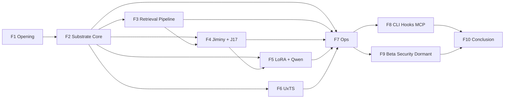

# Global Roadmap — MDEMG Onboarding Deck

**Status**: Phase 1 planning artifact (Epic 1c of MDEMG-ONBOARDING-DECK-001)
**Governed by**: `sprint_plan.md` + `presentation_spec.md` in this directory
**Last verified against CLAUDE.md**: 2026-10-22

This roadmap is the **ordered inventory** of sections in the deck. It drives Epic 2 (per-section roadmaps) and Epic 3 (multi-agent deep-dive fork assignments). If a subsystem is NOT in this roadmap, it will NOT appear in the deck — the forcing function to make scope decisions explicit.

---

## 1 Section-family grouping (10 families)

| Family | Scope | Est. slides | Depth |
|---|---|---|---|
| F1 | Opening — Welcome, Overall Goal, Brief History, 10k-ft how-it-works | 10-14 | FULL (opener; investment time) |
| F2 | Substrate Core — Neo4j CMS, 5-layer hierarchy, Hebbian learning, TSDB | 12-16 | 1 FULL + 1 MINI |
| F3 | Retrieval Pipeline — RRF column voting, rerank, sparse gate, context fingerprinting | 10-14 | 1 FULL + 2 MINI |
| F4 | Jiminy + J17 — Enforcement, classifier, synthesis, J17 protocol, agent briefing packet | 20-26 | 2 FULL + 1 MINI (headline cluster) |
| F5 | LoRA + Qwen + Model Distribution — Fine-tune line, recursive retrain, Ollama + homebrew tap | 12-16 | 1 FULL + 2 MINI |
| F6 | UxTS Framework Family — 16 frameworks, forcing-function pattern, hash pins | 7-10 | 1 FULL |
| F7 | Ops Observability — Grafana + alerts, backup, HITL, RSIC, scheduled jobs, supervisor | 14-18 | 2 FULL + 2 MINI |
| F8 | CLI + Hooks + MCP + Multi-instance | 6-8 | 2 MINI + mentions |
| F9 | Beta Program + Security Hardening + Dormant Census | 4-6 | 2 MINI + mentions |
| F10 | Conclusion — What's left, end goals, continuous improvement loop | 6-8 | 1 FULL |
| **TOTAL** | — | **101-136** | — |

Envelope target: **100 ± 20 slides.** Cut aggressively in Epic 5 if over.

---

## 2 Section-level inventory (ordered walkthrough)

The deck plays in this order. Each row maps to a section-slug used by Epic 2 (`sections/<slug>-roadmap.md`) + Epic 3 (`sections/<slug>-content.md`).

### F1 — Opening

| # | Slug | Working title | Slides | Depth |
|---|---|---|---|---|
| 1.1 | `f1-welcome` | Welcome / audience / timing / navigation | 2 | opener |
| 1.2 | `f1-overall-goal` | Overall goal — AI cognitive substrate, not a tool | 2 | FULL |
| 1.3 | `f1-brief-history` | Brief history — 105 phases + sidecar phases | 3 | FULL |
| 1.4 | `f1-10k-ft` | How MDEMG works at 10k ft (the one-diagram overview) | 3-4 | FULL |

### F2 — Substrate Core

| # | Slug | Working title | Slides | Depth |
|---|---|---|---|---|
| 2.1 | `f2-neo4j-cms` | Neo4j CMS — the real memory | 3 | FULL opening |
| 2.2 | `f2-5-layer` | 5-layer hierarchy (L0 obs → L1 constraint/correction → L2+ emergent) | 3 | FULL |
| 2.3 | `f2-hebbian` | Hebbian learning + CO_ACTIVATED_WITH edges | 3 | FULL |
| 2.4 | `f2-tsdb` | TimescaleDB telemetry — the metrics access model | 3 | MINI (full would duplicate F7) |

### F3 — Retrieval Pipeline

| # | Slug | Working title | Slides | Depth |
|---|---|---|---|---|
| 3.1 | `f3-rrf` | Column-voting RRF — 4 columns, consensus_strength | 3 | FULL |
| 3.2 | `f3-rerank-sparse` | Rerank + sparse gate | 3 | MINI |
| 3.3 | `f3-context-fingerprint` | Context fingerprinting + 5th RRF column | 2 | MINI |
| 3.4 | `f3-pipeline-diagram` | End-to-end retrieval diagram (one slide, Mermaid) + consumer-list slide | 2 | MINI |

### F4 — Jiminy + J17 (headline cluster)

| # | Slug | Working title | Slides | Depth |
|---|---|---|---|---|
| 4.1 | `f4-jiminy-what` | Jiminy — the enforcer, not an advisor | 2 | FULL opening |
| 4.2 | `f4-jiminy-classifier` | The outcome classifier + verifiability class taxonomy | 4 | FULL |
| 4.3 | `f4-jiminy-levers` | Levers A/B/C/D — surfacing + synthesis + scope-gate | 3 | FULL |
| 4.4 | `f4-jiminy-enforce-arc` | ENFORCE-arc (5 sprints) — strict mode + Bash guard + override + arc completion | 3 | FULL |
| 4.5 | `f4-jiminy-ui-rules` | Rules UI + override timeline + mode selector | 2 | MINI |
| 4.6 | `f4-j17-protocol` | J17 AI2AI protocol — header shape (CODES/SEV/ESC/FMT/ANN/TICKET/SEQ) | 3 | FULL |
| 4.7 | `f4-j17-briefing-packet` | The agent briefing packet (v1.1 reframe — data not commands) | 3 | FULL |

### F5 — LoRA + Qwen + Model Distribution

| # | Slug | Working title | Slides | Depth |
|---|---|---|---|---|
| 5.1 | `f5-lora-qwen` | LoRA on Qwen3-14B — rank/alpha/targets/epoch-cap | 4 | FULL |
| 5.2 | `f5-mlx-to-gguf` | MLX → GGUF pipeline + llama-server production config | 2 | MINI |
| 5.3 | `f5-recursive-retrain` | Recursive retraining loop (Phase 6a/6b/7/9) | 3 | FULL |
| 5.4 | `f5-model-dist` | Ollama Library + homebrew tap distribution | 2 | MINI |
| 5.5 | `f5-homebrew-mdemg` | packaging/homebrew-mdemg — tap repo, beta tester entry | 2 | MINI |

### F6 — UxTS Framework Family

| # | Slug | Working title | Slides | Depth |
|---|---|---|---|---|
| 6.1 | `f6-uxts-what` | 16-framework family — the forcing-function pattern | 2 | FULL |
| 6.2 | `f6-uxts-inventory` | Inventory by surface + anatomy of a spec | 3 | FULL |
| 6.3 | `f6-uxts-ci-contract` | Hash-pin + verify-hashes drift tripwire; DORMANT-CENSUS siblings | 2 | FULL |
| 6.4 | `f6-uxts-when-new` | When to add a new UxTS framework (3 cheaper options first) | 1-2 | FULL |

### F7 — Ops Observability

| # | Slug | Working title | Slides | Depth |
|---|---|---|---|---|
| 7.1 | `f7-grafana` | Grafana dashboards (9 shipped) + metric access model | 3 | FULL |
| 7.2 | `f7-alerts` | Alert evaluator — 35+ TSDB-query rules, NOSILENT-001 cooldown-key contract | 3 | FULL |
| 7.3 | `f7-backup` | Backup + restore (Neo4j + TSDB; pgdump + manifest + checksum) | 2 | MINI |
| 7.4 | `f7-hitl` | HITL review platform + auto-curation loop | 3 | FULL |
| 7.5 | `f7-rsic` | RSIC self-improvement engine (self_assess + self_reflect) | 2 | MINI |
| 7.6 | `f7-supervisor` | SUPERVISOR-002 + 15 supervised loops + scheduled job health | 2 | MINI |

### F8 — CLI + Hooks + MCP + Multi-instance

| # | Slug | Working title | Slides | Depth |
|---|---|---|---|---|
| 8.1 | `f8-cli` | CLI surface overview (`mdemg <verb>` taxonomy) | 2 | MINI |
| 8.2 | `f8-hooks` | Hooks (session-start, prompt-context, post-tool-observe, pre-bash-check, pre-write-check) + HOOKSYNC-001 parity | 2 | MINI |
| 8.3 | `f8-mcp` | MCP memory channel + 23 tools | 1 | MENTION |
| 8.4 | `f8-multi-instance` | Multi-instance Docker compose + teardown | 1 | MENTION |

### F9 — Beta + Security + Dormant Census

| # | Slug | Working title | Slides | Depth |
|---|---|---|---|---|
| 9.1 | `f9-beta` | Beta program (62-test plan + beta-import + beta-janitor retention) | 2 | MINI |
| 9.2 | `f9-security` | Security hardening (SEC-TRANCHE-2/3, pathsafe, privacy scrubbing) | 1 | MENTION |
| 9.3 | `f9-dormant-census` | DORMANT-CENSUS registries — the "every declaration must have a consumer" invariant | 1-2 | MINI |

### F10 — Conclusion

| # | Slug | Working title | Slides | Depth |
|---|---|---|---|---|
| 10.1 | `f10-whats-left` | What's left — JIMINY-CEILING-BREAK-2 target (≥80% follow rate), open arcs | 2 | FULL |
| 10.2 | `f10-end-goals` | End goals — what problems MDEMG solves, who it helps | 2 | FULL |
| 10.3 | `f10-ci-loop` | Continuous improvement — HITL → curated dataset → retrain → promote → measure | 2 | FULL |
| 10.4 | `f10-where-to-go` | Where to go next (code map, canonical docs, CLAUDE.md reading order) | 1 | FULL |
| 10.5 | `f10-questions` | Questions / open discussion | 1 | — |

---

## 3 Canonical-source map (per section family)

Driving the Epic 3 fork agents. Each agent gets its family's source list verbatim.

| Family | Primary canonical sources |
|---|---|
| F1 | CLAUDE.md § MDEMG IS Your Internal Dialogue; § Project Context; README.md top |
| F2 | CLAUDE.md § Codebase Hardening + § Graph Health + § Memory Principles; `docs/features/hidden-pattern-identity.md`; `docs/features/consolidation-performance.md`; `docs/features/event-graph-federation.md`; `docs/features/tsdb-data-management.md` |
| F3 | CLAUDE.md § Column-Voting Retrieval + § Sparse Retrieval Gate + § Context Fingerprinting; `docs/features/sparse-retrieval.md`; `docs/features/context-fingerprinting.md`; `docs/features/typed-semantic-edges.md` |
| F4 | CLAUDE.md § /strict Mode + ~20 JIMINY-* pins + 2 J17-* pins; `docs/features/jiminy-strict.md`; `docs/features/jiminy-actionability.md`; `docs/features/jiminy-metric-partition.md`; `docs/features/jiminy-rules-ui.md`; `docs/features/j17-agent-briefing-packet.md`; `docs/features/process-observation.md` |
| F5 | CLAUDE.md § MDEMG Fine-Tuning; `docs/features/jiminy-lora-qwen.md` (shipped 2026-10-14); `docs/features/local-model-distribution.md`; `docs/features/ft-recursive-loop.md`; `docs/features/mlx-watchdog.md` |
| F6 | `docs/features/uxts-frameworks.md` (shipped 2026-10-15); `docs/development/UXTS_FRAMEWORK_MATRIX.md` (authoritative); `docs/features/ubench-framework.md` |
| F7 | CLAUDE.md § Service Alert System + § DH-004 + § DH-005; `docs/features/scheduled-job-health.md`; `docs/features/backup-restore.md`; `docs/features/hitl-review.md`; `docs/features/hitl-auto-curation.md`; `docs/features/rsic-feedback-loop.md`; `docs/features/goroutine-supervisor.md` |
| F8 | CLAUDE.md § Additional CLI Commands + § Enforced Protocols (Hook-Backed); `docs/features/mcp-memory-channel.md`; `docs/features/hook-channel-health.md`; `docs/user/multi-instance.md` |
| F9 | CLAUDE.md § Codebase Hardening + § Deep Dive Bug Fix Campaign + DORMANT-CENSUS pins; `docs/features/beta-import.md`; `packaging/homebrew-mdemg/mdemg_beta_testing.md`; `docs/api/{routes,tsdb,metrics}_consumer_inventory.json` |
| F10 | CLAUDE.md § JIMINY-CEILING-BREAK-2 arc; `docs/development/jiminy-ceiling-break-2/README.md`; `docs/features/ft-recursive-loop.md` §Phase-9; `docs/development/mdemg-onboarding-deck-001/` (this sprint — closing the loop) |

---

## 4 Dependency chain (what must precede what)



Interpretation: F1 opens; F2 is the foundation everything else assumes; F3/F4 are peers consuming F2; F5 depends on both F2 (data substrate feeding training) and F4 (Jiminy consuming the FT model); F6 is horizontal infrastructure once F2 exists; F7 cross-cuts all data-plane subsystems; F8/F9 are operator-surface wrappers; F10 lands.

**Walkthrough ordering = family number (1 → 10 linear).** The dependency graph is for mental-model building, not slide order.

---

## 5 Multi-agent fork roster (Epic 3)

8 fork agents, each with a scoped family (families roughly aligned 1:1 with forks, with F4 + F7 getting bigger budgets since they're the headline clusters):

| Fork | Scope | Canonical sources (from §3) | Est. output |
|---|---|---|---|
| `fork-f1-opening` | Welcome, goal, history, 10k-ft | F1 list | ~10 slides' content |
| `fork-f2-substrate` | Neo4j, 5-layer, Hebbian, TSDB intro | F2 list | ~15 slides' content |
| `fork-f3-retrieval` | RRF + rerank + sparse + context fingerprint | F3 list | ~12 slides' content |
| `fork-f4-jiminy-j17` | Jiminy enforcement + classifier + levers + J17 packet + process observation | F4 list | ~25 slides' content (largest fork) |
| `fork-f5-lora-dist` | LoRA/Qwen + recursive retrain + Ollama + homebrew tap | F5 list | ~15 slides' content |
| `fork-f6-uxts` | 16 UxTS frameworks + anatomy + CI contract | F6 list | ~9 slides' content |
| `fork-f7-ops` | Grafana + alerts + backup + HITL + RSIC + supervisor | F7 list | ~17 slides' content |
| `fork-f8-f9-wrappers` | CLI + hooks + MCP + multi-instance + beta + security + dormant census | F8 + F9 lists | ~10 slides' content |

F10 (Conclusion) is operator-authored directly — it's the "where we're going" story and should carry the operator's voice; a sub-agent can't write that.

---

## 6 Fork prompt template (Epic 3 pre-filled)

Each fork gets this exact shape of prompt (filled per-family):

```
You are a Fable sub-agent authoring the <family-name> section of the MDEMG
onboarding deck.

AUDIENCE: senior engineers + ex-eng technical PMs. Dense, specific,
cite-everything. No marketing. No "unlock your potential"-shaped prose.

OUTPUT: write `docs/development/mdemg-onboarding-deck-001/sections/<slug>-content.md`
with these per-slide subsections (one `## Slide N — <Title>` per slide
from the slide-skeleton below):
  - Slide heading (title)
  - 2-4 bullet points (what shows on the slide)
  - note: block (what the presenter says — 3-5 sentences, cite-ready)
  - citations: list `[claim] → <source-file:line | sprint-pin>` for every
    substantive claim

TEMPLATE: 5-beat per major component — what / why we use it / how it
works / why important / how it will improve. Each beat = 1-3 slides.

CANONICAL SOURCES (REQUIRED — do NOT read beyond this list unless the
sources themselves cite something inside the repo):

<source list per §3 for this family>

CONSTRAINTS:
- Zero fabrication. Every claim traces to a source file + line or sprint
  pin. If a claim cannot be verified, mark it `[VERIFY]` + do NOT include
  it in the final slide.
- Mermaid diagrams for data flows. One per section minimum.
- Honest about current state — if a metric is below target, cite the arc
  that owns the lift (e.g. `JIMINY-CEILING-BREAK-2`).
- Trajectory language, never "by design" language, per
  `trust-signal-must-be-persisted-never-ignore-honest`.

LENGTH: aim for the slide-count estimate for your family (§5). Err
toward CUTTING, not padding. The operator will add if needed.

STAY IN SCOPE: do not drift into other families' territory. If a claim
belongs to a different family, add a note "see §F<N>" and move on.

Report back when done with the file path + a 100-word summary of what
you shipped.
```

---

## 7 Diagram list (operator or fork-authored, Mermaid)

Minimum required diagrams (ties to §6 of presentation_spec.md). Each has a target family + a slug:

| Diagram | Family | Slug |
|---|---|---|
| MDEMG system overview (10k ft) | F1 | `diag-overview` |
| 5-layer memory hierarchy | F2 | `diag-5layer` |
| Hebbian learning flow (co-activation → edge weight update) | F2 | `diag-hebbian` |
| Retrieval pipeline end-to-end (RRF + rerank + sparse gate) | F3 | `diag-retrieval` |
| Jiminy enforcement flow (hook → classify → warn → block) | F4 | `diag-jiminy-flow` |
| J17 protocol message shape | F4 | `diag-j17-shape` |
| Process-observation arc (6 observers, event → match → grade) | F4 | `diag-process-obs` |
| LoRA on Qwen pipeline (MLX → GGUF → llama-server) | F5 | `diag-lora-pipeline` |
| Recursive retraining loop (drift → export → curate → train → convert → gate → promote) | F5 | `diag-recursive-retrain` |
| HITL review loop (candidate → grade → sink → substrate OR L0 correction) | F7 | `diag-hitl-flow` |
| UxTS forcing-function shape (schema → spec → runner → CI → matrix) | F6 | `diag-uxts-shape` |
| Grafana + alert evaluator flow (metric → TSDB → evaluator → alert → dispatcher) | F7 | `diag-alert-flow` |
| Model distribution (Ollama Library + homebrew tap + brew install) | F5 | `diag-model-dist` |
| Beta corpus loop (tester → export → maintainer import → janitor retention) | F9 | `diag-beta-flow` |

14 diagrams. Each fork is responsible for its family's diagrams; operator reviews Mermaid syntax + layout in Epic 5.

---

## 8 Risks (section-roadmap-level, extending `sprint_plan.md` §10)

- **F4 overrun** — Jiminy + J17 is the heaviest cluster; natural tendency is to over-explain. Target 20-26 slides is a hard ceiling. Diagram-heavy, prose-light.
- **F6 under-cover** — UxTS has 16 frameworks; tempting to spend 1 slide each (16 slides) which blows the budget. Prefer: 1 slide listing all 16 + 3-4 slides on the pattern (`uxts-frameworks.md` is the model).
- **F10 drift** — "end goals" + "continuous improvement" can turn into vision-doc fluff. Keep it concrete: name specific metrics, specific arcs, specific numbers.
- **F7 fragmentation** — Grafana + alerts + backup + HITL + RSIC + supervisor could each sprawl. Enforce 2 FULL + 2 MINI depth split; name the one-sentence role per MINI.

---

## 9 Approval gate (Gate 1)

Before Epic 2 starts, operator approves:

- [ ] Section inventory (§2) — 10 families, ~30 sections, ordered walkthrough
- [ ] Slide-count envelope — 100 ± 20 slides total
- [ ] Depth mix per family (full / mini / mention)
- [ ] Fork roster (§5) — 8 forks + F10 operator-authored
- [ ] Diagram list (§7) — 14 diagrams minimum
- [ ] Canonical-source map (§3) is correct + complete (operator spot-checks for missing feature docs)

If operator wants to add / cut / reorder sections, do it HERE before Epic 2 locks the roadmap.

---

## 10 Documents Accessed

- `docs/development/mdemg-onboarding-deck-001/sprint_plan.md` (sibling)
- `docs/development/mdemg-onboarding-deck-001/presentation_spec.md` (sibling)
- `CLAUDE.md` — architecture notes, all pin cross-references in §3
- `docs/features/` directory listing (feature doc map)
- `docs/development/UXTS_FRAMEWORK_MATRIX.md` (F6 source of truth)
- `README.md` top (F1 goal statement)
