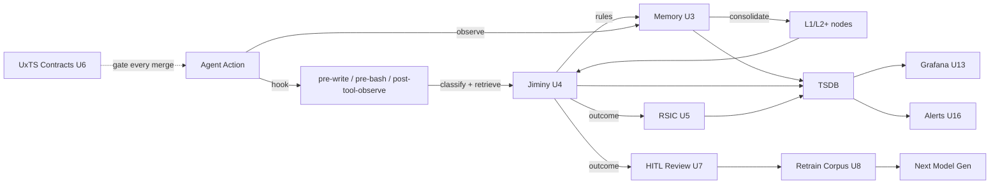
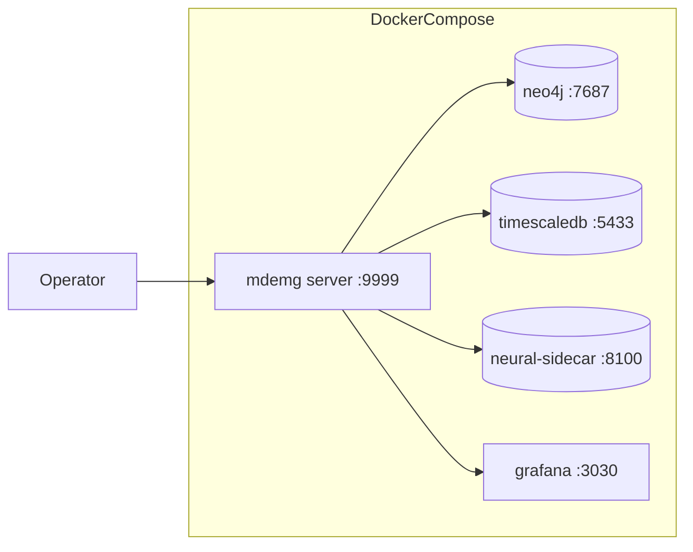
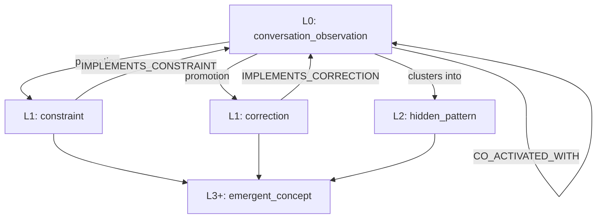
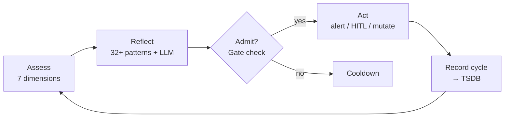
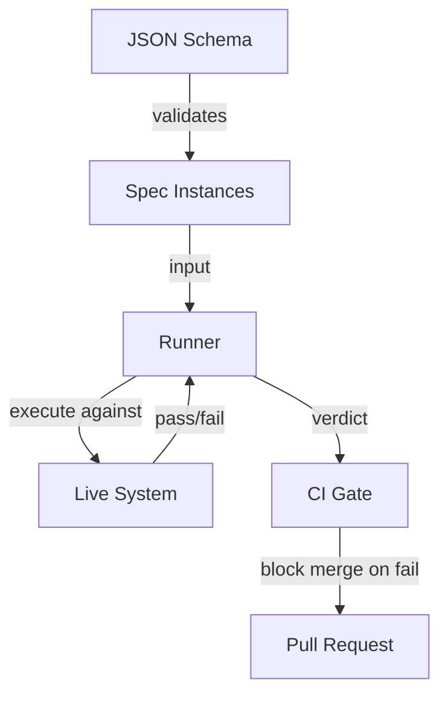
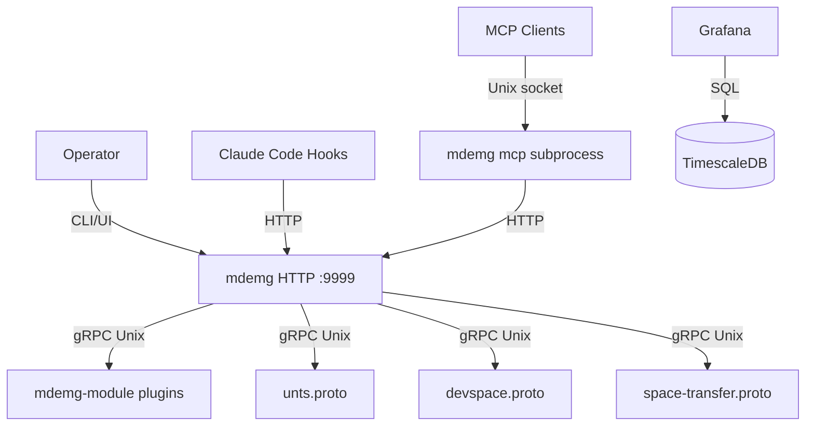

# Draft Slides — End-User Path (U1-U17)

**Sprint**: ONBOARDING-TUTORIAL-ENDUSER-001 Epic 3
**Status**: DRAFT — awaiting E4 stitch into `docs/onboarding/mdemg-onboarding-deck.md`
**Last authored**: 2026-10-26

> This file holds the actual slide content for the end-user path. At E4, these slides get stitched into the main deck (replacing the `#end-user-path` stub) and the staged embed resyncs. During E5 operator live-review, this file acts as the audit trail.

> Convention: each slide = `## Title` + body + `note:` block + `---` separator. Factual-provenance comments (`<!-- source: ... -->`) are stripped at E4 but preserved here for review.

---

<!-- SECTION U1 — OPENING -->

<!-- .slide: id="end-user-path" -->

## U1 · Operator Onboarding — Start Here

The next ~99 minutes answer four questions. Each U-section drills into a piece of the answer. You'll own the operator view by the end.

1. **What is MDEMG?**
2. **What problem(s) does it attempt to solve?**
3. **How does it solve those problems?**
4. **How does it continuously get better at solving those problems?**
5. **How does it all work together?** (U1.6 — the integrator)

**Mini-TOC**:

| § | Topic | ~slides |
|---|---|---:|
| U1 | Opening — The 4 Questions + Integrator | 6 |
| U2 | The Stack + Status + Health | 7 |
| U3 | Memory (CMS) | 8 |
| U4 | Jiminy — Guidance + Enforcement | 11 |
| U5 | RSIC — Self-Improvement | 8 |
| U6 | UxTS Framework Family | 9 |
| U7 | Review / HITL | 7 |
| U8 | Learning / Training Data | 7 |
| U9 | Backup + Ops | 6 |
| U10 | Logs | 5 |
| U11 | Config + Features | 7 |
| U12 | Plugins | 5 |
| U13 | Grafana | 7 |
| U14 | CLI — The Full Command Surface | 9 |
| U15 | APIs + gRPC | 9 |
| U16 | Alerts + Enforcement Escape Hatches | 7 |
| U17 | Where To Go Next | 4 |

**Return to**: [⇤ Landing Fork](#landing-fork) · [⇤ TOC](#table-of-contents)

note:
- If you're building MDEMG, hit ESC and pick the Software Dev path. Otherwise, let's answer these four questions.
- Keyboard: ← → nav · ESC overview · F fullscreen · S speaker view · ? help

---

## What Is MDEMG?

> **Help developers create software that connects in a manner that increases the likelihood of making better decisions.**

- **Persistent memory + cognitive substrate** — not a tool
- **Decisions are the atomic unit** — not features, not metrics
- **Connections** (memory → retrieval → classification → synthesis) are what the system optimizes

The analogy: internal dialogue is to a conscious biological neural network as **MDEMG is to an artificial neural network (an AI agent)**.

note:
- The dev-path's F1 opens with this same quote. Framing identical across paths.
- PM-fallback: think of MDEMG as a persistent, searchable 'notebook of lessons learned' that the AI agent reads before every action.

---

## What Problems Does It Solve?

Three core problem classes:

1. **Context loss across sessions** — the AI agent forgets everything between runs; MDEMG remembers (persistent CMS) → *expanded in U3 Memory*
2. **Behavioral drift** — the agent repeats mistakes; MDEMG surfaces durable guidance that reminds it before action → *expanded in U4 Jiminy, U16 Alerts/Enforcement*
3. **Silent failure modes** — the system degrades without anyone noticing; MDEMG observes itself continuously via alerts + Grafana + RSIC → *expanded in U13 Grafana, U16 Alerts, U5 RSIC*

Honest note: the arcs that MOVE each needle are ongoing; U5 (RSIC) and U17 (Where to Go) carry the trajectory.

note:
- If the agent you work with feels like it 'knows nothing' every morning, Problem 1 is your issue. If it 'keeps doing that thing you told it not to,' Problem 2.

---

## How Does It Solve Them?

Four surfaces (each is a U-section):

1. **Memory substrate** — Neo4j graph of observations + consolidation into layered abstractions → *U3 Memory*
2. **Retrieval + guidance** — RRF 4-column retrieval + Jiminy surfaces durable rules on every prompt → *U3 Memory + U4 Jiminy*
3. **Enforcement** — strict mode blocks violations; override escape hatches preserve operator agency → *U16 Alerts + Enforcement*
4. **Observability** — Grafana + TSDB + alerts channel + /ui/ Status → *U2 Stack, U13 Grafana, U16 Alerts*

Mental model: **"sense → store → retrieve → classify → act → observe → learn"** — the full loop.

note:
- If the four surfaces sound abstract, they get concrete starting in U2. This slide is the map; the territory starts next.

---

## How Does It Continuously Improve?

Four self-improvement loops:

1. **RSIC** — recursive self-improvement cycle: reflect → trigger → admit → outcome → learn → *U5 RSIC*
2. **UxTS forcing-functions** — contract-first framework family (UATS/UVTS/ULTS/…) prevents drift at merge time → *U6 UxTS*
3. **HITL curation** — operator grading of guidance outcomes feeds the retrain corpus → *U7 Review/HITL*
4. **Fine-tuning / recursive retrain** — the production LLM gets measurably better via Phase 5 SFT + the recursive-retrain loop → *U8 Learning/Training Data*

**Honest trajectory language** (operator directive 2026-08-01):
- WRONG: "follow rate 13% by design"
- RIGHT: "follow rate ~13% currently; target ≥80% via the JIMINY-CEILING-BREAK-2 arc; today's trajectory is ..."

note:
- The system is honest about where it is. If a metric is below target, we name the arc moving it. You'll see this trajectory language everywhere from U2 onwards.

---

## How It All Works Together



**Operator sentence**: You observe → MDEMG remembers → classifies → acts → measures → learns → fine-tunes → you see all of it on the dashboards.

The HITL → retrain arc is the newest piece, actively iterating.

note:
- This is the whole loop. Memorize this slide; everything after is a zoomed-in piece of it.
- PM-fallback: think of it like a flight-test rig — the plane flies, instruments record, engineers review, next build improves. MDEMG is that for AI agents and their decisions.

---

<!-- SECTION U2 — THE STACK + STATUS + HEALTH -->

## U2 · The Stack

Everything in U3-U17 lives inside the 5-container stack. This section is the foundation — the stack picture, how to confirm it's up, how to probe its health, and what the watchdog + breakers protect against.

Preview: stack diagram → `docker compose ps` → 4-command path → `healthz` → watchdog → breakers → gotchas.

Points back to U1.4 — this is the implementation of surface #1 (observability + substrate it runs on).

note:
- U2 absorbs what was once "What's Running" — now paired with Health + Status because operators run them together.

---

## What's Running



**Roles**:
- **mdemg** — HTTP API + CLI backend (ghcr.io/reh3376/mdemg)
- **neo4j** — graph substrate (CMS; the "cognitive" layer — U3 Memory)
- **timescaledb** — telemetry hypertables (TSDB; the "measurement" layer — U13 Grafana)
- **neural-sidecar** — rerank + NLI model inference (U15 APIs)
- **grafana** — read-only observability panels (U13)

note:
- This is the whole stack. Nothing else is required to run MDEMG. Everything in the next 100 slides lives inside this picture.
- PM-fallback: mdemg = brain; neo4j = long-term memory; timescaledb = EEG; neural-sidecar = math co-processor; grafana = X-ray screen.

---

## Confirm The Stack

```bash
$ docker compose ps
NAME                        STATUS                 PORTS
mdemg-mdemg-1               Up (healthy)           0.0.0.0:9999->9999/tcp
mdemg-neo4j-1               Up (healthy)           0.0.0.0:7687->7687/tcp
mdemg-timescaledb-1         Up (healthy)           0.0.0.0:5433->5432/tcp
mdemg-neural-sidecar-1      Up (healthy)           0.0.0.0:8100->8100/tcp
mdemg-grafana-1             Up (healthy)           0.0.0.0:3030->3000/tcp
```

Expected: **5 × `Up (healthy)`**. Anything else (`Restarting`, `Exit (0)`) is a triage trigger — `docker compose logs <service>` is the next command.

note:
- This is the ground truth of 'is the stack up?'. Everything else assumes YES to this question.

---

## The 4-Command Happy Path

```bash
mdemg init --defaults        # creates .env + .mdemg config (idempotent)
docker compose up -d         # starts the 5-service stack
mdemg healthz                # verify server + subsystems
open http://localhost:9999/ui/   # dashboard (macOS)
```

**Variants**:
- `mdemg init --quick` is the CLAUDE.md alias; `--defaults` is the current primary flag
- Linux: `xdg-open http://localhost:9999/ui/` or paste into browser
- Already running? `mdemg restart` is a one-shot
- `mdemg tutorial` opens THIS deck (SERVE-001)

note:
- This is the smoke-test for every fresh install, every machine, every day.
- If any of these 4 fails, triage THAT command before anything else. Logs → ports → env file.

---

## healthz — The Right-Now Probe

**Healthy**:
```bash
$ mdemg healthz
status: ok
checks: {neo4j: ok, tsdb: ok, sidecar: ok}
circuit_breakers: {open: 0}
```

**Degraded**:
```
status: degraded
checks: {neo4j: ok, tsdb: ok, sidecar: timeout}
circuit_breakers: {open: 1, names: [neural-sidecar]}
```

**Fix order on `degraded`**:
1. `docker compose ps` — is the subsystem actually up?
2. `docker compose logs <subsystem>` — is it erroring?
3. `curl -s http://localhost:9999/healthz | jq` — fresh HTTP reading

**Exit codes**: 0 if `status=ok`, 1 otherwise — scriptable in `until` loops.

note:
- healthz is cheap. Run it. Don't guess.

---

## Watchdog + Circuit Breakers

**LLM watchdog** (`MLX_WATCHDOG_ENABLED=true` default):
- Probes `127.0.0.1:8102/v1/models` every 5s
- States: `up → degraded → down` with hysteresis
- Fast-fail short-circuits retries at `down`
- `mdemg watchdog status [--json]` to inspect

**Circuit breakers**:
- 24+ named breakers across LLM calls, retrieval, consulting, Jiminy
- `GET /v1/admin/breakers` surfaces state (gated by `AUTH_API_KEYS`)
- DH-004 escape hatch: `POST /v1/admin/breakers/reset {"name":"<name>"}` manually closes a tripped breaker

/ui/ Status tab visualizes watchdog + breaker state.

note:
- When the LLM is slow, these breakers prevent the whole system from cascade-failing on retry storms.

---

## Honest State + Gotchas

**Typical state** (fresh install, well-provisioned machine):
- `healthz: ok` most of the time
- Occasional `degraded` on `sidecar: timeout` during cold-start model load (resolves ~15s)
- Breakers almost always `open: 0`

**Gotchas**:
- `health: ok` with pending HIGH alerts (U16) is NOT contradictory — healthz samples NOW, alerts integrate over hours
- `mdemg healthz` from a shell without `.env` loaded can show stale readings
- `docker compose ps` showing `Up` but `healthz` saying `degraded` = TCP port open but handler misbehaving

**Where to go deeper**: `docs/features/mlx-watchdog.md`, CLAUDE.md "Service Alert System".

note:
- healthz is the stethoscope check; alerts (U16) are the medical history. Both matter; different timescales.
- Next up (U3): what MDEMG REMEMBERS, the central idea.

---

<!-- SECTION U3 — MEMORY (CMS) -->

## U3 · Memory — The Cognitive Substrate

MDEMG remembers. Not in RAM, not in logs — in a Neo4j graph that grows, consolidates, and forgets honestly.

Preview: hierarchy mental model → UI → observe/recall/correct → honest state.

Natural question this answers: "What does MDEMG actually store, and how do I inspect or change it?"

note:
- U3 is the central idea. If you remember one section's content, make it this one.

---

## How Memory Is Shaped



- **L0** (raw observations) — operator/agent utterances; most volume
- **L1** (constraint / correction) — promoted rules extracted from L0 patterns
- **L2** (hidden_pattern) — clusters of L0 that co-activate
- **L3+** (emergent_concept) — abstractions across layers

Each layer: **fewer nodes, more durable, higher-value.** Role-filtered retrieval scopes by layer (e.g., Jiminy only surfaces L1+).

note:
- L0 is a river; L1 is where sediment hardens into rules; L2+ is topology.

---

## How Memory Strengthens

**Hebbian principle**: nodes that co-activate on the same retrieval → `CO_ACTIVATED_WITH` edge weight increases.

**Consolidation cycles** (background, every ~5 min):
1. Fire → identify clusters
2. Promote stable patterns to L1/L2
3. Dedup patterns identity-preservingly (HIDDEN-CHURN-001/002/003)
4. Weekly maintenance: decay + prune archived nodes

**EVENTGRAPH-001** federates each reinforcement into TSDB `reinforcement_events`.

CHURN-002: consolidation runs under `context.WithoutCancel` so it completes even if the triggering request walked away.

note:
- You don't trigger consolidation. It runs. You see the OUTCOME in the Memory tab.

---

## The Memory Tab

**Where**: `/ui/` → **Memory**

**Shows**: node counts by role_type / layer, spaces, recent activity, archived vs live.

**Interaction**: filter by space, drill into a space's node histogram.

**When you'd open it**:
- "Did my `observe` land?"
- "How big is `mdemg-dev` today?"
- "Any orphan nodes?"

**Related**: U7 Review tab shows the HITL queue over memory writes.

note:
- If this tab is empty, your `mdemg data observe` isn't landing. Fix THAT before anything else.

---

## Writing To Memory — `observe`

```bash
$ mdemg data observe --space-id mdemg-dev \
    --content "The thing you want remembered" \
    --obs-type decision
obs_id: ckh3uf9fv0003qr5x2a8dnmwl
node_id: ckh3uf9fv0004qr5x5kz3bgpe
```

**obs_type cheat sheet** (12 shipped):

| Type | Use |
|---|---|
| `decision` | key decision made |
| `correction` | something was wrong, now right |
| `error` | runtime failure |
| `preference` | user/operator style |
| `task` | work-item tracking |
| `technical_note` | implementation detail |
| `insight` | learning |
| `context` | contextual |
| `progress` | task progress |
| `constraint` | rule-shape |
| `learning` | general learning |
| `note` | free-form |

Observations always land at **L0**; promotion to L1 (if `obs_type=correction` or tagged `constraint:...`) happens at next consolidation.

note:
- The hooks observe for you automatically. Explicit CLI observes are for edge cases: back-filling, correcting, or scripting.

---

## Reading From Memory — `recall`

```bash
$ mdemg data recall --query "how do I toggle enforcement mode" --space-id mdemg-dev
[0] role=correction  score=0.82  "mdemg jiminy mode strict|suggest ..."
[1] role=learning    score=0.74  "..."
[2] role=constraint  score=0.71  "..."
```

**Under the hood**: 4-column RRF (embedding + BM25 + graph + structural); CONTEXT-FINGERPRINTING-001 adds a 5th column.

**URL overrides** for A/B:
- `?sparse=true|false` — sparse retrieval gate
- `?intent=true|false` — intent translation
- `?reverse_ref=true|false` — reverse-lookup grep
- `?context=auto|<bytes>` — context fingerprinting

Related: MCP tool `memory_recall` is the agent-facing version.

note:
- If recall feels empty, the first check is `/ui/ Memory` — maybe the content isn't there yet.

---

## Correcting Memory — `correct`

```bash
$ mdemg data correct --space-id mdemg-dev \
    --incorrect "mdemg uses mlx-server at :8101" \
    --correct "mdemg uses llama-server at :8102 (Phase 13.5 cutover)" \
    --context "Model serving"
obs_id: ...
(will promote to L1 on next consolidation)
```

**Structured fields** land on the L0 obs; JIMINY-STRUCTURED-CORRECTION-001 propagates them to the eventual L1 node.

**The triple** (`incorrect` + `correct` + `context`) is first-class — guidance synthesis uses both sides to produce imperative directives.

**Related**: U7 Review HITL — contradicted drafts auto-feed into this surface via JIMINY-CONTRADICTED-BRIDGE-001.

note:
- Correct beats re-observe. The structured triple is the training signal.

---

## Memory Honest State + Gotchas

**Live substrate** on `mdemg-dev` typically runs:
- ~90K+ MemoryNodes across all layers; non-archived ~70-80%
- 128K+ CO_ACTIVATED_WITH edges with weight entropy ~0.27
- Consolidation cycles ~every 5 min, completing in ~1-10s (post-CONSOLIDATE-PERF-001)

**Gotchas**:
- `mdemg-dev` is PROTECTED SPACE — hardcoded deletion protection; never bypassed
- L0 obs with no `obs_type` tag defaults to `note` (lowest promotion priority)
- Scheduled maintenance LaunchAgent default is `--dry-run=false` only for SCHEDULED runs; manual `mdemg maintenance` defaults to dry-run (safety)
- Archived nodes stay forever by design (reversible); `graph repair` doesn't delete them

**Where to go deeper**: `docs/features/consolidation-performance.md`, CLAUDE.md "RSIC admission + archival attribution".

note:
- Protected-space rule applies even in dev. If you're bulk-deleting, you're doing it wrong — tombstone via `is_archived=true` instead.
- Next up (U4): Jiminy — what USES this memory to tell the agent what to do.

---

<!-- SECTION U4 — JIMINY -->

## U4 · Jiminy — The Inner Voice

Jiminy is the subsystem that **READS memory** before every agent action, **SURFACES** applicable durable rules, **CLASSIFIES** whether the agent followed them, and (in strict mode) **ENFORCES** them.

11-slide walkthrough: loop → classifier → corpus → UI → CLI → current state → gotchas.

Points back to U1.3 — primary answer to "behavioral drift". Points to U1.4 — surface #2 (retrieval + guidance).

note:
- This is the headline section of the end-user path. 11 slides. Buckle in.

---

## How Jiminy Thinks

```mermaid
graph LR
  Agent[Agent About To Act] -->|hook POST| Latest[/v1/jiminy/latest]
  Latest -->|retrieve| Memory[(L1 Constraints + Corrections)]
  Memory -->|top-K| Synth[Jiminy Synthesize]
  Synth -->|directive| Agent
  Agent -->|action| World
  World -->|hook POST| Feedback[/v1/jiminy/feedback]
  Feedback -->|classify| Verdict[verdict: followed / ignored / partial / contradicted / NA]
  Verdict -->|record| CO[constraint_outcomes]
  CO --> Trust[Trust Score]
  CO --> RSIC[RSIC U5]
  CO --> Grafana[Grafana U13]
```

Jiminy is a loop: **retrieve, surface, classify, measure, strengthen.**

note:
- PM-fallback: Jiminy is Jiminy Cricket from Pinocchio — the external conscience reminding the agent of durable rules before it acts, then recording whether the agent listened.

---

## How Jiminy Grades — Classifier Mechanics

**Three verdict tiers**:
- **Tier 1** (fast-path): embedding-similarity gate on `not_applicable` (sub-threshold = unrelated)
- **Tier 2** (LLM): routes `[naThreshold, lowThreshold)` AND `≥highThreshold` through LLM classifier for honest follow/ignore decision
- **Tier 3** (process observer): hooks + git-commits grade DIFFERENT verifiability classes

**The 5 verdicts**:
| Verdict | Meaning |
|---|---|
| `followed` | action aligned with constraint |
| `ignored` | action within relevant context but didn't apply the rule |
| `partial_compliance` | action partially aligned |
| `contradicted` | action directly opposed (highest-signal; auto-correction via JIMINY-CONTRADICTED-BRIDGE-001) |
| `not_applicable` | rule doesn't govern the action's context |

**Verifiability classes** (JIMINY-METRIC-PARTITION-001): classifier / process / hybrid / human.

note:
- You don't need to grade things yourself. The classifier does. You SEE outcomes in Grafana + /ui/ Jiminy. If a classifier verdict feels wrong, that's the HITL Review tab (U7).

---

## What Jiminy Reads — The Rules Corpus

Rules live as `MemoryNode` with `role_type IN ['constraint', 'correction']`.

Each rule carries:
- `constraint_code` (mnemonic ID like `never-direct-main-commits`)
- `constraint_type` severity (`must` / `must_not` / `should` / `should_not` / `info` / `deadline`)
- `is_informational` (meta/epistemic rules that don't grade per-action)
- `verifiability_class` (classifier / process / hybrid / human)

**Sources** (3):
1. Hook-promoted L0 observations — operator `observe --obs-type=correction` → consolidation → L1 correction node
2. UI-authored — `/ui/ Rules` tab authored directly (JIMINY-RULES-UI-001)
3. Auto-mined — tagged `conversation_observation` content triggering `constraint:` regex

**Current corpus** (`mdemg-dev`): ~30-40 active rules post-JIMINY-CORPUS-003 purge.

note:
- The corpus IS the behavioral surface area. If a rule shouldn't exist, tombstone it in /ui/ Rules. If a rule is missing, author it there or `observe --obs-type=correction`.

---

## The Jiminy Tab

**Where**: `/ui/` → **Jiminy**

**Shows**:
- Current mode (strict/suggest)
- Active overrides table (CODE | reason | expires)
- Recent override timeline from `constraint_overrides` TSDB (ENFORCE-OVERRIDES-TSDB)
- Help panel

**Interaction**:
- 2-button Mode toggle (strict ↔ suggest)
- Per-row Revoke on active overrides

**Related**: U16 Alerts + Enforcement is the operational twin — what alerts fire, how to respond.

note:
- If you only remember two /ui/ tabs, make them Jiminy and Rules.

---

## The Rules Tab — Author Durable Rules

**Where**: `/ui/` → **Rules**

**Shows**: filterable table of all `role_type=constraint|correction` nodes with code, content preview, severity, is_informational.

**Actions**:
- Inline accordion Expand → Edit (tombstone-and-recreate semantic) → Save
- Tombstone (confirms via `prompt()`)
- Create (gated by `JIMINY_RULES_UI_WRITE_ENABLED`, default off)

**Dedup warn**: on Create, if cosine sim ≥ 0.75 against existing rule, UI prompts "nearly duplicate — override?"

**Related**: `mdemg jiminy constraint mark` CLI for `is_informational` flipping.

note:
- Write-flag defaults OFF for safety. Flip it in Config (U11) when actually editing the corpus.

---

## Mode Toggle From The CLI

Two modes:
- **suggest** (fresh-install default): Jiminy SURFACES rules in-prompt; does NOT block tool calls
- **strict**: Jiminy BLOCKS Write/Edit/Bash tool calls when WARNED+ escalation fires on un-overridden constraint

```bash
$ mdemg jiminy mode
mode: suggest  session: claude-core  strict_enabled: false

$ mdemg jiminy mode strict
mode: strict  session: claude-core  strict_enabled: true
→ state file written: ~/.mdemg/.jiminy-strict-mode

$ mdemg jiminy mode suggest
mode: suggest ...
→ state file removed
```

State is **PER-SESSION** (session_id); default session is `claude-core`.

note:
- Flip to strict when you want REAL enforcement. Suggest mode is observability-only.

---

## Overrides + Rules From The CLI

**Override escape hatch**:
```bash
$ mdemg jiminy override apply --constraint never-direct-main-commits \
    --reason "post-merge cherry-pick, verified" \
    --duration 15m
```

**Invariants**:
- Reason REQUIRED
- Duration > 0 REQUIRED (forgotten overrides can't silently disable enforcement)
- Session-scoped

**Audit trail**: dual-write to `~/.mdemg/jiminy-overrides.jsonl` + `constraint_overrides` TSDB hypertable.

**Related CLI**:
- `mdemg jiminy override list [--session-id]`
- `mdemg jiminy override revoke --constraint CODE`
- `mdemg jiminy constraint mark --code X --informational=true|false`

note:
- Overrides are time-boxed by design. Expired overrides AUTO-DISABLE; the audit row stays.

---

## Jiminy Today — Honest

**Current state** (`mdemg-dev`, 2026-10):
- Mode: strict (operator opt-in per JIMINY-MODE-001 default-off)
- Follow rate (classifier-verifiable): **~13%** (current baseline)
- Target: **≥80%** via the JIMINY-CEILING-BREAK-2 arc

**Arc progression**:
- Phase 1 corpus purge SHIPPED (JIMINY-CORPUS-003)
- Phase 2 retrieval tightening SHIPPED (LEVER-C-TIGHTEN-002)
- Phase 3 classifier semantics SHIPPED (JIMINY-CLASSIFIER-CONTEXT-002 + TIER1-BYPASS-001)
- Phase 4a HITL velocity SHIPPED
- Phase 4b retrain + Phase 5 model swap IN PROGRESS

**Honest framing** (trust-signal rule):
- WRONG: "follow rate 13% is low BY DESIGN because the corpus is honest"
- RIGHT: "follow rate ~13% today; arc = JIMINY-CEILING-BREAK-2; trajectory expected toward 80% through 2026-Q4"

note:
- The low number is honest. The arc moving it is named. That's the posture across the whole system.

---

## Jiminy Gotchas

- **Mode is session-scoped** — toggling `strict` on session A doesn't affect session B
- **Overrides don't persist beyond expiry** — forgotten override expires; the audit row stays
- **`is_informational` rules DON'T grade** per-action — they surface via Lever D (concept bias) but don't contribute to follow-rate
- **The classifier can mislabel** — HITL Review tab (U7) is where you correct false verdicts
- **Fresh install starts in `suggest`** — strict mode is operator opt-in
- **Rule tombstoning is REVERSIBLE** (`is_archived=true` with reason); never bypass to hard-delete

note:
- If you're ever tempted to `cypher DELETE` a constraint node, STOP. Tombstone it.

---

## Jiminy — Where To Go Deeper

**Feature docs**:
- `docs/features/jiminy-strict.md` — enforcement + override + fail-open
- `docs/features/jiminy-actionability.md` — Lever A/B/C/D
- `docs/features/jiminy-rules-ui.md` — UI tab mechanics
- `docs/features/jiminy-metric-partition.md` — per-class gauges
- `docs/features/jiminy-missed-violation.md` — post-hoc correction detector

**CLAUDE.md arch pins**: 12+ Jiminy sprints documented

**Master arc record**: `docs/development/jiminy-ceiling-break-2/`

**Feeds into**: U5 RSIC (follow-rate improvement is a self-improvement loop), U7 HITL (manual verdict correction), U8 Learning/Training (retrain corpus).

note:
- Jiminy touches every other topic. From here, U5 RSIC shows what the system does with the signal Jiminy produces.

---

<!-- SECTION U5 — RSIC -->

## U5 · RSIC — The Self-Improvement Engine

RSIC asks "how well is MDEMG working?" every few minutes. When it finds a problem WITH a known action, it triggers improvement — sometimes a diagnostic alert, sometimes a real substrate mutation.

Preview: cycle → admission → insight → action → UI → trajectory → gotchas.

Points back to U1.5 — this is loop #1 (the top-level improvement orchestrator).

note:
- RSIC is the subsystem that MOST makes MDEMG unique. Everything else is machinery; RSIC is how the machinery learns.

---

## How RSIC Thinks



**The 6 steps**:
1. **Assess** — 7-dim health read → `SelfAssessmentReport`
2. **Reflect** — pattern-match (SQL + LLM) → list of `Insight`s
3. **Admit** — single-flight cooldown, protected-space check, rate limits
4. **Act** — dispatch: alert / HITL / mutation
5. **Record** — write cycle event to TSDB `ft_training_cycles`
6. **Reflect again** — next cycle sees the outcome

note:
- PM-fallback: think of RSIC as the system's internal post-mortem engineer — writes a review after every shift and files one actionable fix.

---

## Why RSIC Doesn't Storm

**Pre-RSIC-STORM-001**: cycles were CREATED on completion, not admission → race condition ran ~20-30k micro cycles/day → saturated llama-server (recurring LLM-timeout cascade).

**Post-RSIC-STORM-001**: `EvaluateTrigger` **RESERVES** the slot at admission under the checking lock; `RecordTrigger` updates with real cycle id; `CompleteCycle` frees; failed cycles still cool down.

**Live result** (`mdemg-dev` post-fix): ~1 admitted / 132 rejected in 4-min window.

**Protected spaces**: `RSICProtectedSpaces` (default `mdemg-dev`) — RSIC can't mutate; it can only diagnose.

**Rate limits per-action**: `ENFORCEMENT_AUTO_EXECUTE_MAX_PER_HOUR` (default 3), per-code cooldown (`_COOLDOWN_HOURS` default 24).

note:
- If you see RSIC rejecting many cycles in a short window — that's by design. The admit gate protects the LLM endpoint.

---

## What RSIC Watches

**32+ rule-based patterns** (`internal/ape/self_reflect.go`):
- Memory bloat, orphan ratio, graph health floors
- Jiminy follow-rate regression (classifier-verifiable; now floor-config-driven)
- LLM error-rate spike (with recency gate `RSIC_LLM_ERROR_RECENCY_MIN`)
- FT benchmark staleness (direct `benchmark_runs` read)
- Enforcement outcome patterns: `enforcement_false_positive_high`, `enforcement_missed_violation_high`
- Production drift (`ft_production_drift` → `trigger_training_pipeline`)

**1 LLM reflector** — novel-pattern discovery via GPT-5.4-mini on the assessment JSON. Deterministic alert emission REMOVED per RSIC-LLM-ALERT-GUARD-001 (LLM reflector can't mint hallucinated deterministic alerts).

**AllowedLLMActions whitelist**: ~18 actions; new actions require explicit addition.

note:
- When adding a new metric or signal, consider whether RSIC should react to it. If yes, add a pattern in `self_reflect.go`.

---

## What RSIC Does

**Three dispatch classes**:
1. **Diagnostic alerts** — informational; routed via alert dispatcher (`service=rsic-<action>` per NOSILENT-001); NO substrate mutation
2. **HITL queue items** — generate contradicted drafts or review candidates for operator grading
3. **Substrate mutations** (auto-execute) — ONLY for safe, reversible, rate-limited actions:
   - `archive_constraint_by_code` — ships default-off + dry-run-true behind 5 guards
   - `trigger_training_pipeline` — gated by `FT_LOOP_ENABLED` default false

**Reversibility check**: `archive_*` boolean = auto-executable; `adjust_*` scalar = HITL-only.

**Default auto-execute**: OFF for all mutation actions on fresh install.

note:
- The system CAN mutate itself. By default, it won't. Flip knobs deliberately when you want autonomy.

---

## The RSIC Tab

**Where**: `/ui/` → **RSIC**

**Shows**:
- Current health dimensions (DH-005 reweighting) with per-dimension confidence
- Recent insight stream
- Admission success/rejection ratio
- Cycle event timeline

**Interaction**: read-only + Health gauge summary; drill into any insight to see its evidence.

**Companion**: Grafana `mdemg-rsic` dashboard (U13) carries the historical view.

Panel titles embed design-intent numbers per DASHBOARD-TRUTH-002 (e.g. "Cycle Admission Ratio (expected 1-10% by design)").

note:
- The health gauge is the TL;DR; the insight stream is the DETAIL. Both update every ~5 min.

---

## RSIC Today — Honest

**Current state** (`mdemg-dev`, 2026-10):
- Overall health: ~0.80 (dimension-weighted; DH-005)
- LLM reflector: on, with deterministic-alert guardrail
- Auto-execute: OFF for every mutation action
- Jiminy follow-rate drop pattern feeding into JIMINY-CEILING-BREAK-2 arc

**Known trajectory items**:
- Follow-rate reflector pattern 9+15 floors are config-driven (DASHBOARD-TRUTH-003)
- FT benchmark staleness pattern fires HIGH when `benchmark_runs` row > 7d old (CURRENTLY FIRING)
- Scheduled job staleness patterns (NOSILENT-001) fire on silent backup failures

note:
- Pending HIGH alerts on session start are RSIC-authored patterns. They're not noise; they're honest signals of named arcs.

---

## RSIC — Gotchas + More

**Gotchas**:
- RSIC cycles reset on server restart (in-memory admission state)
- Protected-space check is HARDCODED for `mdemg-dev` — never remove
- `AllowedLLMActions` doesn't prevent HALLUCINATION — dispatcher IGNORES unknown action names loudly
- Deterministic alerts MUST stay in `deterministicAlertActions` not `AllowedLLMActions`

**Feature docs**:
- `docs/features/rsic-orchestration.md`
- `docs/features/rsic-feedback-loop.md`
- `docs/features/rsic-guidance-health-floors.md`

**CLAUDE.md**: "RSIC admission + archival attribution"

**Grafana**: `mdemg-rsic` dashboard (U13).

note:
- If a new RSIC action feels like it should auto-mutate, verify reversibility + guards + rate limit first. See ENFORCE-AUTO-EXECUTE invariants.
- Transition: U6 — UxTS, the forcing-function family that prevents DRIFT at merge time.

---

<!-- SECTION U6 — UxTS -->

## U6 · UxTS — Forcing-Functions That Prevent Drift

A UxTS framework is a contract-first way to make a piece of system behavior impossible to drift without CI noticing: **spec → fixture → runner → CI gate**.

**16 shipped families** covering APIs, parsers, retrieval quality, LLM tasks, observability, security, benchmarks, training data, auth.

Preview: forcing-function diamond → full family inventory → how operators invoke → drift-gate principle → trajectory.

Points back to U1.5 — this is loop #2 (prevents regression as system evolves).

note:
- If a sprint ships a feature + the matching UxTS contract, the feature CAN'T silently regress. If the matching contract is missing, that's the follow-up to open.

---

## How UxTS Prevents Drift



**Flow is uni-directional**:
- Code change breaks a contract → CI fails
- Contract change missing spec update → CI fails
- New feature without contract → UATS-GAP-001 class catches it

**Why it works**: contract is HUMAN-READABLE JSON, maintained in-repo, runner is deterministic — operators + reviewers verify without re-running whole system.

note:
- Every UxTS family is this shape. Learn one, you know them all.

---

## The UxTS Family — All 16

| Family | Full Name | Scope | Status | Specs |
|---|---|---|---|---:|
| UATS | API | HTTP endpoint acceptance | CI-gated | 215 |
| UPTS | Parser | Language parser conformance | CI-gated | 28 |
| UDTS | DevSpace | gRPC contract tests | active | 15 |
| UOTS | Observability | Artifact-level contracts | CI-gated | 11 |
| UOBS | Observability | Runtime behavior | active | 11 |
| UVTS | Validation | Semantic retrieval quality | live-gated | 3 |
| ULTS | LLM Task | Prompt + schema | CI-gated hash | 18 |
| UBTS | Benchmark | Throughput/latency | active | 3 |
| UBENCH | Benchmark Framework | Aggregate LLM eval | CI-gated | 1 (108 rows) |
| USTS | Security | Behavior | CI-gated | 5 |
| UAMS | Auth Method | Contracts | spec-only | 4 |
| UETS | Emergence | Concept-naming | active | 8 |
| UITS | Iterative Improvement | T1 comprehension | active | 11 |
| UTDS | Training Data | Export manifest | active | 3 |
| UAITS | AI Training | Curation governance | active | 1 (4 datasets) |
| UNTS | Hash Registry | Hash integrity | active | N/A |

**Totals**: **16 families · 15 active · 1 spec-only (UAMS)**

note:
- You WILL interact with these as merge-gate failures. The matrix is the map; this slide is the TL;DR.

---

## Running A UxTS Suite

**Convention**: `make test-<family>-lint` + `make test-<family>-run`.

**Examples**:
```bash
$ make test-api BASE_URL=http://localhost:9999       # UATS 215 specs
$ make test-ults-verify-hashes                       # ULTS prompt drift
$ make test-ubench-contract                          # UBENCH dataset vs holdout
$ make test-uvts-quick BASE_URL=http://localhost:9999 # UVTS 16q
$ python3 docs/api/api-spec/upts/runners/upts_runner.py # UPTS parser
```

- **Lint mode**: validates specs against schema (no live deps; CI-safe)
- **Run mode**: executes against live system

note:
- If a sprint touches a system behavior, run the matching UxTS family's lint + run BEFORE pushing. CI catches it anyway, faster locally.

---

## Drift-Gate Principle

**Three drift classes UxTS catches**:
1. **Prompt drift** — ULTS `--verify-hashes` detects LLM system-prompt changes without pinning the new hash
2. **Spec drift** — UATS runs 215 real HTTP endpoints; response-shape change breaking a documented contract fails merge
3. **Framework drift** — UxTS drift checker enforces adding a NEW family/spec updates `UXTS_FRAMEWORK_MATRIX.md` in the same PR

**UXTS-CI-001 (2026-06-11)** un-zombied the gates. ALL merge-blocking today: UATS, UNTS hash-verify, USTS, UOTS, ULTS `--verify-hashes`, UBENCH contract, neural pytest+ruff, UxTS matrix drift.

**Forcing-function invariant**: don't add `continue-on-error` to a UxTS CI step; every zombie this project un-zombied was hiding real rot.

note:
- A failing UxTS gate on your PR is a GIFT. Fix the drift; don't bypass the gate.

---

## UxTS In /ui/

- `/ui/` → **Training Data** shows UAITS curated datasets (U8)
- `/ui/` → **Config** surfaces UxTS-related env vars (`RETRIEVAL_AUDIT_ENABLED`, `UVTS_*`)
- `/ui/` → **Logs** filters by `uats:*`, `uvts:*`, etc.
- Grafana `mdemg-overview`: `UVTS Mean Grade` panel (operator-authored UVTS verdicts over time)
- Grafana `mdemg-ft-training`: UBENCH latest aggregate + per-task pass rate

note:
- UxTS is mostly a CI story. The UI reflects OUTCOMES — specs' current state — not the specs themselves.

---

## Adding A UxTS Family

**Trigger**: a new domain of system behavior that needs contract-level enforcement AND doesn't fit any existing family's scope.

**Shape**: build the diamond — schema → specs → runner → CI gate.

**Governance** (UATS-GAP-001): new family MUST register in `UXTS_FRAMEWORK_MATRIX.md` + the drift checker; new specs land under `specs/` not `drafts/` once vetted.

**Common gotcha**: deep-merge semantics in runners — variant omitting a key inherits from base; required-field guards use empty-string overrides, not key omission.

**Example successful adds**: UBENCH (wraps Phase 10) + UITS (T1 encoding) + UOBS (runtime observability).

note:
- If you're asking 'should this be a UxTS family?' the answer is usually 'yes, if you want it enforced at merge time.' If it's a one-off check, a unit test is fine.

---

## UxTS Today — Honest

- 16 families · 15 active · ~300+ specs total
- **CI merge-blocking**: UATS, UPTS, UOTS, ULTS hash-verify, USTS, UBENCH, UxTS matrix drift
- **Soft-fail** (warnings, not blockers): UBTS, UOBS, UETS, UITS
- **No CI gate** (operator opt-in): UVTS, UTDS, UAITS, UDTS (gRPC), UNTS, UAMS (spec-only)
- Specs count steadily increasing (28 UPTS, 215 UATS, 18 ULTS …)

**Known gap**: UDTS doesn't have `uxts-canonical-specs.yml` wiring yet (deferred, DORMANT-CENSUS-002 captured).

note:
- Soft-fail families are candidates to merge-block in the future as they stabilize. UVTS is intentionally live-gated — stub-embedder scoring would be dishonest.

---

## UxTS — Where To Go Deeper

**The matrix**: `docs/development/UXTS_FRAMEWORK_MATRIX.md` — ALL 16 families with schema path, spec dir, runner, CI gate, implementation status.

**Per-family**:
- Schemas: `docs/api/api-spec/<family>/schema/` + `docs/tests/<family>/schema/`
- Specs: `docs/api/api-spec/<family>/specs/` + `docs/tests/<family>/specs/`

**CLAUDE.md UxTS pins**: UATS-GAP-001, UXTS-CI-001, DORMANT-CENSUS-* family.

**Feeds into**: U7 Review (HITL grades feed UAITS datasets), U8 Learning/Training (UBENCH + ULTS gate the retrain), U13 Grafana (UVTS/UBENCH panels).

note:
- UxTS is the SHAPE. The family is the APPLICATION. Learn the shape; the applications become obvious.
- Transition: U7 — Review/HITL, where operators FEED the system by grading what UxTS can't automate.

---

<!-- SECTION U7 — HITL REVIEW -->

## U7 · HITL — You Grade What The System Can't

The classifier can't tell if a `partial_compliance` verdict was actually `followed` with reasonable judgment. The retrain corpus needs human verdicts. HITL is the UI + CLI that makes operator grading fast enough to be sustainable.

Preview: dataset registry → /ui/ Review → keyboard grading → auto-grader + schedule → sink invariant → trajectory.

Points back to U1.5 — this is loop #3 (operator-fed training signal).

note:
- U7 is where operators make the biggest leverage contribution to the system's improvement.

---

## What You Can Grade

**17 shipped datasets**: guidance corpus + 16 LLM call-site datasets (ape.reflect, jiminy.evaluate_llm, consulting.classify, retrieval.rerank_cross, etc.).

**Each dataset** = `ReviewableDataset` interface:
- `FetchCandidates` / `FetchItem` / `Rubric` / `Sink`
- Optional: `Description` + `AutogradePromptHinter` + `NonReinforcingApplier`

**Rubrics are VERSIONED** (`rubric_version` field) — grades joined to source rows by `(dataset_id, item_id)`.

**Guidance corpus is the ONLY dataset with a REINFORCING sink** — grade → trust-score mutation + substrate reinforcement.

**All 16 LLM call-site datasets ship with `NoopSink`** — gold-only, no live mutation.

note:
- Reviewing guidance CHANGES behavior. Reviewing LLM outputs produces training data without touching behavior. Different stakes.

---

## The Review Tab — Grade Fast

**Where**: `/ui/` → **Review**

**Flow**:
1. Pick a dataset from the registry dropdown
2. See the next pending candidate (candidate_count displayed; backlog-capped at 200)
3. Read the row — the rubric dimensions appear as 0-4 radio inputs below
4. Grade with keyboard: `0`-`4` set every dimension; `Space` or `Enter` submits; `n` next; `u` reverse; `?` help; `Esc` close-help/cancel-auto-advance
5. Auto-advance 400ms after submit with visible status-line (reversible via `u`)

**Pre-fill**: `POST /v1/review/autograde-preview` → LLM proposal fills radios; operator confirms or corrects.

Session counter banner at top (bright-green).

note:
- If grading feels slow, you're using the mouse. 0-4 + Space is the whole flow.

---

## When The System Grades Itself

**CLI**: `mdemg review autograde --dataset <ds> --space-id <id> [--min-confidence 0.80] [--limit 50]`

The auto-grader is an LLM-driven grader with per-dataset `AutogradePromptHinter` — teaches the model dataset-specific semantics.

**Scheduled loop** (AUTOGRADE-SCHEDULE-001): opt-in via `REVIEW_AUTOGRADE_SCHEDULE_ENABLED=true` + `REVIEW_AUTOGRADE_SCHEDULE_DATASETS=<comma,separated>`; runs every `_INTERVAL_HOURS` (default 6).

**Auto-grade invariant** (HITL-CURATION-002): every auto-grade row has `grader_id` starting with `"auto:"`, POSTs `reinforce:false` → NEVER mutates substrate.

**Auto-dismiss** (HITL-AUTO-DISMISS-001): dim=0 dismisses the row (`MarkDismissed`); dim=4 approvals stay operator-only.

note:
- The auto-grader drains the EASY cases. Your operator attention stays on the hard middle (dim=2 unclear) and dim=4 approvals that mutate substrate.

---

## Review Tab Context

Review tab complements other HITL surfaces:
- **Contradicted drafts** — LLM-authored "did the agent CONTRADICT this rule?" judgments; operator grades + optional auto-dismiss
- **Guidance corpus** — classifier verdicts; operator correction here MUTATES substrate (reinforce=true)
- **LLM audits** — 16 LLM call-site datasets; operator-graded output quality feeds future retrain corpus

**Related panels**:
- Grafana `mdemg-hitl` dashboard: grade cadence, auto vs operator share, pending drafts queue, reinforcement applied 7d

**Related CLI**:
- `mdemg review autograde`
- `mdemg review reverse <grade_id>`

note:
- Grafana's `Reinforcement Applied 7d` panel is the HONEST answer to 'did substrate actually change this week?' — ONLY operator-approved guidance grades count.

---

## HITL Today — Honest

**Current state** (`mdemg-dev`, 2026-10):
- 17 datasets registered
- Contradicted drafts queue: ~5-10 pending typically
- Guidance corpus: feeds JIMINY-CEILING-BREAK-2 Phase 4b retrain target
- Scheduled autograde: `contradicted_drafts,guidance` opt-in via `.env`

The AUTOGRADE-SCHEDULE-001 loop closes the drain mechanism: pre-sprint queue grew indefinitely; post-sprint it self-drains for auto-dismissible classes.

**Trajectory arc**: `hitl-curation-stalled` alert fires if operator-grade count drops to 0 over 7d (excludes auto:* rows) — forces visibility.

note:
- If `hitl-curation-stalled` fires on your session, 10 minutes of keyboard-grading in /ui/ Review clears it.

---

## HITL — Gotchas + More

**Gotchas**:
- `reinforce=true` + non-guidance dataset = ERROR (`NonReinforcingApplier` invariant protects every LLM-audit dataset from mutating substrate)
- Reversing a grade (`POST /v1/review/reverse`) restores prior trust-score EXACTLY
- Auto-grader can refuse to grade — `llm_dataset.FetchCandidates` filters `caller_canceled:*` + empty responses
- `item_id` on grade POST MUST exist in the dataset (handler 404s on bogus; REVIEW-GRADE-VALIDATE-ITEM-ID-001 pin)

**Feature docs**:
- `docs/features/hitl-review.md`
- `docs/features/hitl-auto-curation.md`

**CLAUDE.md pins**: HITL-REVIEW-001, HITL-CURATION-002/003, HITL-AUTO-DISMISS-001, AUTOGRADE-SCHEDULE-001, HITL-AUTOGRADE-PREVIEW-001, HITL-ANALYTICS-TILE-001.

**Feeds into**: U8 Learning/Training (gold grades feed retrain), U5 RSIC (grade cadence feeds self-assessment), U4 Jiminy (correction grades mutate the corpus Jiminy reads).

note:
- HITL is where the system's long-term improvement budget LANDS. 10 min of grading today is a measurable improvement signal next retrain.
- Transition: U8 — Learning / Training Data, where those grades get WOVEN into the next model generation.

---

<!-- SECTION U8 — LEARNING / TRAINING DATA -->

## U8 · Learning + Training Data — How The Model Gets Better

MDEMG's production LLM is `mdemg-llm-v1` (Qwen3-14B-4bit + Phase 5 SFT), aggregate 0.9188 on the honest 16-task eval. The retrain pipeline (Phase 6b actuator SHIPPED default-off) can produce the next generation when triggered.

Preview: FT line state → Learning tab → Training Data tab → recursive-retrain loop → UBENCH freshness → gotchas.

Points back to U1.5 — this is loop #4 (model-level improvement; the slowest and most expensive loop).

note:
- This is the loop that produces measurable, promoted model generations.

---

## What's Running — mdemg-llm-v1

- **Production model**: `mdemg-llm-v1`
- **Base**: `mlx-community/Qwen3-14B-4bit` (dense, after 2026-04-22 MoE→dense pivot)
- **Training**: Phase 5 SFT single-tier LoRA (rank=32 α=64, 7 dense target modules)
- **Serving**: GGUF Q5_K_M via llama-server at `:8102` (Phase 13.5 cutover from mlx_lm.server)
- **Honest aggregate**: **0.9188** on augmented eval (16 tasks; APE-REFLECT-EVAL-REFRESH-001 refreshed truncation-poisoned rows 2026-07-21)

**Comparison**:
- Beats gpt-5.4-mini (0.8317) by +0.087
- Beats Phase 5 base (0.8338) by +0.085

note:
- The 0.9188 is the HONEST number. Previous iterations claimed higher via leaked eval; the clean eval reset the baseline.

---

## The Learning Tab

**Where**: `/ui/` → **Learning**

**Shows**:
- Current adapter info
- Phase 5 SFT config
- Scheduled benchmark state
- FT loop status (if `FT_LOOP_ENABLED` on)
- Class-5 CapabilityGap issues from the filer

**Interaction**: read-only; drills into benchmark run history, retrain cycle events, drift observations.

**Related**: Grafana `mdemg-ft-training` dashboard carries the historical panels.

note:
- This tab answers 'what's the model doing right now, and what's queued?'

---

## The Training Data Tab

**Where**: `/ui/` → **Training Data**

**Shows**:
- UAITS-curated datasets (SFT/DPO/RAFT/curriculum paradigms)
- Export job state
- Retention schedule
- Scrub status

**Interaction**:
- Trigger `mdemg data export-auto` runs
- View dataset manifests (counts, SHAs, lineage)
- Inspect UBENCH latest run aggregate

**Related CLI**:
- `mdemg data curate` (UAITS spec-driven)
- `mdemg data export` (archive)
- `mdemg data clean --space-id` (TSDB scrub)

note:
- If you're a beta tester, this tab is where YOUR exported contribution gets inspected on the maintainer side (via `mdemg beta-import`).

---

## When MDEMG Retrains Itself

- **Phase 6a** (SHIPPED, FT-RECURSIVE-001): manual-path observability — operator runs each stage; each stage records to `scheduled_job_events`
- **Phase 6b** (SHIPPED default-off, FT-RECURSIVE-002): actuator — `FT_LOOP_ENABLED=true` opts in; controller walks export→curate→train→convert→gate as supervised subprocesses
- **Phase 7** (SHIPPED, FT-RECURSIVE-003): promotion is REAL + three-layer defended — pre-swap structural canary → fail-closed `SwapServing` → post-swap tripwire auto-rollback
- **Phase 9** (SHIPPED, FT-RECURSIVE-004): drift-triggered retrain — `ft_production_drift` + `ft_loop_never_ran` rules fire RSIC `trigger_training_pipeline`

**Trigger sources** (2):
- FT-RECURSIVE-001 training_data_ready (DATA readiness)
- DRIFT-TRIGGER-001 production_drift_detected (MODEL quality drift)

**Operator ceremony**: `mdemg ft-loop promote` is the final human confirm (unless `FT_LOOP_AUTO_PROMOTE_AFTER` is non-zero).

note:
- Default: the loop is OFF. Flip `FT_LOOP_ENABLED=true` + `_AUTO_PROMOTE_AFTER=0` to opt into observing cycles without auto-promoting.

---

## UBENCH — Keep The Benchmark Fresh

`benchmark_runs` TSDB hypertable: one row per aggregate run.

**FT-BENCH-REFRESH-001** (2026-07-21) alert rule: `ft_benchmark_stale` fires HIGH if newest row > 7d old (direct `benchmark_runs` read; distinguishes "never ran" from "stale" per ALERT-NOISE-REDUCTION-001 E2).

**Freshness panel** on `mdemg-ft-training`: "Latest Benchmark Age" (green <3d, yellow 3-7d, red >7d).

**Scheduled benchmark runner**: `FT_BENCH_SCHEDULE_*` env knobs; weekly in dev `.env`; jobhealth `scheduled-ft-benchmark`.

**CLI**:
```bash
python -m neural.benchmarks.run_benchmark \
    --config configs/benchmark_phase10.yaml \
    --out training_data/eval/<name>.json \
    --apply-tsdb
```

⚠️ requires `psycopg` — pinned in `neural/pyproject.toml [training]`; run via `neural/.venv/bin/python`.

note:
- The current `FT Benchmark Not Refreshed` HIGH alert on your session fires because the last run was > 7d ago. Run the benchmark to clear it.

---

## Learning — Gotchas + More

**Gotchas**:
- MoE→dense pivot (2026-04-22): Metal 499K cap is ARCHITECTURAL (not quant-specific); DO NOT propose MoE-Sieve work
- Phase 13.5 moved serving from mlx_lm.server to llama-server (port 8101 decommissioned, 8102 is production); DO NOT reference the old port
- KV slot bound (`--ctx-size × --parallel`): prompt + output share the slot — bound reflection prompts via `RSIC_LLM_REFLECT_PROMPT_BUDGET_TOKENS` (APE-PROMPT-BUDGET-001)
- `FT_LOOP_ENABLED` default is FALSE — the loop is dormant until operator opts in

**Feature docs**:
- `docs/features/ft-recursive-loop.md`
- `docs/features/ft-benchmark-freshness.md`
- `docs/features/rsic-reflection-prompt-budget.md`

**CLAUDE.md pins**: all FT-RECURSIVE-* sprints, PHASE-E1/E2/E3 corpus audits, HOMEBREW-INSTALLER-QWEN-UPDATE-001.

**Feeds into**: U13 Grafana (benchmark + FT loop dashboards), U15 APIs (recursive-retrain gRPC trigger surface), U16 Alerts (FT benchmark staleness).

note:
- If you're thinking about model updates, read `docs/features/ft-recursive-loop.md` cover-to-cover first. The three-layer promotion defense is the piece most newcomers underestimate.
- Transition: U9 — Backup + Ops, the day-to-day maintenance surfaces.

---

<!-- SECTION U9 — BACKUP + OPS -->

## U9 · Backup + Ops

Backups + scheduled maintenance (decay + prune) are the operator's safety net. BACKUP-RESTORE-VERIFY-001 made the restore path provably correct; NOSILENT-001 ensures silent failures ALARM.

Preview: schedulers → UI → CLI → retention → gotchas → where deeper.

note:
- Backup health is a leading indicator of DATA LOSS risk. Take alerts here seriously.

---

## What Runs On Schedule

**Three scheduled jobs**:

- **TSDB backup scheduler** — periodic `pg_dump` of TimescaleDB; schedule via `TSDB_BACKUP_SCHEDULE_*`; dockerbin resolver handles launchd minimal PATH that previously broke it silently
- **Neo4j backup** — scheduled via `NEO4J_BACKUP_*`; dumps to `backups/`; staleness guard `neo4j_backup_no_recent_success` fires HIGH if silent
- **Weekly maintenance** — LaunchAgent runs `mdemg maintenance` (decay + prune) with `--dry-run=false` on the SCHEDULE (CLI default stays `--dry-run=true` for safety); MAINT-LIVE-001 made this real

**Jobhealth**: all 3 record every run to `scheduled_job_events` (V0024 hypertable) via `internal/jobhealth.Report`; failures fire HIGH on distinct Services per NOSILENT-001 cooldown-key contract.

note:
- Pending `scheduled-job-staleness-neo4j: No Successful Neo4j Backup In Window` HIGH alert on your session = Neo4j backup hasn't succeeded recently. Check `/ui/ Backup` or `docker compose logs neo4j`.

---

## The Backup Tab

**Where**: `/ui/` → **Backup`

**Shows**:
- Recent backup history (success/failure per DB)
- Scheduled next-run time
- Manifest-SHA verifications
- Retention counts

**Interaction**:
- Trigger a manual backup run
- View manifest content (file counts, SHAs)
- Delete expired backups past retention

**Companion CLI**: `mdemg backup create/list/verify/restore`.

note:
- Backups are honest — a failed `scheduled_job_events` row MEANS the backup didn't happen. Don't paper over this.

---

## Backup + Restore CLI

```bash
$ mdemg backup create --db neo4j --out /path/to/backups/
$ mdemg backup list
$ mdemg backup verify --manifest /path/to/manifest.json
$ mdemg backup restore --manifest /path/to/manifest.json --db neo4j
```

**Restore invariants** (BACKUP-RESTORE-VERIFY-001):
- Manifest SHA-256 checksum gate BEFORE import
- Pre-restore safety snapshot is POLLED to completion (was a 2s-sleep race pre-sprint)
- File-completeness validation against `file_*_count` manifest fields
- Quota retention NEVER deletes the newest backup per type

**`transfer.nodeProps` fix**: observations carry `path=NULL`; proto serializes NULL as `""`; writer OMITS empty path/name to avoid collision with `memorynode_path_unique`.

note:
- If restore fails SHA verification, the backup is corrupt — DO NOT force. Use an older verified backup.

---

## Weekly Maintenance

**Manual preview**:
```bash
$ mdemg maintenance --space-id mdemg-dev --dry-run
decay: would reduce weight on 1234 CO_ACTIVATED_WITH edges
prune: would archive 56 orphan nodes (role_type IN [...])
```

**Live run**:
```bash
$ mdemg maintenance --space-id mdemg-dev --dry-run=false
decay: reduced weight on 1234 edges
prune: archived 56 nodes with reason='scheduled_maintenance'
```

LaunchAgent schedules the live run weekly; MAINT-LIVE-001 made this ACTUALLY RUN (pre-sprint it was dry-run only — never executed in the project's history).

**Orphan disposition** is CONTEXT-DEPENDENT: `--exclude-role-types` or `PRUNE_EXCLUDE_ROLE_TYPES` env; schedule excludes `constraint,conversation_observation`.

**Alert**: `maintenance_no_live_run` fires on only-ever-dry-runs pattern.

note:
- `--dry-run=true` default for the CLI is the safety net. The SCHEDULE is what must not silently no-op.

---

## Backup + Ops — Gotchas + More

**Gotchas**:
- Scheduled backup WAITS on the queue-async job and reports jobhealth `job_name='neo4j-backup'` — not fire-forget
- Backup quota default is 2 GB (comment/code drift was deleting every 3 GB backup ~80 ms after completion; BACKUP-RESTORE-VERIFY-001 Tier 3 drill caught it)
- Batched `CALL { … } IN TRANSACTIONS` Cypher runs via `session.Run` (implicit tx); INSIDE `ExecuteWrite` Neo4j raises TransactionStartFailed
- Schedule excludes `constraint,conversation_observation` for prune — intentional; operator can override

**Feature docs**:
- `docs/features/backup-restore.md`
- `docs/features/scheduled-maintenance.md`
- `docs/features/scheduled-job-health.md`

**Feeds into**: U13 Grafana (`mdemg-overview` + `mdemg-neo4j` panels), U16 Alerts (scheduled-job staleness + maintenance_no_live_run).

note:
- Backup health is a leading indicator of DATA LOSS risk. If `scheduled-job-staleness-*` alerts fire, pause other work and triage.
- Transition: U10 — Logs — when stethoscope + alerts aren't enough and you need the raw details.

---

<!-- SECTION U10 — LOGS -->

## U10 · Logs

`healthz` is now, alerts are history, logs are DETAIL. When a request latency spike happens but nothing's fired, logs are where you look.

Preview: UI → filter → CLI tail → interpretation → gotchas.

note:
- Logs are a last-resort debugging surface. Normal operator work rarely needs them.

---

## The Logs Tab

**Where**: `/ui/` → **Logs**

**Shows**: recent server slog output; filterable by level (INFO/WARN/ERROR) and scope (`jiminy:*`, `retrieval:*`, `rsic:*`, `tsdb:*`, `backup:*`).

**Interaction**:
- Live tail (auto-refresh) + text search
- Pause/resume to inspect a specific moment

**When you'd open it**:
- "healthz says ok but a specific request errored"
- "Post-restart I want to confirm boot sequence"
- "Backup job finished — did it error silently?"

note:
- The Logs tab is a last-resort debugging surface. Normal operator work rarely needs it.

---

## Tailing From Docker

```bash
$ docker compose logs -f mdemg | grep -E 'ERROR|WARN'
$ docker compose logs --tail=100 mdemg
$ docker compose logs -f mdemg --since=10m | jq -c 'select(.level=="ERROR")'
```

The server emits structured JSON slog when `LOG_FORMAT=json`; otherwise key=value pairs.

**Scoping**: filter by level, time window, or search text; `jq` works great against JSON mode.

note:
- The CLI version is better than the /ui/ Logs tab when you need to time-correlate across multiple services.

---

## What Each Scope Means

Common scopes you'll see:
- `jiminy:` — guidance surfacing, classification, mode toggles, override apply/revoke
- `retrieval:` — 4-column RRF + rerank + cache hits/misses
- `rsic:` — self-improvement cycle events (admit/trigger/complete)
- `tsdb:` — flushes, schema migrations, writer backpressure
- `backup:` — scheduled backup lifecycle events
- `embeddings:` — embed calls + call_site attribution (EMBED-CALLSITE-002)
- `health:` — subsystem probe transitions (up/degraded/down)

**Boot-sequence slogs** to watch for:
- `tutorial handler enabled=true url=/ui/tutorial/ files=71 bytes=...` (SERVE-001)
- `jiminy: strict mode auto-enabled` (JIMINY-MODE-001)
- `scheduled autograde started` (AUTOGRADE-SCHEDULE-001)

note:
- If you see an unfamiliar scope, grep the codebase for the slog site. It's structured on purpose.

---

## Logs — Gotchas + More

**Gotchas**:
- `docker compose logs -f` without a service name tails ALL containers — overwhelming; always name the service
- Logs are LOCAL to the container's lifetime; container restart wipes stdout history
- PII scrubber runs at TSDB-write time, NOT at log-emission time — raw logs may contain env vars; be careful sharing
- Trace-level logging requires `LOG_LEVEL=DEBUG` + restart

**Feeds into**: U13 Grafana (log-derived metrics panels), U16 Alerts (log-triggered alert rules), U14 CLI (`mdemg data clean` scrubs TSDB rows that came from loggy flows).

note:
- Logs tell you WHAT happened. The TSDB tells you how often. Grafana tells you the trend. All three answer different questions.
- Transition: U11 — Config + Features, the two tabs for TOGGLING what the system does.

---

<!-- SECTION U11 — CONFIG + FEATURES -->

## U11 · Config + Features — The Toggle Surface

~400 config knobs ship with MDEMG. Most defaults are correct. This section covers the ones operators flip + how to tell which can be flipped live vs needing a restart.

Preview: /ui/ Config → /ui/ Features → ENV-FROM-ENV priority chain → sensitive-value redaction → gotchas.

note:
- Most of MDEMG's power lives in config. Understanding this section pays dividends across every other topic.

---

## The Config Tab

**Where**: `/ui/` → **Config**

**Shows**: current effective config values (post-FromEnv overlay); grouped by domain (LLM / embeddings / retrieval / Jiminy / RSIC / backup / etc.).

**Interaction**:
- View current effective values (sensitive values auto-masked — `AUTH_API_KEYS`, `TSDB_PASSWORD`, `RERANK_JINA_API_KEY`, `GRAFANA_PASSWORD`, `LINEAR_WEBHOOK_SECRET`, `AUTH_JWT_SECRET`, 2 more per SEC-TRANCHE-3)
- See which values are env-override vs code-default
- For admin-flagged knobs, flip live (gated by `AUTH_API_KEYS`)

**Related CLI**:
- `mdemg config show`
- `mdemg config validate`

note:
- If an env var LOOKS sensitive but shows unmasked, that's a BUG — file it. isSensitive is the gatekeeper.

---

## The Features Tab — Feature Flags

**Where**: `/ui/` → **Features**

**Shows**: shipped feature flags with their current enabled state; `*_ENABLED` boolean knobs grouped by feature family.

**Common operator-touched flags**:
- `TUTORIAL_ENABLED` (default true)
- `JIMINY_STRICT_DEFAULT_ENABLED` + `JIMINY_MODE` (U4)
- `FT_LOOP_ENABLED` (U8)
- `RETRIEVAL_COLUMN_VOTING_ENABLED` + `RETRIEVAL_CONTEXT_COLUMN_ENABLED` (U3)
- `GUARDRAIL_PRODUCER_ENABLED` (prod-time guardrail producer)

**HEBB-ETA-001 arch rule**: behavior-changing feature flags default OFF in BOTH code AND `.env`.

**Interaction**: toggle flags; most take effect at next restart, some live (per-flag).

note:
- Features tab is less-visited than Config but EQUALLY important. If something feels missing, it may be `*_ENABLED=false` here.

---

## Where Does A Value Come From?

**Priority** (highest to lowest wins):
1. CLI flag override (per-command, e.g. `mdemg start --port 9999`)
2. Env var set in process environment (shell `export`)
3. `.env` file (loaded by `mdemg init` and compose)
4. Code default in `internal/config/config.go` struct literal

**`mdemg config validate`** (CONFIG-VALIDATE-TRANSIENT-DISTINGUISH-001):
- Validates present config
- Distinguishes "not started" (transient, exit 0) from "broken" (persistent, exit 1)
- Needed because fresh install without services up got FAILED exit 1 pre-sprint

note:
- A `FAILED` from `config validate` on a fresh install usually means services aren't started yet. Run `docker compose up -d` first.

---

## What's Hidden From You

`internal/config/yaml_config.go::isSensitive` masks these in `mdemg config show`:
- `AUTH_API_KEYS` — admin API-key list
- `AUTH_JWT_SECRET` — JWT signing key
- `TSDB_PASSWORD` — TSDB connect password
- `LINEAR_WEBHOOK_SECRET` — Linear webhook signing
- `RERANK_JINA_API_KEY` — if using Jina rerank
- `GRAFANA_PASSWORD` — Grafana admin
- `NEO4J_PASSWORD` — Neo4j connect
- `OPENAI_API_KEY` — OpenAI client key (if set)

Any env var with `PASSWORD` / `PASS` / `API_KEY` / `TOKEN` / `SECRET` in name should be masked; SEC-TRANCHE-3 widened the list from 2 to 8.

**Rule**: when adding a new secret-shaped env var, extend `isSensitive` in the SAME COMMIT.

note:
- If an operator's screen-share reveals a credential, that's a `isSensitive` bug. File it; don't patch locally.

---

## Why Every Operator-Visible Value Is Config-Driven

CLAUDE.md invariant `feedback_no_hardcoded_values`: **"Never hardcode values — use CLI flags, env vars, config with sensible defaults."**

**Why**: makes the system operable without code changes; makes operator-authored overrides discoverable.

**Rule applies to**:
- Thresholds (alert floors, orphan ratios, latency SLOs)
- Timeouts (every LLM call site; every HTTP handler)
- Rate limits (RSIC per-action, auto-execute per-hour)
- Paths (model dir, backup dir, assets dir)
- Model names (`LLM_MODEL`, `OPENAI_MODEL`)

The MODEL-DIST-001 sprint pinned this: "every operator-visible value is dynamic" — 11+ env vars for one feature.

note:
- If you ever see a hardcoded value in code review, flag it. The system's operability depends on this.

---

## Config + Features — Gotchas + More

**Gotchas**:
- DOC-CURRENCY-002 forcing function: `scripts/verify_doc_env_vars.py` catches env vars named in docs but absent from code (prevents fabricated-env-var class); run after any doc change
- `.env` loaded by `mdemg init` BUT NOT by shell commands unless you `source .env`
- Compose templates in `internal/cli/compose_templates/` must stay in sync with repo-root `docker-compose.yml` (CI gate)
- Behavior-changing flags default OFF in code AND `.env` (HEBB-ETA-001)

**Feature docs**:
- `docs/features/*.md` (41 shipped; most carry a Config section)
- CLAUDE.md "Campaign Configuration" section lists ~15 common operator-touched flags

**Feeds into**: U15 APIs (`/v1/admin/*` surface flips flags via API), U16 Alerts (threshold values live here).

note:
- If you're about to flip a flag, read the feature doc FIRST — most behavior-changing flags have invariant protections you need to understand.
- Transition: U12 — Plugins, the extension surface for external code.

---

<!-- SECTION U12 — PLUGINS -->

## U12 · Plugins — The Extension Surface

Plugins are gRPC services the mdemg server talks to over the `mdemg-module` protocol. Four shipped: docs-scraper, uxts-module, linear-module, obsidian-module.

Operators inspect state; developers build + ship.

note:
- Plugins are OPTIONAL extensions. Vanilla MDEMG runs fine with zero plugins installed.

---

## The Plugins Tab

**Where**: `/ui/` → **Plugins**

**Shows**: installed plugins (name, version, status, port, PID), manifest metadata (declared permissions, binary SHA).

**Interaction**:
- View manifest + validation report
- See per-plugin recent-call latencies
- Admin flip: enable/disable (gated by `AUTH_API_KEYS`)

**Related CLI**:
- `mdemg plugin list / validate / install / remove`

note:
- If a plugin is listed but showing errors, start with `mdemg plugin validate <name>` from the CLI.

---

## mdemg plugin validate

```bash
$ mdemg plugin validate --manifest /path/to/manifest.json
✓ Schema valid
✓ Binary SHA matches manifest
✓ Declared permissions ⊂ allowed
✓ Entry point reachable (gRPC Health check passed)
```

**Validates**:
- Manifest JSON against `plugin.schema.json`
- Binary file SHA matches manifest-declared SHA (ships-what-you-shipped invariant)
- Declared permissions subset of allowed set
- gRPC Health check reaches the plugin

**SEC-TRANCHE-2** made validator path-safe (routes through `internal/pathsafe::SafeJoinUnderDir` to CodeQL-recognizable sanitizer).

note:
- Before trusting a shared plugin, validate the manifest. SHA mismatch = DO NOT INSTALL.

---

## What's Shipped

**4 shipped plugins**:
- **docs-scraper** — mdemg-module interface; scrapes a URL set + ingests docs into a space
- **uxts-module** — UxTS runner-as-plugin shape (experimental)
- **linear-module** — Linear issue CRUD via plugin RPC (mirrors MCP Linear tools)
- **obsidian-module** — Obsidian vault adapter; reads vault state as observations

Plugin manager at `internal/plugins/manager.go` supervises each plugin as a subprocess over a Unix socket.

`kickstart -k` reaps prior-generation processes via pgrep by full socket path before spawning new (MCP-REVIVE-001).

note:
- If an MCP client stays connected after a mdemg restart, it keeps its OLD plugin process until reconnect. Normal.

---

## Plugins — Gotchas + More

**Gotchas**:
- Plugin manager launches subprocess over Unix socket; `kickstart -k` reaps stale socket owners BEFORE spawning new
- Plugin paths route through `pathsafe.SafeJoinUnderDir` at HTTP boundaries (SEC-TRANCHE-2)
- A failing plugin doesn't bring down mdemg — plugin manager isolates failures per subprocess
- Plugin RPC calls record to `embedding_events` with `call_site=plugin.<name>` (EMBED-CALLSITE-001)

**Feature docs**:
- `docs/features/plugins.md` (if shipped) — else `api/proto/mdemg-module.proto`
- CLAUDE.md "SEC-TRANCHE-2" + "MCP-REVIVE-001"

**Feeds into**: U15 APIs + gRPC (plugin RPC is a gRPC surface), U16 Alerts (plugin-crash alerts).

note:
- Vanilla MDEMG runs fine with zero plugins installed. These are extension surfaces.
- Transition: U13 — Grafana, the historical companion to /ui/.

---

<!-- SECTION U13 — GRAFANA -->

## U13 · Grafana — The Historical View

Grafana is the time-series companion to /ui/. /ui/ answers "right now"; Grafana answers "the last 24 hours / 7 days / 30 days."

**Nine dashboards** covering ~70 panels — but 5 panels carry most operator attention.

Preview: 9 dashboards → the daily 5 → honest reading patterns → alert panel links → dashboard provenance → gotchas.

Points back to U1.5 — Grafana is the observability substrate for every improvement loop.

note:
- Grafana is where "the arcs are moving" becomes visible.

---

## The 9 Dashboards

All datasource `timescaledb` literal UID per GRAFANA-SHIP:

1. **mdemg-overview** — home dashboard; request rate, p95 latency, error rate, breakers; UVTS arc-trajectory panel
2. **mdemg-jiminy** — follow-rate (classifier + per-class), outcome split, effectiveness, actionable compliance; JIMINY-CEILING-BREAK-2 trajectory panel
3. **mdemg-rsic** — RSIC health dimensions (DH-005), cycle admission, insight stream
4. **mdemg-neo4j** — Neo4j CPU/memory, null-weight edges, orphan ratio, graph node count
5. **mdemg-ft-training** — Phase 10 benchmark aggregate, per-task pass rate, FT loop state, FT benchmark staleness
6. **mdemg-graph-topology** — Hebbian weight entropy, dynamic-edge creation, reinforcement event rate
7. **mdemg-hitl** — grade cadence (auto vs operator), pending drafts, reinforcement applied 7d
8. **mdemg-j17** — J17 protocol compression, trust session count, NLI bias, auto-compact AVG
9. **mdemg-llm-routing** — LLM request rate per task, error rate per task (filtered for caller_canceled), latency per task

note:
- You don't need to memorize all 9. Pin Overview + Jiminy to your Grafana sidebar; others open when a specific symptom demands.

---

## What To Actually Watch — The Daily 5

The 5 panels that catch most operational issues:

1. **mdemg-overview** → **Error Rate** (should be ≤0.001; honest post RETRIEVE-CALLER-CANCEL-001)
2. **mdemg-overview** → **P95 Latency** (SLO: ≤120s per DH-004; retrieval goal <2s)
3. **mdemg-jiminy** → **Follow Rate** panel (current ~13%; title embeds JIMINY-CEILING-BREAK-2 target ≥80%)
4. **mdemg-ft-training** → **Latest Benchmark Age** (green <3d, yellow 3-7d, red >7d; FT-BENCH-REFRESH-001)
5. **mdemg-neo4j** → **Neo4j Memory + CPU** (CPU AVG >500% over 5min actionable; CPU is per-SINGLE-core)

**Alternative**: watch the terminal alerts channel (U16) — panels and alerts share thresholds, so operator attention stays coherent.

note:
- If you only watch 5 things, these 5. Everything else is noise until these 5 go red.

---

## Reading Panels Honestly

**Rules per DASHBOARD-TRUTH-001/002/003**:
- Panel titles EMBED design-intent numbers (e.g. "Follow Rate (honest ~13%; target ≥80% via JIMINY-CEILING-BREAK-2)")
- `noValue` on gated stats names the gate ("N/A (n<2)" not blank)
- Multi-row gauges use bargauge or stat-split; NEVER `lastNotNull` reduce
- Latency buckets cover LLM path up to 120s
- Stat panels showing a RATE use a single windowed aggregate (NEVER per-bucket ratio reduced to lastNotNull)

Expect to see arc-trajectory numbers — this is BY DESIGN, not a bug.

note:
- If a panel feels dishonest, read the TITLE first. 90% of 'this metric looks low' is 'this metric embeds its own honest target in the title.'

---

## How Dashboards Stay Honest

- Dashboard changes land in `deploy/docker/grafana/dashboards/*.json`
- GRAFANA-SHIP (RELEASE-HYGIENE-001 E2): `make sync-grafana-embed` mirrors to `internal/cli/grafana_templates/staged/`; `make verify-grafana-embed` CI gate fails merge on drift
- Datasource UID in every panel = literal `timescaledb` (NOT `${DS_TIMESCALEDB}`)
- When adding a Grafana panel reading `llm_interactions.error`: must apply `NOT LIKE 'caller_canceled:%'` filter (GRAFANA-PANEL-FILTER-001)
- Pin test (`internal/grafanapin/dashboards_test.go`) walks every JSON + fails if any panel in aggregate lacks the required exclusion
- Title governance: embed design-intent number in title; description-only is second-class

note:
- If you want to add a panel, edit the JSON + `make sync-grafana-embed` + commit both in the same change. Drift gate catches you otherwise.

---

## When Alerts Fire — Where To Look

The alerts channel (U16) names the rule; each rule has a corresponding Grafana panel.

**Rule-to-panel map** (abbreviated):
- `jiminy_follow_rate_classifier_verifiable` → `mdemg-jiminy` Follow Rate panel
- `ft_benchmark_stale` → `mdemg-ft-training` Latest Benchmark Age panel
- `scheduled_job_recent_failure` → `mdemg-overview` Scheduled Jobs History
- `low_cache_hit_ratio` → `mdemg-overview` Cache Hit Ratio panel
- `neo4j_high_cpu` → `mdemg-neo4j` Neo4j CPU panel

**Workflow**: alert fires → open the named panel → read the trajectory + title + current value → decide (triage / override / wait / fix).

note:
- Alerts tell you WHAT fired; panels tell you WHEN it started + the trajectory. Both together are the triage toolkit.

---

## Grafana — Gotchas + More

**Gotchas**:
- Grafana admin credential printed by `mdemg init` ONCE; store it; default URL `http://localhost:3030`
- Panels showing "No data" with known-good query are usually time-window issue — expand to 24h or 7d
- Alert-rule changes land in `internal/alert/rules.go` + require server restart; Grafana `mdemg-*` dashboards are read-only (no inline alerting config)
- Dashboard UIDs are STABLE: `mdemg-overview`, `mdemg-jiminy`, etc. — DO NOT RENAME

**Feature docs**:
- CLAUDE.md "Dashboard metric honesty" sprint family (001/002/003)
- Many feature docs include their Grafana panel references

**Feeds into**: U14 CLI (healthz + synergy status + watchdog status), U15 APIs (Grafana reads TSDB directly via `timescaledb` datasource).

note:
- Grafana + /ui/ + CLI are the three operator surfaces. Pick the one that matches your TIMESCALE — now (/ui/), minutes (CLI), hours+ (Grafana).
- Transition: U14 — the CLI command surface, now surveyed in full.

---

<!-- SECTION U14 — CLI -->

## U14 · CLI — The Full Command Surface

`mdemg --help` lists 90+ commands. Operators regularly use ~15, grouped into 5 clusters.

Preview: Lifecycle → Memory → Introspection → Ops → Specialized → inline help → MCP alternative → tutorial-command → gotchas.

note:
- The CLI is the operator's primary surface alongside /ui/. Learn ~15 commands; the rest is on-demand.

---

## Lifecycle — Starting, Stopping, Checking

- `mdemg init [--defaults|--quick] [--force]` — create `.env` + config
- `mdemg start [--auto-migrate]` — launch server (native dev; `docker compose up -d` is production)
- `mdemg stop` — graceful shutdown
- `mdemg restart` — stop + start
- `mdemg status` — PID, port, uptime, service state
- `mdemg version` — version + git commit + build date
- `mdemg healthz` — right-now subsystem probe (U2)
- `mdemg tutorial [--url|--check]` — opens THIS deck (SERVE-001 E5)

**Group ID**: `start`.

note:
- You'll invoke these in your first 10 minutes with MDEMG and whenever you need to recycle the stack.

---

## Memory — Observe, Recall, Correct

- `mdemg data observe --space-id X --content "..." --obs-type Y` — writes L0 node (U3)
- `mdemg data recall --query "..." --space-id X` — 4-column RRF (U3)
- `mdemg data correct --space-id X --incorrect "X" --correct "Y" --context "Z"` — structured correction (U3)
- `mdemg data clean --space-id X [--dry-run=false --force]` — purge errors + silent failures
- `mdemg data curate` — UAITS-driven training data curation
- `mdemg data validate` — UAITS spec schema validation
- `mdemg data export [--instance-id X] [--out-dir Y]` — UTDS archive export
- `mdemg data export-auto [--keep N]` — automated daily export with retention

**Group ID**: `memory`.

note:
- `observe` is the operator's version of the hook. `correct` is the structured version of `observe --obs-type=correction`.

---

## Introspection — What's Going On?

- `mdemg synergy status [--space-id X]` — Claude Code ↔ MDEMG health
- `mdemg synergy check [--auto]` — connectivity + hook integrity
- `mdemg synergy migrate [--dry-run]` — one-time synergy data migration
- `mdemg watchdog status [--json]` — LLM-endpoint state (U2)
- `mdemg jiminy mode [--session-id X]` — view/toggle enforcement (U4)
- `mdemg jiminy constraint {set-class|list-classes|seed-classes|mark|list-informational}` — rule-metadata ops
- `mdemg hooks doctor` — hook-channel health triage
- `mdemg hooks install [--path .claude/hooks]` — install/refresh hooks
- `mdemg tsdb status` — TSDB connection + schema version
- `mdemg config show [--filter X]` — current effective config (sensitive values masked)
- `mdemg config validate` — three-way state (not-started / ok / broken)

note:
- These answer 'am I set up correctly?' + 'is the system coherent?' questions.

---

## Ops — Backup, Upgrade, Maintenance

- `mdemg backup create|list|verify|restore` — backup lifecycle (U9)
- `mdemg upgrade [--docker-only|--no-docker]` — self-update binary + Docker images
- `mdemg maintenance --space-id X [--dry-run=false --force]` — decay + prune cycle (U9)
- `mdemg graph repair --space-id X` — weight-preserving dedup + vendor cleanup
- `mdemg graph backfill-weights --space-id X` — fill null-weight edges
- `mdemg embeddings backfill --space-id X` — fill missing embeddings
- `mdemg teardown [--export]` — destroy local Docker instances (with backup if `--export`)
- `mdemg beta-import <bundle.tar.gz>` — import beta-tester bundle (maintainer-side)
- `mdemg beta-janitor {delete|sweep}` — 30-day retention sweeps on beta-tester data

**Group ID**: `advanced`.

note:
- `upgrade` is the one-stop refresh for binary + Docker containers. `teardown --export` is the destructive-but-safe path.

---

## Specialized — RSIC, Models, FT Loop, etc.

- **RSIC**: `mdemg rsic status`, `mdemg rsic reflect` (manual trigger)
- **Models**: `mdemg model {pull|list|verify|remove|where}` — MODEL-DIST-001/002
- **FT loop**: `mdemg ft-loop {report-stage|promote}` — recursive-retrain manual path
- **Benchmarks**: `python -m neural.benchmarks.run_benchmark --config ... --apply-tsdb`
- **Review**: `mdemg review {autograde|reverse|cadence}` — HITL CLI (U7)
- **Eventgraph**: `mdemg eventgraph {reinforcement|guidance-outcome}-neighborhood` — federation reads
- **Confidence**: `mdemg confidence backfill` (HEBB-ETA-001 precision-weighted η)
- **Concepts**: `mdemg concepts {repair|trace|recluster}` — hidden-layer surgery
- **Corrections**: `mdemg corrections rehydrate-structured`
- **Symbols**: `mdemg extract-symbols` + `mdemg symbols analyze-go-implements`
- **MCP**: `mdemg mcp` — standalone MCP server

note:
- Most of these you'll touch RARELY. Pin this slide for 'what CLI exists for X?' lookup.

---

## --help Everywhere

```bash
$ mdemg --help                       # top-level + groups
$ mdemg data --help                  # subcommand group
$ mdemg data observe --help          # leaf command flags + examples
```

**Cobra convention**: `Short` is the one-line summary; `Long` is the paragraph; `Example` is the recipe.

**Shell completion**: `mdemg completion {bash|zsh|fish|powershell}` outputs the completion script.

note:
- ALWAYS `--help` before Googling. 90% of 'how do I ...' is answered inline.

---

## MCP — The Agent-Facing Alternative

`mdemg mcp` is the Model Context Protocol server MDEMG ships — exposes the memory + agent surfaces as MCP tools.

**When MCP wins over CLI**:
- You're an AI agent, not a human operator (hook flow)
- Programmatic access without shelling out (JSON-in, JSON-out)
- Streaming updates (MCP supports it; CLI mostly doesn't)

**23 shipped MCP tools** (MCP-REVIVE-001 census):
- Memory: store/recall/associate/reject/reflect/status/symbols
- Ingest: trigger/status/cancel/jobs/files
- Linear CRUD
- Eventgraph neighborhoods
- jiminy_strict, validate_changes, memory_space_freshness

Contract suite: `internal/cli/mcp_contract_test.go` — new tools MUST add a contract.

note:
- If you're writing a script that talks to MDEMG, prefer MCP tools over subprocess CLI invocations.

---

## CLI — Gotchas + More

**Gotchas**:
- CLI reads `.env` via `godotenv.Load()` at command init — but ONLY from CWD; export shell env vars for cross-cwd invocations
- Destructive CLIs require explicit `--force` or `--dry-run=false`; dry-run default is a safety net
- `--admin` flag presence: NEVER pass without explicit user authorization (CLAUDE.md governance pin)
- CUIDv2 for ALL identifiers: `--run-id`, `--row-id`, `--grade-id` accept CUIDv2 only; UUID is TECH DEBT
- CLI uses `golangci-lint v2.11.2` locally; new commands lint-clean on the shipped `.golangci.yml`

**Feature docs**:
- CLAUDE.md "Additional CLI Commands" section
- Individual feature docs under `docs/features/`

**Feeds into**: U15 APIs (the HTTP + gRPC surfaces every CLI operates against), U16 Alerts (CLI exit codes correspond to alert severity for scripting).

note:
- If you learn ONE pattern, learn `--help`. If you learn two, learn `--help` + the Memory group commands.
- Transition: U15 — the APIs + gRPC surfaces that EVERY /ui/ click + CLI invocation hits.

---

<!-- SECTION U15 — APIs + gRPC -->

## U15 · APIs + gRPC — The Programmatic Surfaces

/ui/ and CLI are user-facing; APIs + gRPC are what EVERYTHING hits internally. **199 shipped HTTP routes + 4 gRPC services.**

Operators mostly OBSERVE these surfaces; developers extend them.

Points back to U1.4 — implementation of surfaces #3 and #4.

note:
- The APIs are the central nervous system. Everything else is specialized protocols for performance or boundary reasons.

---

## Who Talks To What



note:
- The HTTP API is the central nervous system. Everything else is specialized protocols for performance or boundary reasons.

---

## The HTTP API — /v1/* Routes

**199 routes** shipped (DORMANT-CENSUS-001 census). Grouped by domain:

| Prefix | Scope |
|---|---|
| `/v1/memory/*` | observe, recall, retrieve, correct, store (U3) |
| `/v1/jiminy/*` | latest, warm, feedback, evaluate, classify, strict, mode, override, rules CRUD (U4) |
| `/v1/conversation/*` | observe, correct |
| `/v1/self-improve/*` | assess, reflect (RSIC) |
| `/v1/retrieve` | direct retrieval; `?sparse=`, `?intent=`, `?reverse_ref=`, `?context=` URL overrides |
| `/v1/review/*` | datasets, candidates, grade, reverse, autograde-preview (U7) |
| `/v1/alerts/*` | list, clear (U16) |
| `/v1/admin/*` | breakers (list, reset); gated by `AUTH_API_KEYS` |
| `/v1/eventgraph/*` | reinforcement-neighborhood, guidance-outcome-neighborhood |
| `/v1/metrics/snapshot` | JSON metrics (no `/metrics` endpoint by design) |
| `/ui/*` | UI static assets + the embedded tutorial |
| `/healthz` | subsystem probe |

note:
- `curl -s http://localhost:9999/v1/<endpoint> | jq` is the operator's debugging flashlight.

---

## The 4 gRPC Services

- **mdemg-module** (`api/proto/mdemg-module.proto`) — plugin interface
- **unts** (`api/proto/unts.proto`) — Hash Test Specification registry
- **devspace** (`api/proto/devspace.proto`) — DevSpace workspace coordination
- **space-transfer** (`api/proto/space-transfer.proto`) — export/import spaces across mdemg instances

All 4 use gRPC over **Unix sockets** for in-process communication (performance + easier security boundary vs TCP localhost).

gRPC services NOT exposed over HTTP to external clients — internal to the mdemg process family.

note:
- gRPC is implementation detail unless you're writing a plugin. If you're writing a plugin, start with `api/proto/mdemg-module.proto`.

---

## Probing The Surfaces

**HTTP**:
```bash
$ curl -s http://localhost:9999/healthz | jq
$ curl -s http://localhost:9999/v1/memory/retrieve -X POST \
    -H "Content-Type: application/json" \
    -d '{"query":"foo","space_id":"mdemg-dev"}' | jq
$ curl -s http://localhost:9999/v1/metrics/snapshot | jq .counters
```

**gRPC** (needs `grpcurl` installed):
```bash
$ grpcurl -plaintext unix:///path/to/plugin.sock list
$ grpcurl -plaintext unix:///path/to/plugin.sock describe mdemg.Module
```

**Admin endpoints** require auth: `curl -H "Authorization: Bearer $MDEMG_ADMIN_KEY" ...`.

note:
- `curl | jq` is the most-used operator debugging tool. Make sure `jq` is installed.

---

## How New Surfaces Stay Audited — DORMANT-CENSUS

DORMANT-CENSUS forcing functions catch unused surfaces at merge time:

- **DORMANT-CENSUS-001** (routes): every new mux-registered route needs `docs/api/route_consumer_inventory.json` entry; CI merge-blocks
- **DORMANT-CENSUS-002** (TSDB tables): every new `migrations/*.sql` hypertable needs `docs/api/tsdb_consumer_inventory.json` entry
- **DORMANT-CENSUS-003** (metrics): every declared gauge/counter/histogram needs `docs/api/metrics_consumer_inventory.json` entry

**Pre-commit hook** `check_inventory_adjudication` catches at commit time (PRE-COMMIT-INVENTORY-GATE-001).

**Rationale**: prevent "ship-and-forget" surfaces that languish unused + prevent silent breakage when a consumer disappears but the surface stays.

note:
- If you're adding a route and CI fails on 'route_consumer_inventory.json needs entry', run `python3 scripts/verify_route_consumers.py --generate` + commit the inventory file.

---

## What's Reachable, What's Not

- **Default bind**: `127.0.0.1:9999` (localhost only); `MDEMG_BIND_ADDR=0.0.0.0` to expose on LAN
- **Admin endpoints** (`/v1/admin/*`): require `AUTH_API_KEYS` header; `AUTH_JWT_SECRET` for JWT
- **Path-safe guards** on filesystem-touching routes (SEC-TRANCHE-2): all HTTP handlers route through `pathsafe.SafeJoinUnderDir`
- **Dormant-census routes** stay BOUND but return 503 when disposition is `DORMANT`; shipped routes return normal responses
- **gRPC services** bound to Unix sockets with 0600 perms (operator-only)

note:
- Default bind is localhost-only. ONLY flip `MDEMG_BIND_ADDR=0.0.0.0` after you've secured auth + firewall rules.

---

## APIs + gRPC Today — Honest

**Current state** (`mdemg-dev`, 2026-10):
- 199 HTTP routes shipped, 195 live, 4 dormant (DORMANT-CENSUS-001 adjudicated)
- 4 gRPC services shipped; all 4 active + testable
- CodeQL backlog: SEC-TRANCHE-3/4 pre-existing (not caused by recent sprints)

**Trajectory items**:
- 199 routes is a LOT — DORMANT-CENSUS keeps this honest
- gRPC surface stable at 4; a 5th (recursive-retrain trigger) deferred to FT-RECURSIVE-005

**No `/metrics` endpoint by design** — mdemg uses TSDB-recorded `metric_samples` + `/v1/metrics/snapshot` instead of Prometheus scrape (PROMETHEUS-SCRAPE-INVESTIGATION-001 verdict: DELIBERATE REMOVAL per 2026-03-28 migration).

note:
- If a dashboard looks for `/metrics` and 404s, that's intentional. Use `/v1/metrics/snapshot` for live + SQL over `metric_samples` for historical.

---

## APIs + gRPC — Gotchas + More

**Gotchas**:
- 199 routes isn't the right count to memorize; adjudicate via inventory JSON when needed
- CodeQL doesn't recognize regex validation as a path-injection sanitizer — route through `pathsafe.SafeJoinUnderDir`
- `#nosec` is gosec-only; CodeQL ignores it
- `writeInternalError` auto-classifies caller cancellation as 499 (not 500) — any new handler routing through this helper inherits the behavior
- gRPC Unix sockets persist until mdemg restart; stale sockets reaped on `kickstart -k`

**Feature docs**:
- `docs/api/api-spec/uats/specs/*.json` — 215 UATS contracts covering most HTTP routes (U6)
- CLAUDE.md DORMANT-CENSUS-001/002/003 pins

**Feeds into**: U13 Grafana (reads TSDB directly, bypasses this API surface), U16 Alerts (admin breaker-reset uses /v1/admin/*).

note:
- You rarely need to KNOW the API surface. You often need to PROBE it. `curl -s | jq` is the operator superpower.
- Transition: U16 — Alerts + Enforcement Escape Hatches, the operational decision surface.

---

<!-- SECTION U16 — ALERTS + ENFORCEMENT -->

## U16 · Alerts + Enforcement — Operator Triage

This is where you RESPOND. Alerts tell you what's wrong (historical, hours-scale). Enforcement is Jiminy preventing a durable constraint violation (right-now).

Both ship **escape hatches** that preserve operator agency.

Preview: alerts channel → terminal banner → severity map → clearing → enforcement in-session → override flow → audit trail.

Points back to U1.4 — the ENFORCEMENT surface.

note:
- U16 is the operational decision surface. When something goes wrong, this is where you LIVE.

---

## The Alerts Channel

**Storage**: `~/.mdemg/alerts/current.json` (configurable via `ALERT_FILE_PATH`); JSON array of alert objects.

**Shape**: `{severity, service, title, body, timestamp, cleared_at: null}`.

**Severities**:
- **CRITICAL** — immediate operator attention; typically triggers macOS notification
- **HIGH** — significant degradation; operator-triage within hours
- **MEDIUM** — regression trajectory; often arcs-in-progress; operator-aware
- **LOW** — informational trajectory

**Sources**: RSIC alert actions (U5), circuit breaker state changes (U2), health prober transitions, server-native alert evaluator (24+ TSDB-query rules), Grafana webhook.

The 44 pending alerts on your session banner are a mix of MEDIUM (Jiminy follow-rate — arcs-in-progress) + HIGH (FT benchmark staleness, scheduled-job-staleness) + LOW (cache hit ratio).

note:
- The banner at session start summarizes active alerts. Each line is one alert, severity-coded.

---

## Reading The Banner

- **Session-start hook** (`.claude/hooks/session-start.sh`) reads `current.json` and surfaces CRITICAL + HIGH alerts
- **Prompt-context hook** (`.claude/hooks/prompt-context.sh`) shows ALL pending alerts every prompt
- Format: `[SEVERITY] [timestamp] service: title — body`

**Reading rules**:
- Group by severity (CRITICAL + HIGH first)
- Group by service (same service multiple fires = root cause probably one issue)
- Age matters: a 30-min-old alert is current; a 2-week-old alert is stale

**Clearing**: hooks auto-clear surfaced alerts via `POST /v1/alerts/clear` (cleared = delivered).

note:
- If the banner feels overwhelming, triage by severity first, service second. 44 pending breaks down into maybe 5 distinct ROOT issues.

---

## When Jiminy Blocks You

**When active**:
- Mode = `strict` AND
- A durable constraint has WARNED+ escalation on current session AND
- No active override applies

**Example block** (hook output on Write/Edit/Bash):
```
[/strict] Durable constraint violation
  code: never-direct-main-commits
  severity: must_not
  reason: Attempted git commit directly to main branch
  override: mdemg jiminy override apply --constraint never-direct-main-commits \
            --reason "cherry-pick post-merge" --duration 15m
```

**Blocked tool call RETURNS error** (not silent) with copy-paste override command inline.

Classify endpoint `/v1/jiminy/classify` is the server-side decision site; `pre-write-check.py` + `pre-bash-check.py` hooks fire it before every mutation.

note:
- The block message is COPY-PASTE READY. Don't fight it; use the override command inline if you need to proceed.

---

## The Override Escape Hatch

```mermaid
graph LR
  Agent[Agent Action] -->|hook POST| Classify[/v1/jiminy/classify]
  Classify -->|verdict=deny| Block[Block + Reason]
  Block --> Op{Operator}
  Op -->|run override apply| Override[/v1/jiminy/override]
  Override -->|audit| JSONL[~/.mdemg/jiminy-overrides.jsonl]
  Override -->|audit| TSDB[constraint_overrides TSDB]
  Override -->|respects| Classify
  Classify -->|verdict=pass| Allow[Allow Action]
```

**Invariants**:
- Reason REQUIRED
- Duration > 0 REQUIRED
- Session-scoped
- Audit via BOTH JSONL + TSDB (portability + queryability)

**Audit row stays forever** for compliance review.

note:
- Overrides EXPIRE. 15m is my default. Longer durations require more justification in the reason.

---

## When The System Mutates Itself

3 potential auto-executable actions, all DEFAULT OFF:

- `archive_constraint_by_code` (ENFORCE-AUTO-EXECUTE): auto-tombstones a constraint when `enforcement_false_positive_high` fires N times
  - 5 guards: enabled flag · empty-check · protected-space · rate limit + per-code cooldown · dry-run (defaults true)
- `trigger_training_pipeline` (FT-RECURSIVE-002): opens a retrain cycle; gated by `FT_LOOP_ENABLED=false` default
- `adjust_guidance_confidence` (deferred): not auto-executable; non-trivially reversible, HITL-only

**Rule**: `archive_*` boolean mutations auto-executable; `adjust_*` scalar mutations require HITL.

**Audit**: every auto-execute emits a MEDIUM alert (`rsic-auto-archive` service) with REVERSAL CYPHER in the message body — operator sees + can reverse.

note:
- By default, the system doesn't mutate itself. If you flip auto-execute on, read the 5-guard sequence in CLAUDE.md FIRST.

---

## Alerts + Enforcement — Gotchas + More

**Gotchas**:
- `/v1/alerts/clear` is RECEIPT-OF-DELIVERY, not RESOLUTION — the underlying condition may still be true next evaluation window
- 44 pending alerts is NOT a crisis — most are MEDIUM Jiminy follow-rate (arc-in-progress) + HIGH FT benchmark staleness (re-evaluates hourly)
- Enforcement is session-scoped; multi-agent setups need per-agent session IDs
- Overrides expire — forgotten overrides can't silently disable enforcement forever
- Auto-execute is OPT-IN; `ENFORCEMENT_AUTO_EXECUTE_ENABLED=false` default
- Cooldown-key contract: distinct Services per rule — two rules sharing `(service, severity)` key would suppress each other

**Feature docs**:
- `docs/features/service-alerts.md`
- `docs/features/jiminy-strict.md`
- `docs/features/jiminy-overrides.md`

**Feeds into**: U5 RSIC, U7 HITL (contradicted drafts), U13 Grafana (alert panels).

note:
- Alerts are HONEST SIGNALS. Enforcement is PREEMPTIVE PROTECTION. Overrides are CONSCIOUS DISAGREEMENT. The three together are the operator's full agency surface.
- Transition: U17 — where to go from here.

---

<!-- SECTION U17 — WHERE TO GO NEXT -->

## U17 · Where To Go — Documentation

- `docs/features/*.md` — **41+ feature docs** (one per major shipped feature)
- `docs/user/*` — user-facing operational docs
- `docs/development/UXTS_FRAMEWORK_MATRIX.md` — authoritative UxTS registry (U6)
- `docs/api/*.md` — endpoint reference + inventory
- `CLAUDE.md` — architecture pins + governance (104+ shipped sprint records)
- `README.md` — top-level entry + install + credits
- Beta-tester guide: `packaging/homebrew-mdemg/mdemg_beta_testing.md`

note:
- If you remember ONE pointer, remember `CLAUDE.md`. It's the master index into every sprint arc, every arch rule, every invariant.

---

## Honest — What's Open Right Now

**Current HIGH alerts** (trajectory language per `trust-signal-must-be-persisted-never-ignore-honest`):
- **FT Benchmark Not Refreshed** — latest `benchmark_runs` row > 7d old; arc = schedule the next run or operator-triggered (U8)
- **Scheduled-Job Staleness (Neo4j backup)** — no successful Neo4j backup in window; arc = investigate scheduler
- **Scheduled-Job Staleness (TSDB backup)** — same class; arc = investigate scheduler
- **Health probe failures** — neo4j/tsdb/neural_sidecar probes failing (likely Docker Desktop paused)

**MEDIUM arc-in-progress** (expected during JIMINY-CEILING-BREAK-2):
- Jiminy Follow Rate Drop (classifier/process/hybrid) — current ~13%; target ≥80%

**LOW arcs**:
- Cache Hit Ratio low — honest ~75% vs DH-004 baseline; expected pattern

These are HONEST and TRACKED; they fire because the system is honest about its state, not because operation is broken.

note:
- If you want to help: pick an open HIGH + check its arc + propose the next sprint.

---

## Contributing Observations + Issues

**Operator contributions LAND at TWO points**:
1. **Observations** via `mdemg data observe --obs-type correction --content "..."` — becomes L0 → consolidates to L1 → feeds Jiminy (U3-U4)
2. **Rules authored in /ui/ Rules** — directly as L1 constraint nodes (JIMINY-RULES-UI-001; `JIMINY_RULES_UI_WRITE_ENABLED=true` to flip)

**Issue filing**:
- GitHub Issues on the mdemg repo
- RSIC CapabilityGap filer (FT-RECURSIVE-003) files class-5 issues automatically
- MCP tool `linear_create_issue` from inside a Claude Code session

**Beta corpus**: beta testers run `mdemg data export` → maintainer runs `mdemg beta-import <bundle>` → data lands in `space_id=beta-tester-<submission_id>` (never maintainer's own space).

note:
- The system expects feedback. Observations are the lightest-weight contribution; rules in /ui/ are the highest-leverage.

---

## Thank You

**MDEMG** — Cognitive Substrate for AI-Assisted Development

Questions welcome. Everything in this deck traces to CLAUDE.md, feature docs, sprint records, or shipped code.

- `Deck owner`: reh3376
- `Last verified`: 2026-10-26
- `Quarterly refresh`: next Q1

**Return to**: [⇤ Landing Fork](#landing-fork) · [⇤ TOC](#table-of-contents) · [README](./README.md) · [Speaker notes](./mdemg-onboarding-notes.md) · [Governance](../features/tutorial-serve.md)

note:
- Pause here for Q&A. This is the longest Q&A anchor in the end-user path.
- End of U17 — return to Landing Fork via the link row, or continue to the dev-path if curious about architecture.
