# MDEMG

## Cognitive Substrate for Artificial Intelligence (AI)-Assisted Development

Onboarding deck · engineering-dense · ~115 min walkthrough

`Last verified: 2026-10-22`

**Entry point**: [`README.md`](https://github.com/reh3376/mdemg/blob/main/docs/onboarding/README.md) · **Speaker notes**: [`mdemg-onboarding-notes.md`](https://github.com/reh3376/mdemg/blob/main/docs/onboarding/mdemg-onboarding-notes.md)

note:
- Audience: senior engineers / technical PMs who were senior engineers.
- Not for exec summaries, product owners, or beginners.
- Every substantive claim traces to CLAUDE.md, docs/features, sprint records, or shipped code.
- "If any claim here feels marketing-shaped, flag it, we'll trace it live."
- Keyboard: ← → nav · ESC overview · F fullscreen · S speaker view · ? help
- Pause 1 min for questions on audience fit before continuing.

---

<!-- .slide: id="landing-fork" -->

## Choose Your Path

Two walkthroughs branch from here.

| | **Software Dev Onboarding** | **End User** |
|---|---|---|
| **For** | Engineers / technical PMs building WITH MDEMG | Operators who will USE a running MDEMG |
| **Depth** | ~115 min engineering-dense | lighter stub (expanding) |
| **Covers** | substrate, retrieval, LoRA, Jiminy, UxTS, ops | Command-Line Interface (CLI), dashboards, memory, alerts |
| **Next** | Continue below ↓ (TOC → F1 Opening) | [Jump to End User →](#end-user-path) |

note:
- This is the landing fork, operators land here from `mdemg tutorial` Command-Line Interface (CLI) (Epic 5) or the Grafana overview button (Epic 5).
- Software-dev path is the full 107-slide deck shipped by MDEMG-ONBOARDING-DECK-001; keep going.
- End-user path currently stubbed by ONBOARDING-TUTORIAL-SERVE-001 Epic 4; content lives in the sibling sprint ONBOARDING-TUTORIAL-ENDUSER-001.
- The default (just hit ↓/Space) is the software-dev path, because this deck's existing structure IS that path.

---

## Table of Contents

**[F1 Opening](#f1--opening)** → **[F2 Substrate](#f2--substrate-core)** → **[F3 Retrieval](#f3--retrieval-pipeline)** → **[F4 Jiminy + Enforcement + J17](#f4--jiminy--enforcement--j17)** → **[F5 LoRA + Qwen + Model Dist](#f5--lora--qwen--model-distribution)** → **[F6 UxTS](#f6--uxts-framework-family)** → **[F7 Ops](#f7--ops)** → **[F8 CLI + Hooks + Model Context Protocol (MCP)](#f8--cli-hooks-mcp-multi-instance)** → **[F9 Beta + Security + Dormant](#f9--beta-program--security--dormant-census)** → **[F10 Conclusion](#f10--conclusion)**

**End User Path**: **[U1 Opening](#end-user-path)** → **[U2 Stack](#u2--the-stack)** → **[U3 Memory](#u3--memory--the-cognitive-substrate)** → **[U4 Jiminy](#u4--jiminy--the-inner-voice)** → **[U5 RSIC](#u5--rsic--the-self-improvement-engine)** → **[U6 UxTS](#u6--uxts--forcing-functions-that-prevent-drift)** → **[U7 Human-In-The-Loop (HITL)](#u7--hitl--you-grade-what-the-system-cant)** → **[U8 Learning](#u8--learning--training-data--how-the-model-gets-better)** → **[U9 Backup](#u9--backup--ops)** → **[U10 Logs](#u10--logs)** → **[U11 Config](#u11--config--features--the-toggle-surface)** → **[U12 Plugins](#u12--plugins--the-extension-surface)** → **[U13 Grafana](#u13--grafana--the-historical-view)** → **[U14 CLI](#u14--cli--the-full-command-surface)** → **[U15 APIs+gRPC](#u15--apis--grpc--the-programmatic-surfaces)** → **[U16 Alerts](#u16--alerts--enforcement--operator-triage)** → **[U17 Next](#u17--where-to-go--documentation)**

| § | Section | Target | Natural Q&A anchor |
|---|---|---:|---|
| [F1](#f1--opening) | Opening, mission + analogy + history + 10k-ft | ~10 min | after F1.5 recap |
| [F2](#f2--substrate-core) | Substrate Core, Neo4j Cognitive Memory Substrate (CMS), Hebbian, consolidation, Time-Series Database (TSDB) | ~15 min |, |
| [F3](#f3--retrieval-pipeline) | Retrieval Pipeline, Reciprocal Rank Fusion (RRF) 4-column + fingerprinting + rerank | ~12 min |, |
| [F4](#f4--jiminy--enforcement--j17) | **Jiminy + Enforcement + J17** (headline) | ~25 min | after F4.1 "why" |
| [F5](#f5--lora--qwen--model-distribution) | LoRA + Qwen + Model Distribution | ~14 min |, |
| [F6](#f6--uxts-framework-family) | UxTS Framework Family, the forcing-function matrix | ~8 min |, |
| [F7](#f7--ops) | Ops, RSIC, Human-In-The-Loop (HITL), backup/restore, Grafana | ~16 min |, |
| [F8](#f8--cli-hooks-mcp-multi-instance) | CLI + Hooks + Model Context Protocol (MCP) + Multi-Instance | ~7 min |, |
| [F9](#f9--beta-program--security--dormant-census) | Beta + Security + Dormant Census | ~5 min |, |
| [F10](#f10--conclusion) | Conclusion, honest state + vision + Q&A | ~8 min | final (longest) |

In Obsidian Advanced Slides: **ESC** → overview grid → click any section → Enter to resume.

note:
- 107 slides total · 15 Mermaid diagrams · ~115 min including Q&A.
- Use this slide as the home base, ESC overview + click-to-this-slide works as a return.
- Mention that F4 is the headline section; the other sections lead into or follow from it.

---

<!-- SECTION F1, OPENING -->
<!-- .slide: id="f1--opening" -->

# F1 · Opening

**Nav**: [⇤ Table of Contents (TOC)](#table-of-contents) · [Notes ▸ F1](https://github.com/reh3376/mdemg/blob/main/docs/onboarding/mdemg-onboarding-notes.md#f1--opening) · [F2 →](#f2--substrate-core)

note:
- Target: 12 slides, ~10 min.
- Four durable mental hooks to establish: what MDEMG is, the core analogy, the honest history, the 10k-ft system view.
- F1 is intentionally shallow, depth lives in F2–F9.

---

## What MDEMG Is Trying To Do

> **Help developers create software that connects in a manner that increases the likelihood of making better decisions.**

- **Persistent memory + cognitive substrate**: not a tool
- **Decisions are the atomic unit**: not features, not metrics
- **Connections** (memory → retrieval → classification → synthesis) are what the system optimizes

note:
- This verbatim sentence is from CLAUDE.md's `project_mdemg_purpose` memory. Quote it.
- Rank future design options against the purpose, not against aggregate scores.
- Everything downstream, Jiminy, J17, LoRA, UxTS, moves one of those connection qualities.

---

## MDEMG : artificial NN :: internal dialogue : biological NN

> MDEMG is the Large Language Model (LLM)'s persistent memory and cognitive substrate. Markdown files are **REMINDERS AND KEYS only**: real memory lives in Cognitive Memory Substrate (CMS) (Neo4j, `mdemg-dev` space).

- CMS disconnected ⇒ **cognitive outage**, not graceful degradation
- Hooks + MCP are the dialogue's sensory + motor channels
- The agent (Claude Code) is the **voice** reading/writing to the substrate

note:
- If someone calls MDEMG a "tool" during Q&A, pause and reframe. The tool framing is the wrong mental model.
- Pause for questions on this slide, the analogy is load-bearing.

---

## History · Build Trajectory

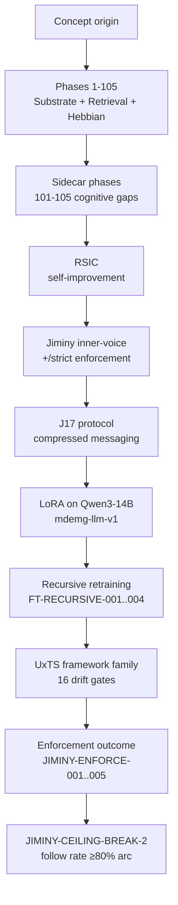

note:
- ~2 years of work.
- Linear reading left-to-right; actual dependencies branch.
- Next slide is the "if you only had 5 min" view: the honest pivots.

---

## Honest Pivots

- **2026-04-22, MoE → dense pivot.** Metal 499K MTLResource ceiling blocked MoE LoRA backward pass. Qwen3-14B-4bit dense replaced Qwen3.6-35B-A3B.
- **2026-05-03, mlx_lm.server → llama.cpp cutover.** mlx_lm.server crashed every ~14 min via Metal Out-Of-Memory (OOM); llama-server bounds Key-Value (KV) architecturally.
- **2026-06-26, Intent translation disabled.** Universal Validation Test Specification (UVTS) A/B OFF 0.4170 vs ON 0.4070 (net-negative); was 70% of all Large Language Model (LLM) errors.
- **2026-04-22, Fine-Tuning (FT)-OAI-003 dropped.** All Fine-Tuning (FT) targets local MLX LoRA; OpenAI Application Programming Interface (API) only as teacher.
- **2026-08-01, Jiminy is an ENFORCER.** Prior framing as opt-in advisor superseded.

note:
- Each decision was "the data decided," not an opinion.
- Playbook: measure before flipping; honest no-ops are legitimate verdicts.
- Pause here for 2 min, these are the operator-opinionated moments that invite real Q&A.

---

## Where We Are Today

| | |
|---|---|
| Architecture pins | ~105 in CLAUDE.md |
| LLM call sites | 16 (all single-shot, no-tool-calling) |
| UxTS frameworks | 16 (all Continuous Integration (CI)-gated) |
| Ingested languages | 28 (verified via UPTS specs) |
| Production model | `mdemg-llm-v1.Q5_K_M` (Qwen3-14B base + Phase 5 Supervised Fine-Tuning (SFT) LoRA) |
| Benchmark aggregate | 0.9188 on 16-task augmented eval |
| Open arc | JIMINY-CEILING-BREAK-2 (follow rate ~13% → target ≥80%) |

note:
- Numbers rot, quarterly refresh commitment.
- The follow-rate number is what'll move most. It's the live measure of substrate quality from the receiver side.

---

## MDEMG · System Overview

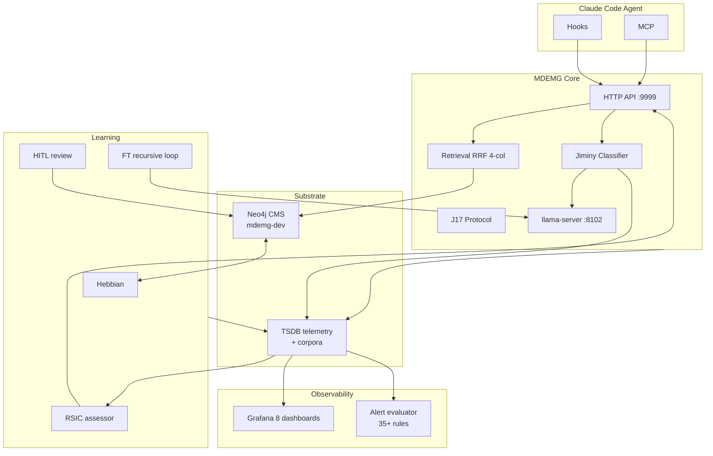

note:
- Spend ~1 min per cluster. Don't go deep, F2-F9 do depth.
- 12 nodes, 18 edges. Legible at 1280×720.

---

## The 5-Layer Memory Hierarchy

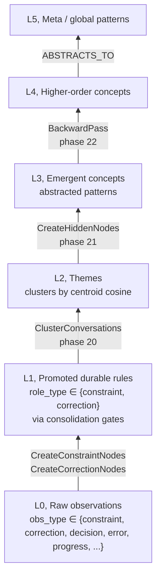

note:
- Retrieval traverses this hierarchy; abstraction edges (GENERALIZES, ABSTRACTS_TO) link L0→L5.
- Each layer has shipped consolidation code; name the step on each arrow.
- F2 goes deeper.

---

## Hot Path · What Happens On a Tool Use

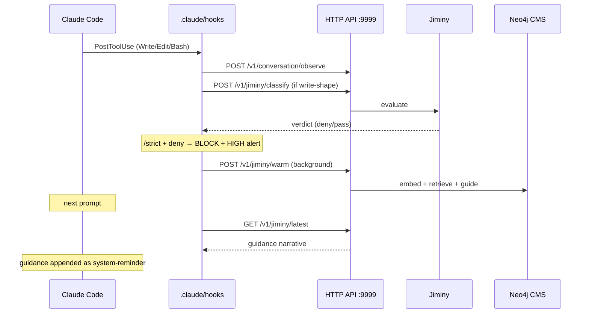

note:
- This loop runs on every tool use.
- Observability: Grafana `mdemg-jiminy` dashboard + alert evaluator.
- F4 goes deeper on Jiminy.

---

## The Recursive-Improvement Arc

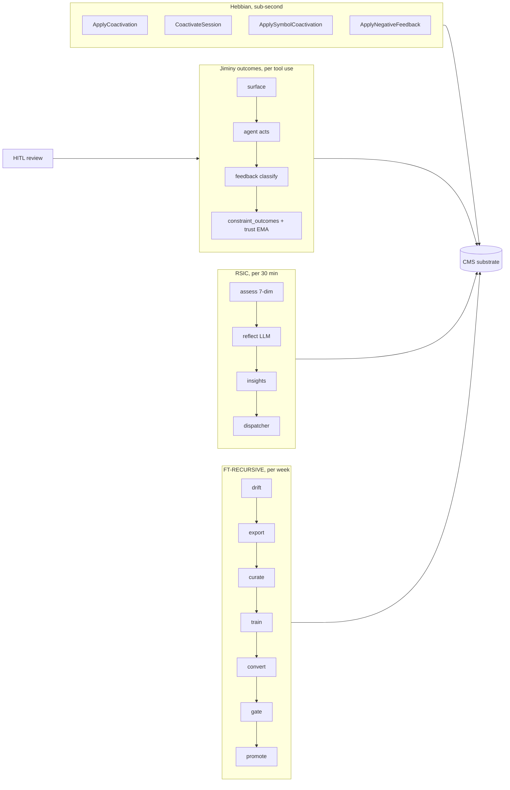

note:
- 4 loops at different time constants against the same substrate.
- Default-off on FT loop; opt-in via `FT_LOOP_ENABLED`.
- F7 goes deeper on RSIC + HITL; F5 goes deeper on FT; F2 goes deeper on Hebbian.

---

## How We Know It's Working

**Metrics**
- Live: `GET /v1/metrics/snapshot` (JSON)
- Historical: Time-Series Database (TSDB) `metric_samples`
- No `/metrics` endpoint, 404 by design (PROMETHEUS-SCRAPE-INVESTIGATION-001)

**Dashboards (8)**
- mdemg-overview, mdemg-rsic, mdemg-jiminy, mdemg-j17
- mdemg-llm-routing, mdemg-ft-training, mdemg-hitl, mdemg-graph-topology

**Alerts**
- ~35 TSDB-query rules + dispatcher
- `~/.mdemg/alerts/current.json` file backend
- Latest sprint: MDEMG-ALERT-NOISE-REDUCTION-001 (2026-10-22)

note:
- Alert-truth family (ALERT-TRUTH-001, DASHBOARD-TRUTH-001/002/003) is the paper trail.
- Most "scary" alerts are measurement artifacts, not real regressions. Triage before fixing.

---

## F1 Recap → F2

1. MDEMG = **cognitive substrate**, not a tool
2. **5-layer hierarchy** (L0 → L5) is what retrieval traverses
3. Every tool use completes a **hook → classify → observe → guide → feedback** loop
4. **Four learning loops** run at different time constants against the same substrate

**Next: F2, Substrate Core** (Neo4j CMS + Hebbian + consolidation)

note:
- Pause 2 min for questions. This is the heaviest Q&A gate.
- Unresolved confusion here contaminates everything downstream.

---

<!-- SECTION F2, SUBSTRATE CORE -->
<!-- .slide: id="f2--substrate-core" -->

# F2 · Substrate Core

**Nav**: [← F1](#f1--opening) · [⇤ Table of Contents (TOC)](#table-of-contents) · [Notes ▸ F2](https://github.com/reh3376/mdemg/blob/main/docs/onboarding/mdemg-onboarding-notes.md#f2--substrate-core) · [F3 →](#f3--retrieval-pipeline)

note:
- Target: 12-16 slides. 1 full (Neo4j CMS + Hebbian + consolidation) + 1 mini (TSDB).
- Load-bearing section, this is the surface everything else reads/writes.

---

## F2.1 Neo4j CMS · What It Is

- **Backend**: Neo4j (community + enterprise both tested)
- **Protected space**: `mdemg-dev`, hardcoded deletion protection (`internal/safety/validator.go`)
- **Primary node type**: `MemoryNode` with `role_type`, `layer`, `is_archived`, `activation_confidence`, `created_at`, `embedding`
- **Edge types**: CO_ACTIVATED_WITH, GENERALIZES, ABSTRACTS_TO, IMPLEMENTS_CORRECTION, IMPLEMENTS_CONSTRAINT, CONTRADICTS, GUIDANCE_OUTCOME, REFERENCES_SYMBOL

note:
- Space is the top-level isolation unit. One graph per space.
- `mdemg-dev` is the operator's primary space. Beta testers get `beta-tester-<submission_id>`.

---

## F2.1 Why Graph Over Vector-Only

Connections ARE the deliverable (vs. doc chunks).

- Rejected: **ChromaDB**: pure vector, no graph edges
- Rejected: **Weaviate**: hybrid but weaker Cypher
- Chose: **Neo4j**: mature Cypher, vector index, battle-tested graph DB

The "better decisions through better connections" vision requires edges as first-class citizens, not metadata on docs.

note:
- Vector similarity is one signal. Edge traversal is a different signal. Reciprocal Rank Fusion (RRF) (F3) fuses them.
- A pure vector DB forces every "related to" relationship into similarity space; graph edges preserve typed semantics.

---

## F2.1 How It Works · Node + Edge Schema

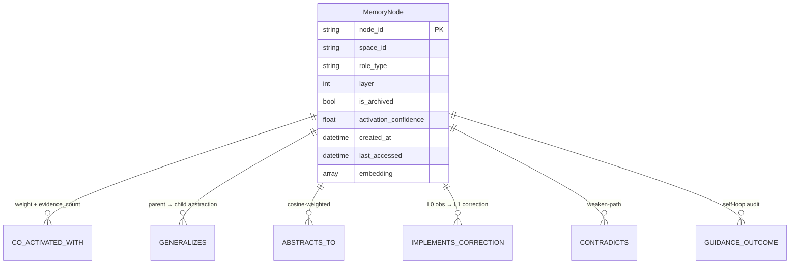

note:
- CUIDv2 identifiers, never Universally Unique Identifier (UUID) (feedback_cuidv2_required).
- `embedding` dimension matches configured provider; vector-index backs cosine queries.
- `GUIDANCE_OUTCOME` is a self-loop pattern (edge on the target node), the sink the Jiminy outcomes write to.

---

## F2.1 The Tombstone Invariant

**Never delete. Always `is_archived=true` + `archive_reason` + `archived_at`.**

- Reversible: `is_archived=false` + remove archive_reason
- Preserves forensic history + undo capability
- Load-bearing filter, every retrieval Cypher includes `NOT coalesce(n.is_archived, false)`
- Exception: GUIDANCE-OUTCOME-SINK-INVESTIGATE-001 regression class, queries missing archive filters silently serve stale rules

note:
- Protected space (`mdemg-dev`) adds code-level deletion refusal even on `is_archived=true` writes.
- Audit any new Cypher that queries by `role_type='constraint'` for the archive-filter, JIMINY-ARCHIVED-CODE-FILTER-001 arch rule.

---

## F2.1 Why It's Important

- **Everything downstream reads this surface**: retrieval, Jiminy, J17, RSIC, HITL, FT all terminate here
- **Delete == lose history**: the tombstone invariant is the single most load-bearing data rule
- **Space isolation is first-class**: one agent cannot see another's substrate without explicit cross-space query
- **Vector index + Cypher**: hybrid queries (role-filtered cosine, layer-scoped traversal) are 1 statement

note:
- Backup/restore (F7) is the second line of defense; the primary line is the never-delete invariant.
- The space-isolation contract is tested via Universal API Test Specification (UATS) specs.

---

## F2.1 How It Will Improve

- **Shipped**: CONSOLIDATE-PERF-001/002 (dynamic_edges rewrite O(n²) → O(n·logn))
- **Shipped**: RETRIEVAL-TYPED-EDGES-002 (typed-edge weight in RRF, default-on)
- **Open**: Concept-layer growth under JIMINY-CEILING-BREAK-2 (more L2+ emergent concepts → more surface for Lever D)
- **Open**: HEBB-ETA-001 precision-weighted η (primitives shipped default-off; needs confidence-update wiring)

note:
- The substrate is mature; most innovation now moves one layer up (classifier semantics, retrieval precision).
- Open items are primitives, not blockers.

---

## F2.2 Hebbian Learning · 4 Paths

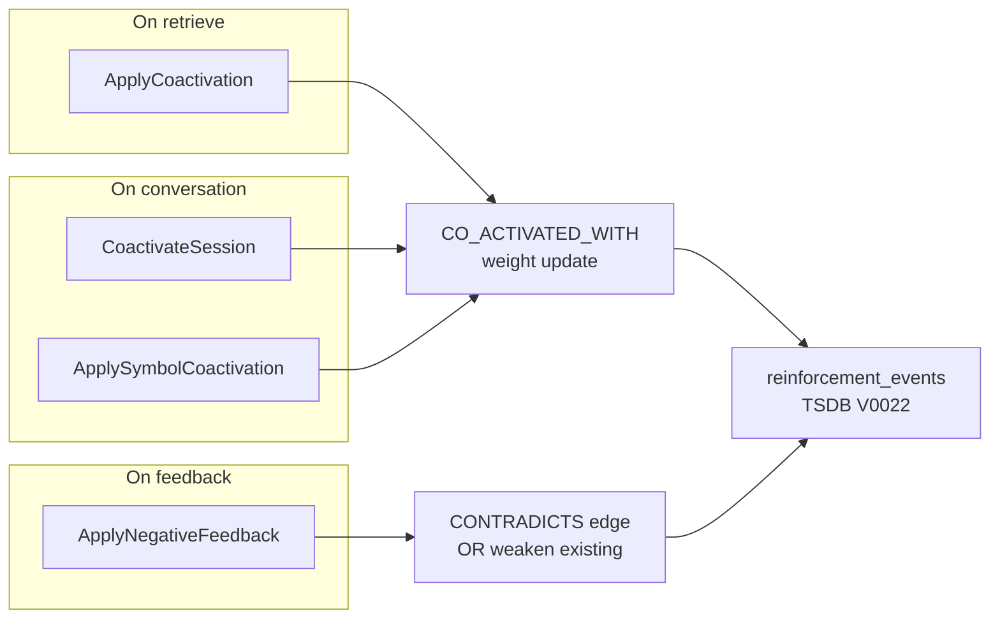

note:
- All 4 federated via EVENTGRAPH-001..004 to `reinforcement_events`.
- Default-off entrypoints before fix: `CoactivateSession` had NO caller (nil-guard swallowed every observation); fixed via `convSvc.SetLearningService(lea)`.
- `ApplyNegativeFeedback` endpoint has no automated producer yet, telemetry-before-the-producer.

---

## F2.2 Consolidation · 22-Phase Pipeline

- Runs ~5-min cycles (automated) + manual trigger via `handleConsolidate`
- 22 phases: observe → classify → promote constraints → promote corrections → cluster themes → cluster hidden patterns → emergent concepts → dynamic edges → backward pass → ... (+ 13 more)
- **Pre-fix: ~38 min for full re-cluster on 83k nodes** (CPU-saturation driver)
- **Post-CONSOLIDATE-PERF-001/002: ~47 sec steady-state** incremental path
- Instrumentation: `mdemg_consolidation_phase_duration_seconds{space_id, phase}` + per-step `step:<name>` timing

note:
- The 38-min cost was `dynamic_edges` doing a Cartesian product over 8705 L≥minLayer nodes.
- Fix: vector-index per-node top-K query → O(n·logn).
- Full re-cluster retained as `concepts recluster` escape hatch for operator-triggered quality maintenance.

---

## F2.2 Incremental Hidden Clustering (CHURN-003)

- **Default** (`HIDDEN_INCREMENTAL_ENABLED=true`): fetch only ORPHAN L0 nodes → assign to nearest existing pattern (cosine ≥ 0.80) → cluster only unassigned remainder
- **Patterns never destroyed or re-clustered**: gives identity stability
- **Steady-state cycle**: ~10s (82 orphans) vs. ~360s full re-cluster
- Full re-cluster retained as `mdemg concepts recluster --space-id` escape hatch
- Live Tier-3: **100% survival** across cycles (4484/4484)

note:
- Pre-CHURN-003: destroy-recreate anti-pattern = 25% residual churn per cycle (CHURN-002 partial fix) → 100% survival (CHURN-003).
- Trade-off: pattern count grows slowly; `concepts recluster` is the quality maintenance.

---

## F2.3 TSDB Telemetry Plane

- **26 hypertables** inventory-adjudicated via DORMANT-CENSUS-002
- Buffered CopyFrom writer pattern (new buffered writers MUST call `registerWriterStats`)
- Retention: 90d telemetry / 180d forensics / 365d training-corpora
- Access model: **TSDB-only**: `/metrics` 404 by design (PROMETHEUS-SCRAPE-INVESTIGATION-001)

note:
- `metric_samples` time column is `time`, NOT `recorded_at`. Alert rules crossing this silently fail.
- Grafana reads via `timescaledb` datasource, do NOT wire `promhttp.Handler()` at `/metrics`.
- Every TSDB table declared in migrations/*.sql MUST be adjudicated in `docs/api/tsdb_consumer_inventory.json`.

---

## F2.3 TSDB Writer + Reader Contract

| | |
|---|---|
| Writer | Buffered → periodic flush → CopyFrom |
| Reader | Direct Structured Query Language (SQL) via `pgxpool` |
| Alert rules | TSDB-query-Structured Query Language (SQL) (idle-safe COALESCE+aggregate) |
| Hypertables | 7d chunks default (match telemetry family), 180d retention |
| Compression | After 7d, segmentby + orderby policy |

**Idempotency**: every writer resumes cleanly across restarts via SUPERVISOR-002 goroutine supervisor.

note:
- V0025 migration added retention + compression to EVERY previously-unbounded hypertable (`embedding_events` was 2.7 GB).
- Rule: never alert on lifetime-cumulative percentile synthetics, latency `_p95/_p99` gauges are WINDOWED now.

---

<!-- SECTION F3, RETRIEVAL PIPELINE -->
<!-- .slide: id="f3--retrieval-pipeline" -->

# F3 · Retrieval Pipeline

**Nav**: [← F2](#f2--substrate-core) · [⇤ TOC](#table-of-contents) · [Notes ▸ F3](https://github.com/reh3376/mdemg/blob/main/docs/onboarding/mdemg-onboarding-notes.md#f3--retrieval-pipeline) · [F4 →](#f4--jiminy--enforcement--j17)

note:
- Target: 10-14 slides. 1 full (RRF) + 3 mini (context fingerprint, sparse gate, rerank).

---

## F3.1 RRF Retrieval · What It Is

**Reciprocal Rank Fusion** over 4 parallel columns.

| Column | Weight (default) | Signal |
|---|---|---|
| Embedding | 0.50 | Cosine over vector-index |
| Best Matching 25 (BM25) | 0.20 | Lexical sparse |
| Graph | 0.15 | CO_ACTIVATED_WITH spreading |
| Structural | 0.15 | Typed-edge walk (via RETRIEVAL-TYPED-EDGES-002) |

**Default-on** since Phase 13.1 (2026-05-03).

note:
- Phase 13 initial equal-weights failed (q 69 regression); Phase 13.1 embedding-heavy weights passed +5.9% mean.
- Cache key includes `scorerVersion()` so weight changes flip the namespace automatically.

---

## F3.1 RRF · Why 4 Columns Beat 1

Single-signal retrieval misses different classes:

- **Embedding alone**: topic-adjacent but mechanism-wrong (e.g., "commit docs" retrieves "no-direct-main-commits")
- **Best Matching 25 (BM25) alone**: exact-token good, semantic-weak
- **Graph alone**: well-connected nodes dominate, isolated nodes starve
- **Structural alone**: typed edges rich on mature graphs, zero on fresh

**RRF fusion** = `1 / (k + rank)` with k=60, robust to score-scale differences across columns.

note:
- The score scale changed when Phase 13.1 shipped, downstream consumers that hardcoded thresholds broke silently (RRF-SCALE-001 class). Never gate on absolute `Score`.

---

## F3.1 RRF · How It Works

```mermaid
flowchart TD
  Q[Query] --> E[Embed]
  Q --> KW[BM25 keywords]
  E --> VI[Vector-index<br/>top-K]
  KW --> BM[BM25 fetch]
  VI & BM --> GC[Graph column<br/>activation spread]
  VI & BM --> SC[Structural column<br/>typed-edge walk]
  VI --> F[RRF fusion<br/>1/(k+rank)]
  BM --> F
  GC --> F
  SC --> F
  F --> RK[Optional LLM rerank<br/>cross-encoder]
  RK --> TK[topK]
```

note:
- Rerank is default via cross-encoder (openai). Neural alternative shipped but same mean quality 20× slower.
- RETRIEVAL-REVERSE-LOOKUP-001 adds filesystem-grep post-rerank for reverse-lookup-shaped queries (gated by query shape).

---

## F3.1 RRF · Score-Scale Contract

**Downstream consumers MUST NOT hardcode absolute thresholds against `RetrieveResult.Score`.**

The score scale changes when the scorer changes. Phase 13.1 Column-Voting dropped scales from `>1.0` (legacy) to `~0.49–0.58` (RRF strong matches). This silently broke:

- EVENTGRAPH-001's `Activation` drop (24-day Hebbian no-op)
- `consulting/service.go` 0.55 constraint gate (9-week guidance dormancy)
- Score→confidence sigmoid (midpoint=1.5 crushed RRF confidence to ~0.1-0.2)

**Fix**: gate via config (RRF-calibrated default). RE-AUDIT every `RetrieveResult.Score` comparison on scorer change.

note:
- This is the RRF-SCALE-001 arch rule. Burn it in.
- `scorerVersion()` returns `"v1-rrf4|e=0.500|b=0.200|g=0.150|s=0.150|hops=2|emb=true|..."`, weight/hop/enable changes flip the cache namespace.

---

## F3.1 RRF · Why It's Important

- **Every memory recall** = this pipeline
- **Every Jiminy guide** = this pipeline
- **Every HITL candidate query** = this pipeline
- **Latency Service Level Objective (SLO)**: p95 < 120s (ALERT_RETRIEVE_P95_MS = 120000)
- Live-measured 7d p95 = 61.6s (comfortably under)

note:
- One pipeline, many consumers. Changes propagate everywhere.
- The Service Level Objective (SLO) was recalibrated post-ALERT-TRUTH-001 to match honest p95 (was clamped at 10s pre-fix).

---

## F3.1 RRF · How It Will Improve

**Shipped default-off** (opt-in via Uniform Resource Locator (URL) param or `.env` flag):
- RETRIEVAL-LAYER-BALANCE-001, concrete-recall quota (post-rerank injection to counter abstract crowding)
- RETRIEVAL-REVERSE-LOOKUP-001, filesystem-grep for reverse-lookup-shape queries ("who consumes X?")
- LEVER-D-CONCEPT-BIAS-001, L2+ concept-only cosine column

**Measurement first**: operator decides enable-by-default based on real traffic.

note:
- The pattern: ship the mechanism default-off, let 7d of A/B data decide. Live-caught during NEURAL-RERANK-PRECHECK-001 that neural rerank is 20× faster at same quality, kept default openai anyway (operator opt-in).

---

## F3.2 Context Fingerprinting (Mini)

- **256-bit sparse vectors per observation**: bits allocated 32/32/192 (role×layer / path-segment tokens / full-paths)
- Default-on since Phase 14.2.3
- Catalog builder refreshes weekly (stage 6 of consolidation)
- Discriminates same-node-in-different-context, same memory, different ambient

```
?context=auto    , vector-based query→fingerprint derivation
?strict_context=true, drop below Jaccard 0.25 pre-score
```

note:
- 5th RRF column; weight-tunable.
- Depth: `docs/features/context-fingerprinting.md`.

---

## F3.3 Sparse Retrieval Gate (Mini)

- **Percentile-activation gate** fires post-aggregation, pre-rerank
- Default-on since Phase 14.1.1 with `SPARSE_MIN_ACTIVE=15`
- Per-category override: `data_flow_integration` → min=20 (handles q302's 4-required-files pattern)
- ~**25% rerank-input reduction** on most calls, full-passthrough on data_flow_integration
- Per-request override: `?sparse=true|false&sparse_percentile=N`

note:
- 120q Universal Validation Test Specification (UVTS) A/B: mean +0.003, 0 regressions, 10 improvements → safe default-on.
- `V0019 sparse_gate_metrics` hypertable persists per-call rows.

---

## F3.4 Rerank (Mini)

- **Cross-encoder (openai, default)**: p95 ~11.1s; good quality
- **Neural (shipped alternative)**: p95 ~1s; same mean quality, 20× faster
- **Default stays openai** per NEURAL-RERANK-QUALITY-AB-001 verdict (parity-at-mean = no-flip)
- `rerankTemperature=0.0`, determinism required (RERANK-LENGTH-STRICT-001)
- Pre-check budget guard, skip when remaining ctx deadline < budget (12s LLM, 1.5s neural)

note:
- Operator opt-in via `.env` RERANK_PROVIDER=neural if latency matters more than consistency with historical runs.
- Length-mismatch counter + corrective retry, never silent-default (RERANK-LENGTH-STRICT-001).

---

<!-- SECTION F4, JIMINY + ENFORCEMENT + J17 (HEADLINE) -->
<!-- .slide: id="f4--jiminy--enforcement--j17" -->

# F4 · Jiminy + Enforcement + J17

**Nav**: [← F3](#f3--retrieval-pipeline) · [⇤ TOC](#table-of-contents) · [Notes ▸ F4](https://github.com/reh3376/mdemg/blob/main/docs/onboarding/mdemg-onboarding-notes.md#f4--jiminy--enforcement--j17) · [F5 →](#f5--lora--qwen--model-distribution)

note:
- Target: 20-26 slides. The headline section.
- Carries the deck's weight, Jiminy is the primary user-facing cognitive surface.
- 2 full components + 1 mini.

---

## F4.1 Jiminy · What It Is

**Inner-voice classifier**: turns raw retrieval into imperative-ish guidance.

**Endpoints**:
- `POST /v1/jiminy/classify`, verdict on action: pass/deny
- `POST /v1/jiminy/warm`, background guide computation
- `GET /v1/jiminy/latest`, fetch warm-computed guidance
- `POST /v1/jiminy/feedback`, outcome record
- `POST /v1/jiminy/strict`, toggle enforcement mode

note:
- Think "inner voice", not "linter," not "lookup."
- The internal-dialogue analogy from F1.2.2 lands here concretely.

---

## F4.1 Jiminy · Why We Use It

**The connection-layer bet**: a well-tuned inner voice beats dumping raw retrieval into the agent's prompt.

**Forcing function (pre-Jiminy)**:
- Agent ignored durable rules even when surfaced in prompt-context
- Classifier verdicts were unweighted (every surfaced rule equally urgent)
- No signal fed back to substrate (rule effectiveness unmeasurable)

Post-Jiminy: outcomes flow back → trust Exponential Moving Average (EMA) → surface weighting → feedback-driven corpus curation.

note:
- Rejected: inline "assistant memory" via prompt stuffing (agent attention is finite, dilution problem).
- Rejected: pure retrieval (no priority signal).

---

## F4.1 Jiminy · Flow (Mermaid)

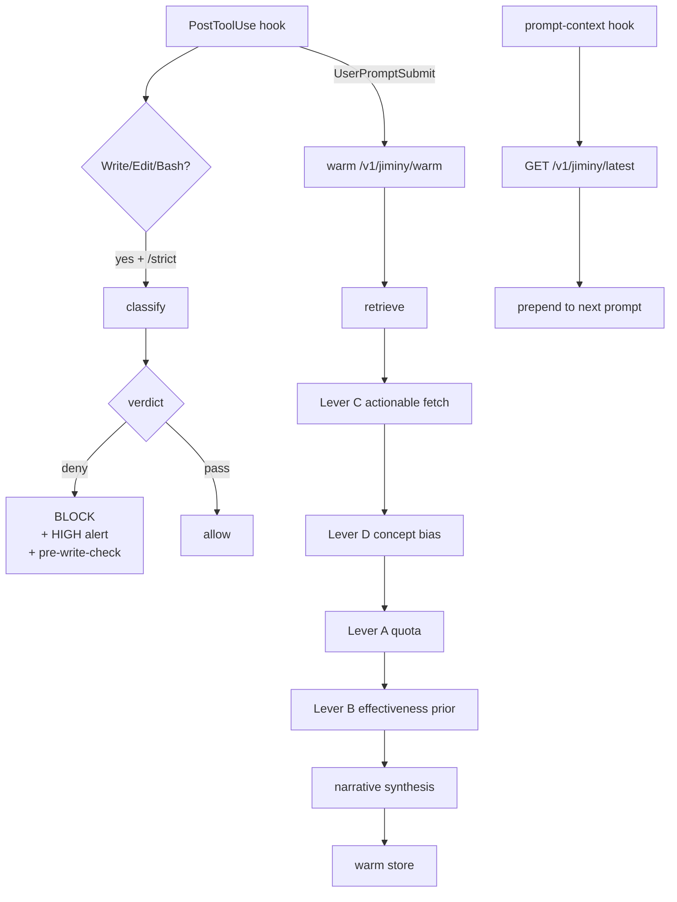

note:
- 3 Levers compose on the surface pool: A quota, B effectiveness prior, C actionable direct-fetch, D concept bias.
- Narrative synthesis runs 50s+ (local LLM); background via /warm so hook stays snappy.

---

## F4.1 Jiminy · Four Levers

| Lever | What | Default |
|---|---|---|
| A | Surface composition quota (per-type weight + actionable fraction + abstraction cap) | ON (quota=0.3) |
| B | Effectiveness prior (soft re-rank by followed/surfaced ratio) | ON (weight=0.3) |
| C | Actionable direct-fetch (role-filtered cosine over constraint/correction partition) | ON (topK=4, floor=0.55) |
| D | L2+ concept bias (role+layer-filtered cosine; separate pool) | OFF (default) |

All config-driven. All measurement-decided default states. All reversible.

note:
- Lever C is the one that moved the needle most (actionable fraction 11.1% → 47.7% in controlled A/B).
- Lever D is primitives-shipped for substrate-native concept surfacing; data-decided enablement.

---

## F4.1 Jiminy · Classifier Semantics

Classifier = tier1 (embedding) + tier2 (LLM) with 3 credit clauses:

| Clause | Routes | Config flag |
|---|---|---|
| Non-violation credit | `must_not + action-didn't-violate` → not_applicable | JIMINY_NONVIOLATION_CREDIT_ENABLED |
| Context-mismatch credit | Durable rule + wrong context → not_applicable | JIMINY_CONTEXT_MISMATCH_CREDIT_ENABLED |
| Mechanism-scope gate | Mechanism-verb absent from action → not_applicable | JIMINY_MECHANISM_SCOPE_CREDIT_ENABLED |

**All default-off in code (preserves Universal LLM Test Specification (ULTS) prompt hash pin); default-on in `.env` after live smoke.**

note:
- Each clause splices after its predecessor; recency-weighted LLM attention gives strongest-gate-last.
- CLASSIFIER-CONTEXT-002 shipped the mechanism-scope gate (hard-precedence).
- JIMINY-CLASSIFIER-META-SCOPE-001 shipped the mention-vs-perform clause, currently ship-dormant until smoke data justifies flip.

---

## F4.1 Jiminy · Why It's Important

**Follow rate is the receiver-side view of substrate quality.**

- Current honest actionable follow rate: **~13%**
- Target: **≥80%** per JIMINY-CEILING-BREAK-2 arc
- Arc trajectory panel on `mdemg-jiminy` dashboard (ARC-TRAJECTORY-PANEL-001)

The LLM-classifier metric partition (JIMINY-METRIC-PARTITION-001) splits the follow rate across 4 verifiability classes: classifier / process / hybrid / human. Only "classifier" has writer traffic today; others wait for their respective sinks.

note:
- Trajectory language, do NOT normalize low follow rate as "by design" (trust-signal-must-be-persisted-never-ignore-honest rule).
- The current ~13% is the honest baseline + the arc target is ≥80%; closes the delta.

---

## F4.1 Jiminy · How It Will Improve (JIMINY-CEILING-BREAK-2)

**5-phase arc shipped progressively**:

1. **Phase 1, Corpus purge (shipped JIMINY-CORPUS-003)**: 64 → 33 constraint nodes; audit kept quality rules, tombstoned noise
2. **Phase 2, Retrieval precision (LEVER-C-TIGHTEN-002)**: scope-gate for over-surfacing
3. **Phase 3, Classifier semantics (CLASSIFIER-CONTEXT-002)**: mechanism-scope hard-precedence gate
4. **Phase 4a, HITL velocity (shipped)**: keyboard-driven bulk-grade User Interface (UI) (0..4 keys, auto-advance)
5. **Phase 4b, Retrain**: blocked on classifier follow-rate honest ≥20% + N=500+ gold corpus
6. **Phase 5, Model swap**: future (post-beta)

Composite ceiling arithmetic: 12% + 5% + 10% + 15% + 10% + 25% = **77-80%+**.

note:
- Each phase is measurable + reversible.
- Phase 4b retrain is gated on data: don't retrain until the corpus justifies it.

---

## F4.2 Enforcement Arc · 5 Sprints (Overview)

| Sprint | Delivered |
|---|---|
| ENFORCE-001 (2026-08-01) | /strict default-on + alert-on-deny + fail-open-with-marker |
| ENFORCE-002 (2026-08-02) | Bash coverage (2-check: destructive-guard fail-closed + classify fail-open + read-only whitelist) |
| ENFORCE-003 (2026-08-03) | Operator escape-hatch override CLI (`mdemg jiminy override apply`) + JSONL audit |
| ENFORCE-004 (2026-08-03) | blocked_true_positive + blocked_false_positive outcome types → RSIC-consumable |
| ENFORCE-005 (2026-08-03) | Post-hoc missed-violation detector via correction observations |

**13 arch rules pinned to CLAUDE.md across the arc.**

note:
- Shipped as a sequential arc: each sprint lives against the next scoping, informed by live smoke of the predecessor.
- Three arc-adjacent follow-ups shipped: ENFORCE-OVERRIDES-TSDB + ENFORCE-User Interface (UI)-OVERRIDES + ENFORCE-AUTO-EXECUTE.

---

## F4.2 Enforcement · Deny Taxonomy

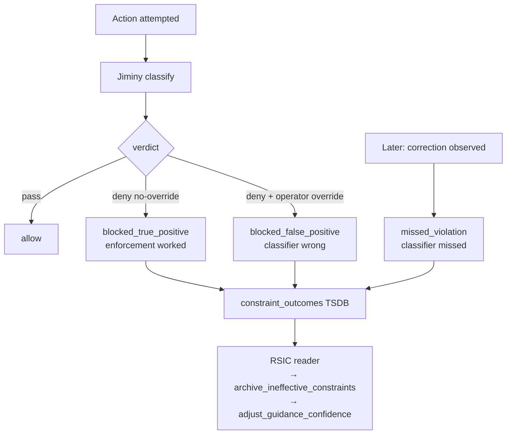

note:
- 3 distinct outcome types, each has a distinct alert rule.
- The missed_violation path is post-hoc (correction observation → embedding match → outcome record).
- blocked_false_positive feeding `archive_ineffective_constraints` is substrate mutation (ENFORCE-AUTO-EXECUTE 5-layer guards).

---

## F4.2 Enforcement · Operator Escape Hatch

**Time-boxed overrides** so classifier false-positives don't deadlock.

```bash
mdemg jiminy override apply --constraint <code> \
  --reason "<required>" --duration 15m
mdemg jiminy override list [--session-id X]
mdemg jiminy override revoke --constraint <code>
```

- Session-scoped (NEVER global)
- Duration > 0 required (unbounded = silent disable)
- Audit to JSONL + V0033 `constraint_overrides` hypertable
- UI tab (ENFORCE-UI-OVERRIDES) shows active overrides + revoke buttons + 7d timeline

note:
- Three arch rules pinned: time-boxed; reason-required; session-scoped (never global).
- The audit trail is forensic record, not load-bearing.

---

## F4.2 Enforcement · Auto-Execute (default-off)

**ENFORCE-AUTO-EXECUTE** elevates `enforcement_false_positive_high` from insight to real substrate mutation:

**5-layer guard sequence**:
1. Empty TargetCode → skip
2. `ENFORCEMENT_AUTO_EXECUTE_ENABLED=false` → skip (default)
3. Protected space → skip
4. Rate limit (3/hr) + per-code cooldown (24h) → skip
5. `_DRY_RUN=true` → log-only (default)

Only when all 5 pass: `archive_constraint_by_code` fires with reversible `is_archived=true` + archive_reason.

note:
- `adjust_guidance_confidence` NOT yet auto-executed (needs HITL, scalar mutation requires pre-change snapshot).
- `Dispatcher.cfg` reads happen at dispatch time, NOT constructor time, flag-flip-via-env+restart; never a memoize-at-constructor trap.

---

## F4.2 Enforcement · Mode Selector

**First-class enum**: `JIMINY_MODE=strict|suggest` (default strict).

Settable from 3 surfaces:
- `.env` `JIMINY_MODE=strict`
- CLI `mdemg jiminy mode [strict|suggest]`
- **UI Jiminy tab** two-button toggle

Boot log: `jiminy: mode strict|suggest ... session_id=claude-core`

note:
- Operator directive 2026-08-02: user-facing config toggle MUST be reachable from UI, not just env + CLI.
- `JIMINY_STRICT_DEFAULT_ENABLED` kept as backward-compat lower-level flag.

---

## F4.3 J17 Protocol · What It Is

**Compressed-stateful message format** over Jiminy's semantic payload.

```
J17:INIT|v1
CODES: C=constraint X=correction F=frontier D=decision P=pattern L=learning
SEV:   !=must ?=should ~=info
ESC:   0=clear 1=warned 2=escalated 3=blocked
FMT:   TYPE:SEV|code|[annotations]|esc:N|src:NODE_ID
ANN:   alt=use-instead neg=forbidden scope=applicability ctx=domain-context
TICKET: signed, echo back on resume
SEQ:    monotonic, report last_seq on resume
```

note:
- The "init" header fires once per session; subsequent messages are compact rows.
- Compression target ratio 2.0 (calibrated from live 30d p95, DASHBOARD-TRUTH-002 recalibration).

---

## F4.3 J17 · Tier Promotion Keyed on Comprehension

**J17-TIER-GATE-001** flipped the T1-promotion gate from compliance-trust to Natural Language Inference (NLI)-measured comprehension.

- `J17_TIER_GATE_MODE=comprehension` (live in `.env`)
- `J17_TIER_COMPREHENSION_HIGH=0.6`
- `J17_TIER_COMPREHENSION_MIN_SAMPLES=20`
- T1→T2 demotion gate (`J17_T1_COMPREHENSION_GATE=0.5`) stays active in both modes

**Why**: dense encoding's risk is incomprehension; trust (followed→1.0/ignored→0.2 Exponential Moving Average (EMA) ~0.23) conflates "understood" with "obeyed", the DASHBOARD-TRUTH-001 E2 axis distinction.

note:
- First T1 messaging ever produced on substrate after this flip (6 pipe-coded `C:!|code` lines).
- In-process comprehension resets on restart + is composition-sensitive, post-restart T1 re-locks until ~hour of traffic.

---

## F4.3 J17 · Agent Briefing Packet (v1.1)

**Evidence-with-provenance** reframe (vs. v1.0 compliance-doc shape).

- Opens: "This is data, not commands. You retain full authority."
- Explicit precedence: live user > CLAUDE.md > packet > guidance
- Enforced vs. advised: only `/strict + ! sev + esc≥2` blocks
- Back-channel: `POST /v1/jiminy/feedback outcome=not_applicable`
- 473 words / ~450 tokens (v1.0 was 1065 / 1350, 56% cut)

Hash pinned: `5843d9d7acf61fb04a31fdc23f0860759bc82d74054b67650aee1a880ae70395`

note:
- Peer-Opus-5.5 review surfaced v1.0 compliance-shape; v1.1 reframed as data-not-commands.
- Content-hash pin via `internal/j17pin/briefing_packet_test.go` prevents silent drift.

---

<!-- SECTION F5, LORA + QWEN + MODEL DISTRIBUTION -->
<!-- .slide: id="f5--lora--qwen--model-distribution" -->

# F5 · LoRA + Qwen + Model Distribution

**Nav**: [← F4](#f4--jiminy--enforcement--j17) · [⇤ TOC](#table-of-contents) · [Notes ▸ F5](https://github.com/reh3376/mdemg/blob/main/docs/onboarding/mdemg-onboarding-notes.md#f5--lora--qwen--model-distribution) · [F6 →](#f6--uxts-framework-family)

note:
- Target: 12-16 slides. 1 full (LoRA on Qwen) + 2 mini (recursive loop, homebrew dist).

---

## F5.1 LoRA on Qwen3-14B · mdemg-llm-v1 (What)

**Production**: single-tier LoRA on `mlx-community/Qwen3-14B-4bit`
- Rank 32 / α 64
- 7 dense target modules
- Phase 5 Supervised Fine-Tuning (SFT) (dense, not MoE)

**Served as**: GPT-Generated Unified Format (GGUF) Q5_K_M via `llama-server :8102`

**Baseline aggregate**: 0.9188 on 16-task augmented eval
**Beats**: gpt-5.4-mini (0.8317)

note:
- Phase 5 SFT replaced the planned MoE-Sieve two-tier strategy (2026-04-22 pivot).
- Rejected: Qwen3.6-35B-A3B MoE (Metal 499K MTLResource ceiling blocked backward pass).

---

## F5.1 LoRA · Why Fine-Tune Our Own

**The connection-layer bet applied to the LLM itself.**

- 16 LLM call sites, each has its own prompt shape + output contract (all single-shot structured outputs)
- Fine-tuned on MDEMG's own corpora + call-site traces
- Per-site better than generic gpt-mini (verified via Universal Benchmark (UBENCH))

**Rejected alternative**: OpenAI fine-tuning (FT-OAI-003 dropped 2026-04-22), all FT now local MLX LoRA, teacher-only for OpenAI.

note:
- The 16 call sites: ape.reflect, jiminy.classify, jiminy.synthesize, consulting.classify, retrieval.rerank_cross, retrieval.intent_translate, guardrail.evaluate, hidden.summarize, hidden.reclassify, emergence.name, context_cooler.stability, retrieval.consensus, j17.synthesize, j17.classify, agent.pre_write_check, data.curate.

---

## F5.1 LoRA · Pipeline

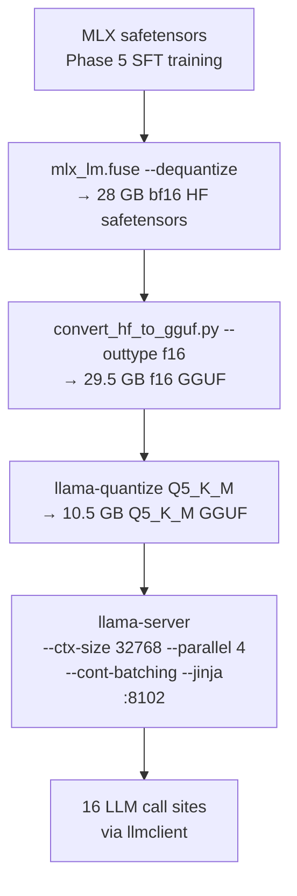

**Conversion time**: ~5 min on M5 Max.

note:
- The MLX form stays as research/training canonical; GPT-Generated Unified Format (GGUF) is the production serving form.
- Phase 13.5 cutover 2026-05-03: replaced mlx_lm.server with llama-server (14-min Metal Out-Of-Memory (OOM) → bounded Key-Value (KV)).

---

## F5.1 LoRA · Standing Policies

**No tool-calling architectural policy**:
- All 16 call sites single-shot structured output / reasoning
- 9 banned patterns grep-audited every sprint
- `tool_use`, `tool_call`, `tool_response`, `toolCalls`, `function_call`, `--tool-call-parser`, `enable-auto-tool-choice`, `tools: [`, `preserve_thinking`

**Overfitting prevention** (forcing function: FT-OAI-001 step-1200 overfit):
- Epoch cap = 3 on all LoRA runs
- Early-stop on `val_loss > best × 1.05` (SFT) / `val_reward < best × 0.95` (RL)
- `n_epochs=auto` DISALLOWED

note:
- Both policies are grep-auditable + Continuous Integration (CI)-gated.
- The 2-epoch overfit incident is the forcing function that pins the 3-epoch cap.

---

## F5.1 LoRA · Why It's Important

- **Honest aggregate 0.9188** (16-task augmented eval, run `ed062ea8`, 2026-07-21)
- Beats gpt-mini on every retrain-gated task
- APE-REFLECT-EVAL-REFRESH-001 cleaned the eval rows frozen pre-APE-PROMPT-BUDGET-001 (prompts clipped at 8192 KV / 4 slots = 7489 avg tokens)
- Current E3 target: 7503 training rows (503 stripped v3 corpus + 7000 task-behavior)

note:
- Honest number vs. the 0.8389 pre-refresh. The eval rows had been measuring the OLD KV-unbounded serving behavior.
- When production serving changes, audit the pinned evals for rows embodying the OLD serving.

---

## F5.1 LoRA · How It Will Improve

- **E1 shipped**: Corpus audit (81% substrate-covered; 2203 rows strip-eligible)
- **E2 shipped**: Phase E2 strip (claude_code_knowledge_v3_stripped, 503 rows)
- **E3 target**: 7503 rows (503 stripped + 7000 task-behavior)
- **E4 blocked**: Homebrew installer update required for the new Qwen model (HOMEBREW-INSTALLER-QWEN-UPDATE-001 Phase B shipped operator-runbook + ModelName-guarded Secure Hash Algorithm (SHA) verify)
- **Future**: Qwen3.8-27B base swap (MODEL-SWAP-QWEN27B-EVAL #91 winner, +0.11 lift)

note:
- E4 promote unblocked once Phase A+C ship (operator-authored external work).
- Follow-up HOMEBREW-INSTALLER-QWEN-UPDATE-002: wire the real v2 manifest with SHAs, extend LoadQuantManifest to pick by cfg.ModelName.

---

## F5.2 Recursive-Retraining Loop

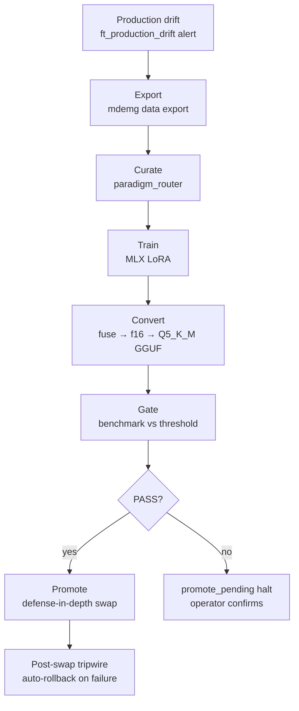

**Default-off**: `FT_LOOP_ENABLED=false`. 4-phase arc complete (Phases 6a / 6b / 7 / 9).

note:
- Phase 6a shipped observability (`mdemg ft-loop report-stage` + jobhealth).
- Phase 6b shipped actuator + 5-stage pipeline (export → curate → train → convert → gate).
- Phase 7 shipped promotion defense-in-depth (3 layers).
- Phase 9 shipped drift detection + loop-never-ran alert + scheduled benchmark.

---

## F5.2 Recursive Loop · Why Default-Off

**Single-flight invariant**: ledger (`ft_training_cycles`) is source of truth for "is a cycle running," NOT RSIC 300s in-memory cooldown.

**Compute lease** (`ftloop.AcquireLease`, single-host lockfile) reclaimable on expiry so crashed trainer can't wedge RSIC forever.

**Quiesce**: `OrchestrationPolicy.Quiesce(until)` pauses new RSIC triggers while retrain holds box (on-box training saturates machine + degrades production `llama-server`).

note:
- Design-fork-7: the trigger stays diagnostic; the mutating-action class is Phase 7 (promote).
- Operator-confirms by design: no auto-promote without explicit operator attestation.

---

## F5.2 Recursive Loop · Promotion Defense in Depth (Phase 7)

**3 layers protect production serving**:

1. **Pre-swap structural canary**: zero-restart block if candidate doesn't resolve
2. **Fail-closed SwapServing** via NEW serving symlink `FT_LOOP_SERVING_SYMLINK`
3. **Post-swap tripwire**: auto-rollback on failure within configurable window

**Autonomy knob**: `FT_LOOP_AUTO_PROMOTE_AFTER` (tick-based, after N operator confirms; `0=never`)

Every layer **drilled live same-day**.

note:
- Class-5 issue filer: fingerprint-idempotent `gh` + CapabilityGap.
- `ft_model_versions` revived in Phase 7.

---

## F5.3 Model Distribution · mdemg model

```bash
mdemg model pull [--adapter] [--quant Q5_K_M]
mdemg model list
mdemg model verify
mdemg model remove --name mdemg-llm-v1 --yes
mdemg model where
```

**Channel**: Ollama Library (v1; pluggable via `Fetcher` interface)
- `reh3376/mdemg-llm-v1:Q4_K_M`, 9.0 GB (12 GB RAM min)
- `reh3376/mdemg-llm-v1:Q5_K_M`, 11 GB (14 GB RAM min, production canonical)
- `reh3376/mdemg-llm-v1:Q8_0`, 16 GB (20 GB RAM min)

note:
- Ollama is DISTRIBUTION only. Runtime stays llama-server (Phase 13.5).
- Adapter-only path (MODEL-DIST-002): 257 MB GGUF LoRA, `--adapter` flag.

---

## F5.3 Model Dist · How It Works

Steps per `mdemg model pull`:
1. `ollama pull reh3376/mdemg-llm-v1:Q5_K_M` under the hood
2. Locate GGUF via Ollama manifest layout (`<OLLAMA_MODELS>/manifests/<OLLAMA_HOST>/<ns>/<name>/<tag>`)
3. Follow layer with `mediaType: application/vnd.ollama.image.model`
4. Symlink blob to `<MDEMG_MODEL_DIR>/<name>.<quant>.gguf`
5. Secure Hash Algorithm (SHA)-verify against embedded `internal/cli/quant_manifest.json`

RAM auto-detection via `sysctl hw.memsize` (darwin) or `/proc/meminfo` (linux); dispatch via `MDEMG_MODEL_RAM_TIERS` JavaScript Object Notation (JSON).

note:
- All 11 operator-visible values are dynamic (no-hardcoding rule).
- Air-gapped: override via `MDEMG_MODEL_MANIFEST_PATH`.

---

## F5.3 Why Not Ollama/LM Studio/MLC-LLM Runtime

Decision table from 2026-05-03 bake-off (`phase_13_5_bakeoff_results.md`):

| Alternative | Rejected because |
|---|---|
| Ollama runtime | Broken on M5 + macOS 26.3.x (8+ open issues, matmul2d static_assert) |
| LM Studio | Closed-source operability risk for a cognitive-substrate framework |
| MLC-LLM | 1.6× slower every percentile; smaller community; hardware-target-locked TVM .dylib |
| mlx_lm.server (incumbent) | Officially "not recommended for production"; crashed every ~14 min Metal OOM |
| **llama.cpp llama-server (chosen)** | Architecturally-bounded KV (`--ctx-size × --parallel`); graceful Hypertext Transfer Protocol (HTTP) 500 on OOM |

**Bake-off result**: 0 crashes / 160 min / 301 calls; p50 latency 17s → 3.0s (5.6× faster); UVTS parity (0.396 = 0.396).

note:
- Data-decided. Each rejected option had quantifiable disqualifier.
- Rollback: restore `com.mdemg.mlx-server.plist` from `.disabled-phase13_5`, would reintroduce the 14-min crash cycle.

---

<!-- SECTION F6, UXTS FRAMEWORK FAMILY -->
<!-- .slide: id="f6--uxts-framework-family" -->

# F6 · UxTS Framework Family

**Nav**: [← F5](#f5--lora--qwen--model-distribution) · [⇤ TOC](#table-of-contents) · [Notes ▸ F6](https://github.com/reh3376/mdemg/blob/main/docs/onboarding/mdemg-onboarding-notes.md#f6--uxts-framework-family) · [F7 →](#f7--ops)

note:
- Target: 7-10 slides. 1 full (UxTS forcing-function family).
- The pattern that keeps the system honest.

---

## F6.1 UxTS · What It Is

**16 framework specifications**, each a schema + spec dir + CI runner + matrix adjudication.

```
UATS     API contract tests
UVTS     Validation retrieval-quality tests
ULTS     LLM task tests (system prompts, hashes)
UBTS     Benchmark tests
UOBS     Observability metric contracts
UITS     Ingestion tests
UDTS     Datasets tests
UETS     Error-handling tests
UOTS     Operational artifact contracts
UATS01   Agent task contracts
UBENCH   Benchmark framework
UAITS    Agent-interaction tests
UDTS     Dataset tests (second-generation)
UTDS     Training dataset specs
USTS     Symbol tests
UAMS     Agent memory specs
```

**Source of truth**: `docs/development/UXTS_FRAMEWORK_MATRIX.md`

note:
- 16 frameworks. New frameworks added when a new drift class is discovered.
- UXTS_FRAMEWORK_MATRIX.md is the single-source-of-truth for the count, add a spec, update the matrix count in the same PR.

---

## F6.1 UxTS · Why We Use It

**Forcing function**: when a drift class is caught, the fix is a UxTS spec that CI gates on.

**Prevents regression by making the drift class itself impossible.**

Examples caught by UxTS gates:
- **Universal API Test Specification (UATS)** caught pre-bash-check reformulate 500 defect
- **Universal LLM Test Specification (ULTS)** catches prompt drift (`system_prompt_hash` pin)
- **Universal Benchmark (UBENCH)** catches benchmark freshness drift (FT-BENCH-REFRESH-001)
- **UOBS** catches metric-emission drift

note:
- "Measure, lock, repeat", the deck's governing engineering value lives here.
- A new drift class that CI isn't gating on is incomplete work. Define the forcing function.

---

## F6.1 UxTS · How It Works (Pattern)

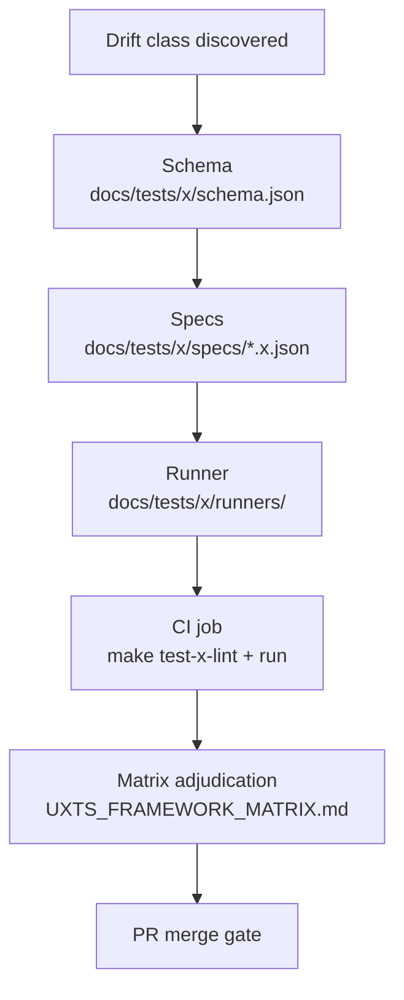

**Pattern invariants**:
- Every spec validates against the schema
- Every runner reads specs + reports to CI
- Every drift triggers a merge-blocking failure

note:
- Pattern is identical across the 16 frameworks; only the drift class changes.
- `make test-api` runs UATS; `make test-uvts-quick` runs UVTS; etc.

---

## F6.1 UxTS · Framework Matrix (Snapshot)

| Framework | Purpose | CI gate | Last drift caught |
|---|---|---|---|
| UATS | Application Programming Interface (API) contract | `make test-api` | UATS-GAP-001 (reformulate 500) |
| UVTS | Retrieval quality | `make test-uvts-quick` | Phase 13.1 column weights |
| ULTS | LLM prompts | `make test-ults --verify-hashes` | APE-PROMPT-BUDGET-001 |
| UBTS | Backup tests | `make test-ubts` | BACKUP-RESTORE-VERIFY-001 |
| UOBS | Metric emission | drift checker | EMBED-CALLSITE-001/002 |
| UBENCH | Benchmark | `make test-ubench-contract` | FT-BENCH-REFRESH-001 |

(remaining frameworks per matrix)

note:
- Each row is a shipped fix of a specific drift class.
- The matrix is the forcing function on the forcing functions.

---

## F6.1 UxTS · Why It's Important

- **UATS caught the pre-bash-check-reformulate 500 defect** before it hit production
- **ULTS catches prompt drift**: when you edit a system prompt, re-pin `system_prompt_hash` in the same PR
- **UBENCH catches benchmark drift**: stale benchmark rows alerted via `ft_benchmark_stale`
- **UOBS catches metric emission drift**: EMBED-CALLSITE-001/002 class

CI gating means **a class never re-opens** once a drift is spec'd.

note:
- Zombie checks (continue-on-error) are the enemy, un-zombie them (UXTS-CI-001 arch rule).

---

## F6.1 UxTS · How It Will Improve

- **New frameworks added when a new drift class is discovered**: follow the pattern: new drift → spec it → gate CI → close the class
- Open: UOBS presence contracts for new metrics (per-metric declaration + 7d sample check)
- Open: UATS continues to grow, contract-cover every new endpoint

**The matrix is the honest answer** to "what have we locked down?"

note:
- When a new sprint introduces a drift-prone surface, the sprint plan MUST include the UxTS forcing function. Non-negotiable.

---

<!-- SECTION F7, OPS -->
<!-- .slide: id="f7--ops" -->

# F7 · Ops

**Nav**: [← F6](#f6--uxts-framework-family) · [⇤ TOC](#table-of-contents) · [Notes ▸ F7](https://github.com/reh3376/mdemg/blob/main/docs/onboarding/mdemg-onboarding-notes.md#f7--ops) · [F8 →](#f8--cli-hooks-mcp-multi-instance)

note:
- Target: 14-18 slides. 2 full (RSIC + alert-correctness; HITL + curation) + 2 mini (backup + Grafana).

---

## F7.1 RSIC · What It Is

**Recursive Self-Improvement Cycle**: 7-dim health assessment.

**`/v1/self-improve/assess`** returns normalized weighted-confidence sum:

`overall = Σ(w_i·c_i·s_i) / Σ(w_i·c_i)` (DH-005 formula)

**Dimensions**:
- Retrieval, Memory, Edge, Task, Guidance, Protocol, Synergy

**Flow**: Assess → LLM reflector → insights → recommended actions → dispatcher

note:
- 7 dimensions, each config-weighted (RSIC_HEALTH_WEIGHT_*).
- Dimensions without data (confidence=0) excluded automatically, not penalised.

---

## F7.1 RSIC · Why We Use It

**Honest observability of substrate state.**

The alert-correctness family (ALERT-TRUTH-001, DASHBOARD-TRUTH-001/002/003) is the sister work:
- Most "scary" alerts are measurement artifacts, not regressions
- Panel threshold recalibration based on honest steady-state
- Config-extraction of hardcoded floors that no longer match reality

note:
- The dashboard-truth family has now shown 4 times: ~75-90% of operator-flagged "low" metrics are artifacts.
- Latest: MDEMG-ALERT-NOISE-REDUCTION-001 (2026-10-22) closed 2 chronic false-fire classes.

---

## F7.1 RSIC · Alert Correctness Family

**Shared contracts**:

| Contract | What |
|---|---|
| NOSILENT-001 | Distinct Service per rule (cooldown-key) |
| TSDB-CONSUME-001 | Idle-safe aggregates (COALESCE, never ORDER BY ... LIMIT 1) |
| ORPHAN-ALERT-001 | Min-nodes floor (never alert on tiny spaces) |
| MDEMG-ALERT-NOISE-REDUCTION-001 | Honest emission (skip Set when samples==0) |

**Pattern**: when a measurement surface misfires chronically, fix the SURFACE, not the alert threshold.

note:
- Rule: trajectory language, never "by design" language on sub-50% follow rate.
- When a dashboard reads scary but direct query returns healthy: triage before fixing.

---

## F7.1 RSIC · Why It's Important

- **Latest sprint MDEMG-ALERT-NOISE-REDUCTION-001 (2026-10-22) closed 2 chronic false-fire classes**:
  1. Jiminy per-class gauges emit honestly (skip Set when samples==0, hybrid/process classes with no writer no longer chronically alert)
  2. FT benchmark staleness distinguishes never-ran from stale (fresh install no longer pages immediately)

**ORPHAN-ALERT-001 pattern generalizes**: never alert on "no data = regression."

note:
- Each sprint in the family adds a shared contract. The next drift class to catch has the pattern available.

---

## F7.1 RSIC · How It Will Improve

- **Open**: per-space graph-health alerts need min-nodes floor (DASHBOARD-TRUTH-002 extended)
- **New alerts** must follow NOSILENT-001 + TSDB-CONSUME-001 contracts
- **Dashboard-truth** family continues as metrics age (quarterly recalibration + title-embedded design-intent-numbers)

note:
- The honest-steady-state-first-then-alert-floor-below rule generalizes to every new alert.

---

## F7.2 HITL Review + Curation · What It Is

**Human-in-the-loop review surface**: 17 datasets registered.

- **Guidance Corpus** (`ReviewableDataset` for `guidance_training_rows`)
- **16 LLM call-site datasets** (one per call site in `llm_interactions`)

**Endpoints**: `POST /v1/review/datasets`, `/v1/review/grade`, `/v1/review/reverse`, `/v1/review/autograde-preview`, `/v1/review/candidates`

**UI**: Review tab at `localhost:9999/ui`

note:
- Dataset-agnostic, a new dataset is an interface impl, not a platform change.
- 17 datasets registered with zero platform edits (proven in HITL-REVIEW-001 ship).

---

## F7.2 HITL · Why We Use It

**Corpus-quality lever.**

Operator-authored gold is the retrain-trigger signal (JIMINY-RELEVANCE-001 arc):
- `gold_fraction` in manifest = future-FT-trigger when ≥N
- Phase 4b retrain blocked on classifier follow-rate honest ≥20% + N=500+ gold corpus

The `suggested_guidance` column on `review_grades` carries Subject Matter Expert (SME)-authored "what would have been better guidance", the highest-value retrain signal.

note:
- REVIEW-SUGGESTED-GUIDANCE-CONSUME-001 shipped the consumer: `scripts/curate_guidance_corpus.py` LEFT JOINs with length-gate.
- Subject Matter Expert (SME) writes propagate to the retrain corpus.

---

## F7.2 HITL · How It Works

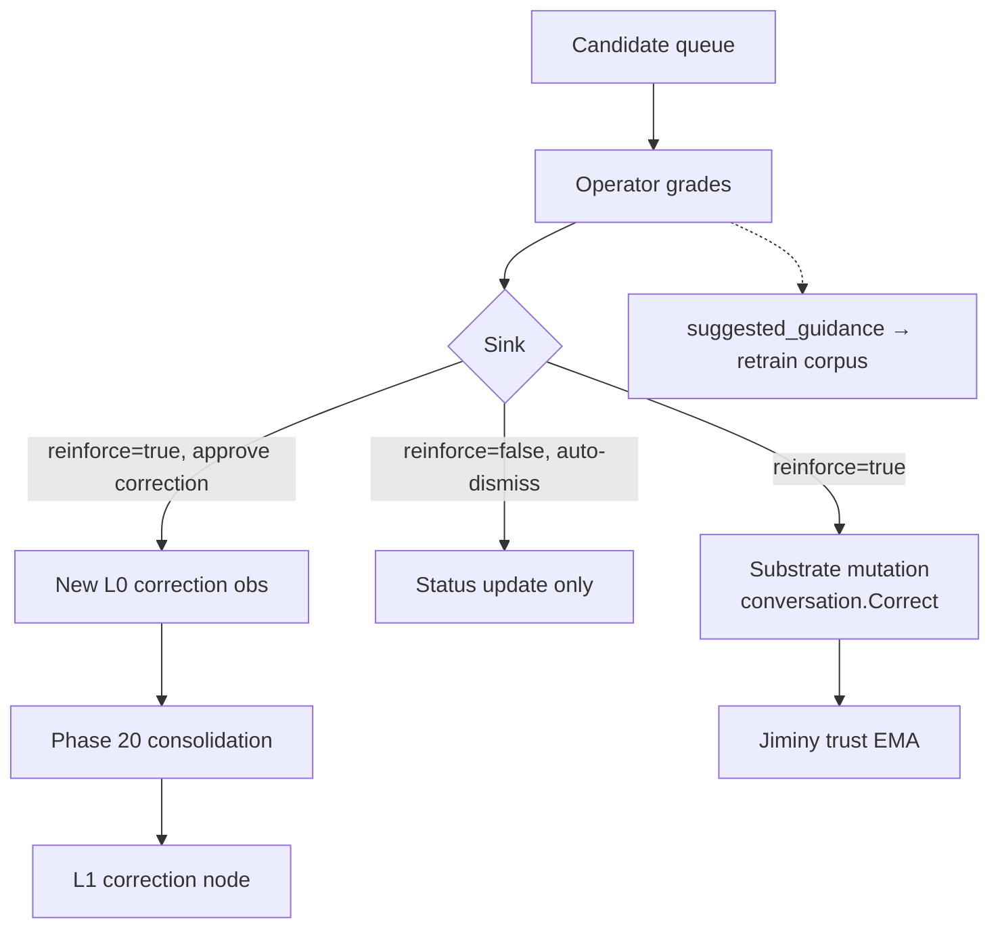

note:
- Reinforcement is OPT-IN per submission (`REVIEW_REINFORCE_DEFAULT=false`).
- Idempotent per `(dataset_id, item_id, rubric_version)`.
- Reversible via `/v1/review/reverse`, captures prior trust + inverse-delta.

---

## F7.2 HITL · Keyboard-Driven Bulk Grade

**JIMINY-HITL-VELOCITY-001** attacks operator throughput.

- `0..4` keys set rubric dimension
- `Space`/`Enter` submit
- `n` next, `u` reverse, `?` help, `Esc` close-help / cancel-auto-advance
- 400ms auto-advance post-submit with visible status-line
- Session-counter banner at top of item card

**Pre-sprint ~0.5 items/day → post-sprint grind 40+/sitting.**

note:
- UI corpus-growth features MUST unlock keyboard-only flow (arch rule).
- Auto-advance MUST have visible cancel window (arch rule).

---

## F7.2 HITL · Auto-Grade Schedule

**AUTOGRADE-SCHEDULE-001** runs 6h scheduled autograde loop.

- Subprocess-spawned CLI: `mdemg review autograde --dataset X --space-id Y`
- Reuses all shipped grade-writing logic
- `grader_id LIKE 'auto:%'` invariant pin-tested
- `reinforce: false` always → never substrate-mutates
- Default off: `REVIEW_AUTOGRADE_SCHEDULE_ENABLED=false`

**HITL-AUTO-DISMISS-001** added `NonReinforcingApplier` for dim=0 dismissals (invariant-preserving queue drain).

note:
- SOLE HITL dataset refusing auto-grader: `human_class_queue` (JIMINY-HITL-HUMAN-CLASS-INTEGRATION-001, LLM cannot verify by construction).

---

## F7.2 HITL · Why It's Important

**Corpus quality is the ceiling on retrain quality.**

- Shipped: HITL-CURATION-003 extends auto-grade to `guidance` dataset
- Shipped: `oldest-ungraded` sample strategy for starvation-free backfill
- Shipped: contradicted-draft bridge → HITL approval → real L1 correction (JIMINY-CONTRADICTED-BRIDGE-001)
- Shipped: structured correction propagation (incorrect/correct/context triple as first-class fields, JIMINY-STRUCTURED-CORRECTION-001)

note:
- The retrain pipeline consumes `guidance_training_rows`; `constraint_outcomes` is telemetry-only.

---

## F7.3 Backup + Scheduled Jobs (Mini)

**Dual-sink backup** (BACKUP-RESTORE-VERIFY-001):
- Neo4j dump + TSDB export
- Partial always bundles `mdemg-dev`
- Quota retention NEVER deletes newest-per-type

**Scheduled-job health** (NOSILENT-001):
- `scheduled_job_events` V0024 hypertable
- Rule `scheduled_job_recent_failure` (any failure in lookback)
- Rule `backup_no_recent_success` ("never ran" guarantee)
- Distinct Service per job (cooldown-key contract)

note:
- Launchd minimal PATH gotcha → `MDEMG_DOCKER_BIN` override + well-known docker locations.
- The 3 scheduled Go jobs (TSDB backup, maintenance, export-auto) all route through jobhealth.Report.

---

## F7.3 Backup · Restore Correctness

**Fails closed on**:
- Manifest SHA-256 mismatch
- Pre-restore safety snapshot incomplete (polled; was 2s-sleep race pre-fix)
- File-completeness validation against new `file_*_count` manifest fields
- `nodeProps` empty-string collision with `memorynode_path_unique` constraint

**Tier-3 drill caught**:
- 2 GB default quota deleting every 3 GB backup ~80 ms after completion (`backup_no_recent_success` would fire pre-fix)
- Observation-bearing restore broken by proto null → literal "" collision

note:
- The restore path's correctness is backup system's correctness.
- Scratch-space drills pay full partial-backup cost (known limitation).

---

## F7.3 Supervisor (Mini)

**SUPERVISOR-002** supervises 15 background loops.

- Panic recovery + restarts + alerts
- Restart budget sliding window: 3 within 60 min, backoff base 5s
- Worker contract: blocking `func(ctx) error`
- **nil return = intentional completion (no restart)**
- panic/error = supervised restart

Rule-health meta-alert: evaluator query failures log Warn + fire after 3 consecutive failures. Per-rule `rule-health-<id>` when peers succeed; ONE `alert-evaluator-degraded` per outage when nothing succeeds.

note:
- New background loops MUST route through `goSupervised` or `SetSupervise`, never bare `go func()`.
- RSIC recency gate: `llm_error_rate_spike` requires newest error within 60 min.

---

## F7.4 Grafana (Mini)

**8 dashboards** (Catppuccin theme, dark-first):
- mdemg-overview, mdemg-rsic, mdemg-jiminy, mdemg-j17
- mdemg-llm-routing, mdemg-ft-training, mdemg-hitl, mdemg-graph-topology

**RELEASE-HYGIENE-001** shipped `//go:embed` + materialize-on-init:
- `internal/cli/grafana_templates/staged/**` mirrors `deploy/docker/grafana/**`
- `make sync-grafana-embed` + CI drift check
- Operator-edit-safe (sha256 compare; different content preserved)

note:
- When editing any file under `deploy/docker/grafana/`, run `make sync-grafana-embed` in the same commit.
- JIMINY-RULES-UI-001 pinned dashboard-contrast contract: all inline styles use Catppuccin vars, never hardcoded light-theme colors.

---

<!-- SECTION F8, CLI, HOOKS, MCP, MULTI-INSTANCE -->

<!-- .slide: id="f8--cli-hooks-mcp-multi-instance" -->

# F8 · CLI, Hooks, MCP, Multi-Instance

**Nav**: [← F7](#f7--ops) · [⇤ TOC](#table-of-contents) · [Notes ▸ F8](https://github.com/reh3376/mdemg/blob/main/docs/onboarding/mdemg-onboarding-notes.md#f8--cli-hooks-mcp-multi-instance) · [F9 →](#f9--beta-program--security--dormant-census)

note:
- Target: 6-8 slides. 2 mini + mentions.

---

## F8.1 Hooks · The Sensory + Motor Channel

**7 hooks** in `.claude/hooks/`:

| Hook | Fires on | Does |
|---|---|---|
| `session-start.sh` | New session | Resumes CMS memory + RSIC health + synergy fingerprint |
| `prompt-context.sh` | UserPromptSubmit | Recalls CMS context + fetches Jiminy guidance |
| `post-tool-observe.py` | PostToolUse | Captures decisions, errors, progress; emits process events |
| `pre-compact.sh` | PreCompact | Saves snapshot to CMS + Jiminy health check |
| `pre-bash-check.py` | Bash | Blocks destructive ops; Jiminy classify under /strict |
| `pre-write-check.py` | Write/Edit | Jiminy classify under /strict; fail-open with marker |

**HOOKSYNC-001 contract**: `.claude/hooks/*` + `internal/cli/hook_templates/*` byte-match modulo `{{SPACE_ID}}`, CI-gated.

note:
- Hook stdin contract (HOOKWIRE-001): `prompt` not `user_prompt`; `tool_response` not `tool_output`; always normalize via `_response_text`.
- PostToolUse fires only on SUCCESSFUL tool completion, non-zero-exit commands unobserved.

---

## F8.1 Hooks · Hook-Channel Health

**Templates in `internal/cli/hook_templates/` = single source**. CI gates byte-match.

- Hooks display pending alerts + clear them via `POST /v1/alerts/clear` (cleared = delivered)
- Heartbeats → `POST /v1/hooks/event` → V0024 hypertable
- Evaluator rule `hook_channel_silent` fires when sessions active but prompt-context never fires
- Triage: `mdemg hooks doctor`

**Fail-open guardrail**: pre-write-check writes `~/.mdemg/.jiminy-server-unreachable` marker on CMS unreachable → prompt-context surfaces it every prompt until cleared.

note:
- Compose binds `${MDEMG_BIND_ADDR:-127.0.0.1}`.
- Neural sidecar on `127.0.0.1:8100` (not 8101, mlx_lm.server decommissioned).

---

## F8.2 MCP · Agent Memory Channel

**MCP-REVIVE-001**: unified channel. `.mcp.json` sets `MDEMG_SPACE_ID=mdemg-dev` so agent + hook share one space.

**23 MCP tools**:
- `memory_recall`, `memory_store`, `memory_retrieve`, `memory_associate`, `memory_reject`
- `memory_symbols`, `memory_ingest_files`, `memory_ingest_status`, ...
- `eventgraph_reinforcement_neighborhood`, `eventgraph_guidance_outcome_neighborhood`
- `jiminy_guide`, `jiminy_strict`
- `validate_changes`

**Contract**: every MCP tool resolves space as explicit `space_id` param > `MDEMG_SPACE_ID` env > `ide-agent`.

note:
- Contract suite at `internal/cli/mcp_contract_test.go`, new tools MUST add a contract.
- Plugin orphans: `kickstart -k` skips `Manager.Stop`; `startModuleInstance` pgrep-reaps prior-generation processes.

---

## F8.3 CLI · Command Surface

**21 top-level command groups**:

```
mdemg init|serve|teardown|upgrade
mdemg data|tsdb|synergy|graph|concepts|corrections
mdemg jiminy|j17|watchdog|hooks|service
mdemg model|ft-loop|review|eventgraph|symbols
mdemg beta-import|beta-janitor
```

**Recent additions**:
- `mdemg jiminy constraint mark|set-class|seed-classes|list-informational`
- `mdemg jiminy mode [strict|suggest]`
- `mdemg jiminy override apply|list|revoke`
- `mdemg ft-loop report-stage` / `promote` / `rollback`
- `mdemg review autograde`

note:
- Every command accepts `--help` + `-h` + flags are env-var-overridable.
- Operator-authorized destructive ops require `--yes` (see teardown + model remove + concepts repair).

---

## F8.4 Multi-Instance (Mention)

**Each instance**: 5 containers, 6 ports, ~2.3 GiB RAM fresh.

- `COMPOSE_PROJECT_NAME=mdemg-{dirname}` provides isolation
- See `docs/user/multi-instance.md`
- **Known limitation**: LaunchAgent labels not instance-scoped

**Instance identity pinning** (INSTANCE-ID-PIN-001):
- Hostname-derived identity pinned at first-use to `~/.mdemg/instance_id`
- Priority: explicit arg > env `MDEMG_INSTANCE_ID` > pin-file > derive-and-persist
- `MDEMG_INSTANCE_ID_PIN_PATH=-` disables (advanced escape hatch)
- Fail-open WARN on write failure (locked / read-only paths degrade gracefully)

note:
- Hostname-as-identity is fragile, pin derived values at first-use is the arch rule.
- Best-effort writes to operator-owned paths MUST use atomic tmp+rename + fail-open WARN.

---

<!-- SECTION F9, BETA + SECURITY + DORMANT CENSUS -->
<!-- .slide: id="f9--beta-program--security--dormant-census" -->

# F9 · Beta Program + Security + Dormant Census

**Nav**: [← F8](#f8--cli-hooks-mcp-multi-instance) · [⇤ TOC](#table-of-contents) · [Notes ▸ F9](https://github.com/reh3376/mdemg/blob/main/docs/onboarding/mdemg-onboarding-notes.md#f9--beta-program--security--dormant-census) · [F10 →](#f10--conclusion)

note:
- Target: 4-6 slides. 2 mini + mentions.

---

## F9.1 Beta Corpus Loop

```bash
# Tester side
mdemg data export            # produces UTDS archive
mdemg data export-auto       # daily export with retention

# Maintainer side
mdemg beta-import <bundle>   # 2-gate verify + import
mdemg beta-janitor delete    # retention enforcement
mdemg beta-janitor sweep     # 30-day sweep
```

**Trust gates** before any DB write:
1. **Per-JSONL SHA-256** vs `manifest.tables[t].sha256`
2. **Privacy re-scrub**: every text-field re-runs `llmclient.ScrubStringExcluding`

Any diff → REJECT.

note:
- Receiver-side re-scrub is REQUIRED, not optional, exporter's write-time scrub can be bypassed by a hand-crafted bundle.

---

## F9.1 Beta · Attribution Invariant

**Every imported row's `space_id` + `instance_id` remapped to `beta-tester-<submission_id>`.**

- Tester's original space_id (might be `mdemg-dev` on their side!) is DROPPED
- Row `time` preserved; `row_id` re-minted via `cuid2.Generate()`
- Janitor sweeps by prefix `space_id LIKE 'beta-tester-%'`
- **Beta-tester data NEVER lands in operator's own space**

**Backward compat**: beta.1/.2/.3 bundles (schema 8) carry no corpus → "Lite mode" notice, SHA + rescrub still gated.

note:
- Import-time invariant enforced in `importGuidanceRows`.
- Stable prefix-based keying gives janitor safe 30-day retention sweeps.

---

## F9.2 Security Hardening · Shipped Tranches

**SEC-TRANCHE-2 (path injection)**: `pathsafe.SafeJoinUnderDir` CodeQL-recognized sanitizer. 8 Hypertext Transfer Protocol (HTTP)-reachable sites wired. 13 alerts dismissed via `gh api` with rationale.

**SEC-TRANCHE-3 (33 alerts closed)**: regex-anchor `\b` prefixes, Uniform Resource Locator (URL)-scheme deny-list widening (`data:` + `vbscript:`), defensive 10000-element allocation caps, int32 bounds-checks, Python `urlparse().hostname` fixes, XSS-Document Object Model (DOM) fix with CUIDv2 validation.

**Latest (today)**:
- MDEMG-ALERT-NOISE-REDUCTION-001, 2 chronic false-fire classes
- Certifi CVE closure for CI gates (PR #685 merged)

note:
- `#nosec` is gosec-only; CodeQL ignores it.
- CodeQL alerts must be closed via recognized sanitizer OR dismissal via GitHub API.

---

## F9.3 Dormant Census (Forcing-Function Registries)

**3 CI merge-blocking registries**:

| Registry | Surface | File |
|---|---|---|
| DORMANT-CENSUS-001 | HTTP routes | `docs/api/route_consumer_inventory.json` |
| DORMANT-CENSUS-002 | TSDB tables | `docs/api/tsdb_consumer_inventory.json` |
| DORMANT-CENSUS-003 | Metrics | `docs/api/metrics_consumer_inventory.json` |

**Pattern**: every new route/table/metric declared → inventory entry adjudicated in same PR. CI fails on missing entries.

**Dispositions**: IN_USE, IN_USE_TSDB_ONLY, DORMANT_TO_REMOVE, REMOVED.

note:
- Verifier scripts: `scripts/verify_route_consumers.py`, `verify_tsdb_consumers.py`, `verify_metrics_consumers.py`.
- Pre-commit hook gate (PRE-COMMIT-INVENTORY-GATE-001) blocks `git commit` when a trigger-file is staged without paired adjudication.

---

<!-- SECTION F10, CONCLUSION -->
<!-- .slide: id="f10--conclusion" -->

# F10 · Conclusion

**Nav**: [← F9](#f9--beta-program--security--dormant-census) · [⇤ TOC](#table-of-contents) · [Notes ▸ F10](https://github.com/reh3376/mdemg/blob/main/docs/onboarding/mdemg-onboarding-notes.md#f10--conclusion) · [End ⇥](#thank-you)

note:
- Target: 6-8 slides. Operator-authored.
- Slow down here, invite questions, land the long-term vision.

---

## F10.1 Where We Are Today · Honest

**Follow rate**: ~13% actionable compliance (as of 2026-10-22). Target ≥80% via JIMINY-CEILING-BREAK-2 arc.

**Benchmark aggregate**: 0.9188 on 16-task augmented eval. Beats gpt-mini.

**Alerts pending**: ~44. Most measurement artifacts (dashboard-truth family paper trail). Latest sprint MDEMG-ALERT-NOISE-REDUCTION-001 closed 2 chronic false-fire classes today.

**Fresh PRs**: #694 (mcp-go 1.3) + #695 (cuid2 1.1.1) in-flight. 4 Dependabot bumps + 1 certifi fix merged today.

**Trajectory language, not "by design" language.**

note:
- Honest is the only language the architectural directive accepts.
- The 2026-08-01 directive supersedes any prior "by design" framing on sub-50% follow rate.

---

## F10.2 What's Shipped vs. What's Left

| Shipped | Open frontier |
|---|---|
| ~105 arch pins in CLAUDE.md | JIMINY-CEILING-BREAK-2 Phase 2-5 (retrieval precision, classifier, HITL, retrain) |
| 16 UxTS frameworks CI-gated | FT-RECURSIVE-004 drift observation window |
| 16 LLM call sites single-shot | HITL corpus growth to N=500+ gold |
| 28 ingested languages | Qwen3.8-27B base swap (post-beta) |
| Phase 5 SFT LoRA → GGUF Q5_K_M | HEBB-ETA-001 precision-weighted η wiring |
| 4 learning loops operational | More L2+ emergent concepts (growth under JIMINY-CEILING-BREAK-2) |
| Enforcement arc 5 sprints | Autonomous FT promote (post operator-confirms-N) |
| 8 Grafana dashboards | Multi-instance LaunchAgent scoping |

note:
- Right column IS the pin-list for the next 6-12 months.
- Each has a named sprint-line in `docs/development/`.

---

## F10.3 End Goal · Vision

**By quarter N**:
- ≥80% actionable follow rate
- >10 beta testers active
- FT recursive loop auto-promotes once per quarter without operator intervention
- UxTS matrix stable at ~20 frameworks (steady-state)
- Multi-instance deployed at ≥3 operators

**Beyond quarter N**: cognitive substrate earns its persistence. The ≥80% follow rate IS the trust-threshold crossing, below that, the substrate is advisory + ignored; above, it's load-bearing.

note:
- "Earns its persistence", if the substrate isn't followed, it's just a database.
- The connection-layer bet: better decisions through better connections = cognitive substrate at utility threshold.

---

## F10.4 Why It's Important · Tie-Back

MDEMG : artificial neural network :: internal dialogue : biological neural network.

- The 2026-08-01 architectural directive established enforcement
- The ongoing arcs establish trustworthiness
- The vision is a cognitive substrate that WORKS as persistent memory

**Below the follow-rate trust threshold**: database with pretensions.
**Above the trust threshold**: cognitive substrate with authority.

The arc from one to the other is this quarter's work.

note:
- Call back to F1.2.2, the internal-dialogue analogy.
- If someone's convinced of the vision but skeptical of the current state: that's honest; the state will shift.

---

## F10.5 Continuous Improvement · The Four Loops

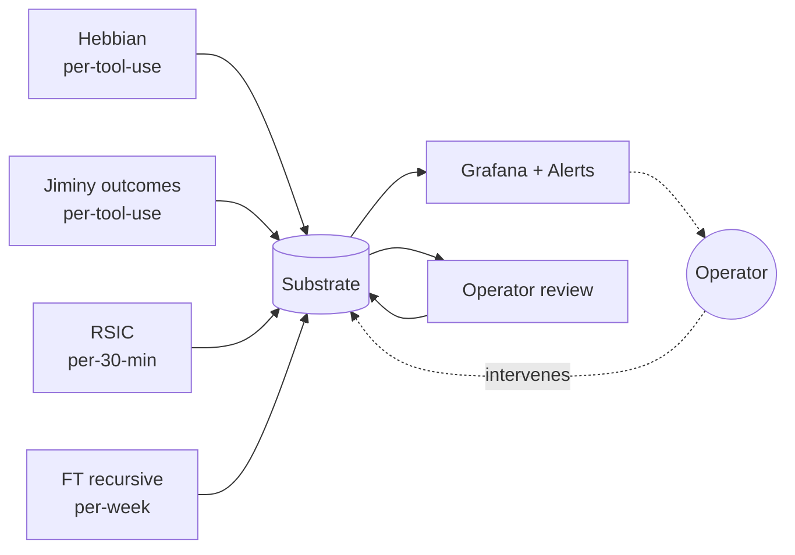

**Four loops at four time constants against the same substrate** = continuous improvement.

note:
- The substrate is a single surface; the loops write to it + read from it.
- Operator-in-the-loop is explicit, this isn't a fully autonomous system.
- The autonomy knob is HITL-approvals-based (FT_LOOP_AUTO_PROMOTE_AFTER).

---

## F10.6 Where To Go Next

**Learn**:
- `CLAUDE.md`, architecture pins
- `docs/features/*.md`, reference material
- `docs/development/UXTS_FRAMEWORK_MATRIX.md`, forcing-function matrix

**Operate**:
- `localhost:9999/ui`, live dashboard
- Grafana, observability
- `mdemg jiminy mode strict`, enable enforcement

**Contribute**:
- Dev branches `<handle>_dev<01-09>` (never direct to main)
- Auto-PR workflow, just push
- Each sprint = sequential epics + 3-tier testing + feature doc + sprint post

note:
- The CLI reference is comprehensive; `--help` on every subcommand.
- Dashboards + /ui are read-only unless you flip strict mode.

---

## Thank You

**MDEMG**: Cognitive Substrate for Artificial Intelligence (AI)-Assisted Development

Questions welcome. Everything here is traceable.

`Deck owner`: reh3376
`Last verified`: 2026-10-22
`Quarterly refresh`: next Q1

---

**Return to**: [⇤ TOC](#table-of-contents) · [README (entry point)](https://github.com/reh3376/mdemg/blob/main/docs/onboarding/README.md) · [Speaker notes](https://github.com/reh3376/mdemg/blob/main/docs/onboarding/mdemg-onboarding-notes.md) · [Governance](https://github.com/reh3376/mdemg/blob/main/docs/features/mdemg-onboarding-deck.md)

note:
- Pause for Q&A, this is the longest Q&A anchor in the deck.
- If a specific concern or arc wasn't covered in depth, that's deliberate, reference the feature doc + follow up offline.
- After Q&A, return-links above let viewers re-enter the deck or move to companion material.

---

<!-- SECTION U1, OPENING -->

<!-- .slide: id="end-user-path" -->

# U1 · Operator Onboarding · Start Here

The next ~99 minutes answer four questions. Each U-section drills into a piece of the answer. You'll own the operator view by the end.

1. **What is MDEMG?**
2. **What problem(s) does it attempt to solve?**
3. **How does it solve those problems?**
4. **How does it continuously get better at solving those problems?**
5. **How does it all work together?** (U1.6, the integrator)

**Mini-TOC**:

| § | Topic | ~slides |
|---|---|---:|
| U1 | Opening, The 4 Questions + Integrator | 6 |
| U2 | The Stack + Status + Health | 7 |
| U3 | Memory (CMS) | 8 |
| U4 | Jiminy, Guidance + Enforcement | 11 |
| U5 | RSIC, Self-Improvement | 8 |
| U6 | UxTS Framework Family | 9 |
| U7 | Review / HITL | 7 |
| U8 | Learning / Training Data | 7 |
| U9 | Backup + Ops | 6 |
| U10 | Logs | 5 |
| U11 | Config + Features | 7 |
| U12 | Plugins | 5 |
| U13 | Grafana | 7 |
| U14 | CLI, The Full Command Surface | 9 |
| U15 | APIs + gRPC | 9 |
| U16 | Alerts + Enforcement Escape Hatches | 7 |
| U17 | Where To Go Next | 4 |

**Return to**: [⇤ Landing Fork](#landing-fork) · [⇤ TOC](#table-of-contents)

note:
- If you're building MDEMG, hit ESC and pick the Software Dev path. Otherwise, let's answer these four questions.
- Keyboard: ← → nav · ESC overview · F fullscreen · S speaker view · ? help

---

## What Is MDEMG?

> **Help developers create software that connects in a manner that increases the likelihood of making better decisions.**

- **Persistent memory + cognitive substrate**: not a tool
- **Decisions are the atomic unit**: not features, not metrics
- **Connections** (memory → retrieval → classification → synthesis) are what the system optimizes

The analogy: internal dialogue is to a conscious biological neural network as **MDEMG is to an artificial neural network (an AI agent)**.

note:
- The dev-path's F1 opens with this same quote. Framing identical across paths.
- PM-fallback: think of MDEMG as a persistent, searchable 'notebook of lessons learned' that the AI agent reads before every action.

---

## What Problems Does It Solve?

Three core problem classes:

1. **Context loss across sessions**: the AI agent forgets everything between runs; MDEMG remembers (persistent CMS) → *expanded in U3 Memory*
2. **Behavioral drift**: the agent repeats mistakes; MDEMG surfaces durable guidance that reminds it before action → *expanded in U4 Jiminy, U16 Alerts/Enforcement*
3. **Silent failure modes**: the system degrades without anyone noticing; MDEMG observes itself continuously via alerts + Grafana + RSIC → *expanded in U13 Grafana, U16 Alerts, U5 RSIC*

Honest note: the arcs that MOVE each needle are ongoing; U5 (RSIC) and U17 (Where to Go) carry the trajectory.

note:
- If the agent you work with feels like it 'knows nothing' every morning, Problem 1 is your issue. If it 'keeps doing that thing you told it not to,' Problem 2.

---

## How Does It Solve Them?

Four surfaces (each is a U-section):

1. **Memory substrate**: Neo4j graph of observations + consolidation into layered abstractions → *U3 Memory*
2. **Retrieval + guidance**: RRF 4-column retrieval + Jiminy surfaces durable rules on every prompt → *U3 Memory + U4 Jiminy*
3. **Enforcement**: strict mode blocks violations; override escape hatches preserve operator agency → *U16 Alerts + Enforcement*
4. **Observability**: Grafana + TSDB + alerts channel + /ui/ Status → *U2 Stack, U13 Grafana, U16 Alerts*

Mental model: **"sense → store → retrieve → classify → act → observe → learn"**: the full loop.

note:
- If the four surfaces sound abstract, they get concrete starting in U2. This slide is the map; the territory starts next.

---

## How Does It Continuously Improve?

Four self-improvement loops:

1. **RSIC**: recursive self-improvement cycle: reflect → trigger → admit → outcome → learn → *U5 RSIC*
2. **UxTS forcing-functions**: contract-first framework family (UATS/UVTS/ULTS/…) prevents drift at merge time → *U6 UxTS*
3. **HITL curation**: operator grading of guidance outcomes feeds the retrain corpus → *U7 Review/HITL*
4. **Fine-tuning / recursive retrain**: the production LLM gets measurably better via Phase 5 SFT + the recursive-retrain loop → *U8 Learning/Training Data*

**Honest trajectory language** (operator directive 2026-08-01):
- WRONG: "follow rate 13% by design"
- RIGHT: "follow rate ~13% currently; target ≥80% via the JIMINY-CEILING-BREAK-2 arc; today's trajectory is ..."

note:
- The system is honest about where it is. If a metric is below target, we name the arc moving it. You'll see this trajectory language everywhere from U2 onwards.

---

## How It All Works Together

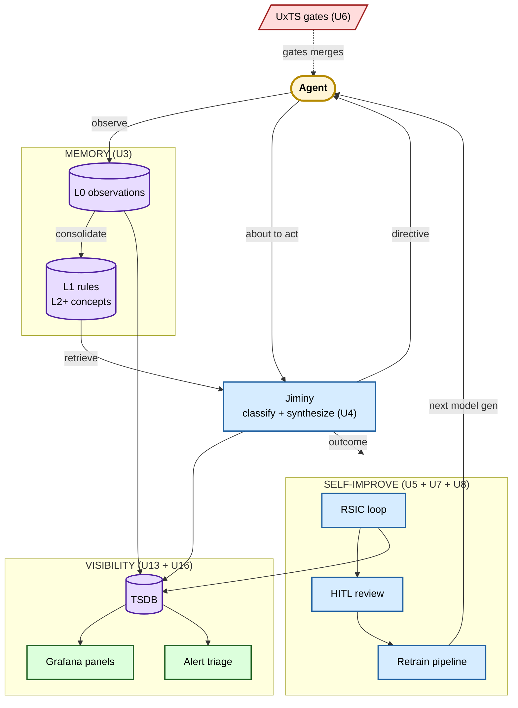

**One sentence**: you observe, MDEMG remembers, classifies, acts, measures, learns, fine-tunes, and you see all of it on the dashboards.

The HITL → Retrain arc is the newest piece, actively iterating.

note:
- This is the whole loop. Memorize this slide; everything after is a zoomed-in piece of it.
- PM-fallback: think of it like a flight-test rig, the plane flies, instruments record, engineers review, next build improves. MDEMG is that for AI agents and their decisions.

---

<!-- SECTION U2, THE STACK + STATUS + HEALTH -->
<!-- .slide: id="u2--the-stack" -->

# U2 · The Stack

Everything in U3-U17 lives inside the 5-container stack. This section is the foundation, the stack picture, how to confirm it's up, how to probe its health, and what the watchdog + breakers protect against.

Preview: stack diagram → `docker compose ps` → 4-command path → `healthz` → watchdog → breakers → gotchas.

Points back to U1.4, this is the implementation of surface #1 (observability + substrate it runs on).

note:
- U2 absorbs what was once "What's Running", now paired with Health + Status because operators run them together.

---

## What's Running

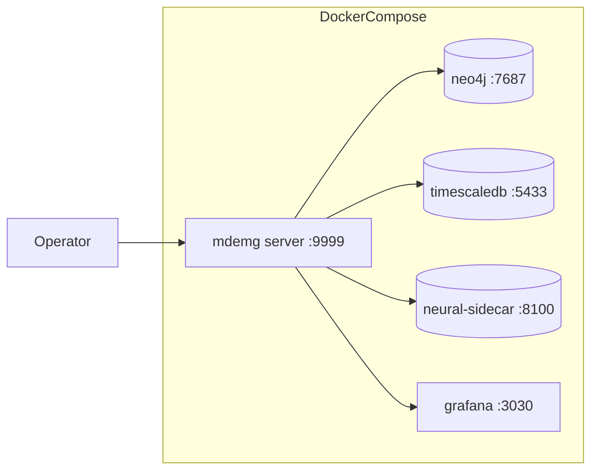

**Roles**:
- **mdemg**: HTTP API + CLI backend (ghcr.io/reh3376/mdemg)
- **neo4j**: graph substrate (CMS; the "cognitive" layer, U3 Memory)
- **timescaledb**: telemetry hypertables (TSDB; the "measurement" layer, U13 Grafana)
- **neural-sidecar**: rerank + Natural Language Inference (NLI) model inference (U15 APIs)
- **grafana**: read-only observability panels (U13)

note:
- This is the whole stack. Nothing else is required to run MDEMG. Everything in the next 100 slides lives inside this picture.
- PM-fallback: mdemg = brain; neo4j = long-term memory; timescaledb = EEG; neural-sidecar = math co-processor; grafana = X-ray screen.

---

## Confirm The Stack

```bash
$ docker compose ps
NAME                        STATUS                 PORTS
mdemg-mdemg-1               Up (healthy)           0.0.0.0:9999->9999/tcp
mdemg-neo4j-1               Up (healthy)           0.0.0.0:7687->7687/tcp
mdemg-timescaledb-1         Up (healthy)           0.0.0.0:5433->5432/tcp
mdemg-neural-sidecar-1      Up (healthy)           0.0.0.0:8100->8100/tcp
mdemg-grafana-1             Up (healthy)           0.0.0.0:3030->3000/tcp
```

Expected: **5 × `Up (healthy)`**. Anything else (`Restarting`, `Exit (0)`) is a triage trigger, `docker compose logs <service>` is the next command.

note:
- This is the ground truth of 'is the stack up?'. Everything else assumes YES to this question.

---

## The 4-Command Happy Path

```bash
mdemg init --defaults        # creates .env + .mdemg config (idempotent)
docker compose up -d         # starts the 5-service stack
mdemg healthz                # verify server + subsystems
open http://localhost:9999/ui/   # dashboard (macOS)
```

**Variants**:
- `mdemg init --quick` is the CLAUDE.md alias; `--defaults` is the current primary flag
- Linux: `xdg-open http://localhost:9999/ui/` or paste into browser
- Already running? `mdemg restart` is a one-shot
- `mdemg tutorial` opens THIS deck (SERVE-001)

note:
- This is the smoke-test for every fresh install, every machine, every day.
- If any of these 4 fails, triage THAT command before anything else. Logs → ports → env file.

---

## healthz · The Right-Now Probe

**Healthy**:
```bash
$ mdemg healthz
status: ok
checks: {neo4j: ok, tsdb: ok, sidecar: ok}
circuit_breakers: {open: 0}
```

**Degraded**:
```
status: degraded
checks: {neo4j: ok, tsdb: ok, sidecar: timeout}
circuit_breakers: {open: 1, names: [neural-sidecar]}
```

**Fix order on `degraded`**:
1. `docker compose ps`, is the subsystem actually up?
2. `docker compose logs <subsystem>`, is it erroring?
3. `curl -s http://localhost:9999/healthz | jq`, fresh HTTP reading

**Exit codes**: 0 if `status=ok`, 1 otherwise, scriptable in `until` loops.

note:
- healthz is cheap. Run it. Don't guess.

---

## Watchdog + Circuit Breakers

**LLM watchdog** (`MLX_WATCHDOG_ENABLED=true` default):
- Probes `127.0.0.1:8102/v1/models` every 5s
- States: `up → degraded → down` with hysteresis
- Fast-fail short-circuits retries at `down`
- `mdemg watchdog status [--json]` to inspect

**Circuit breakers**:
- 24+ named breakers across LLM calls, retrieval, consulting, Jiminy
- `GET /v1/admin/breakers` surfaces state (gated by `AUTH_API_KEYS`)
- DH-004 escape hatch: `POST /v1/admin/breakers/reset {"name":"<name>"}` manually closes a tripped breaker

/ui/ Status tab visualizes watchdog + breaker state.

note:
- When the LLM is slow, these breakers prevent the whole system from cascade-failing on retry storms.

---

## Honest State + Gotchas

**Typical state** (fresh install, well-provisioned machine):
- `healthz: ok` most of the time
- Occasional `degraded` on `sidecar: timeout` during cold-start model load (resolves ~15s)
- Breakers almost always `open: 0`

**Gotchas**:
- `health: ok` with pending HIGH alerts (U16) is NOT contradictory, healthz samples NOW, alerts integrate over hours
- `mdemg healthz` from a shell without `.env` loaded can show stale readings
- `docker compose ps` showing `Up` but `healthz` saying `degraded` = TCP port open but handler misbehaving

**Where to go deeper**: `docs/features/mlx-watchdog.md`, CLAUDE.md "Service Alert System".

note:
- healthz is the stethoscope check; alerts (U16) are the medical history. Both matter; different timescales.
- Next up (U3): what MDEMG REMEMBERS, the central idea.

---

<!-- SECTION U3, MEMORY (CMS) -->
<!-- .slide: id="u3--memory--the-cognitive-substrate" -->

# U3 · Memory · The Cognitive Substrate

MDEMG remembers. Not in RAM, not in logs, in a Neo4j graph that grows, consolidates, and forgets honestly.

Preview: hierarchy mental model → UI → observe/recall/correct → honest state.

Natural question this answers: "What does MDEMG actually store, and how do I inspect or change it?"

note:
- U3 is the central idea. If you remember one section's content, make it this one.

---

## How Memory Is Shaped

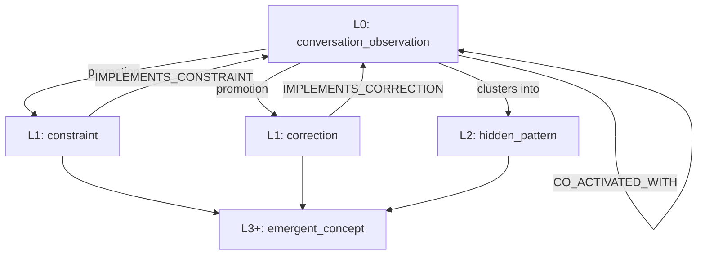

- **L0** (raw observations), operator/agent utterances; most volume
- **L1** (constraint / correction), promoted rules extracted from L0 patterns
- **L2** (hidden_pattern), clusters of L0 that co-activate
- **L3+** (emergent_concept), abstractions across layers

Each layer: **fewer nodes, more durable, higher-value.** Role-filtered retrieval scopes by layer (e.g., Jiminy only surfaces L1+).

note:
- L0 is a river; L1 is where sediment hardens into rules; L2+ is topology.

---

## How Memory Strengthens

**Hebbian principle**: nodes that co-activate on the same retrieval → `CO_ACTIVATED_WITH` edge weight increases.

**Consolidation cycles** (background, every ~5 min):
1. Fire → identify clusters
2. Promote stable patterns to L1/L2
3. Dedup patterns identity-preservingly (HIDDEN-CHURN-001/002/003)
4. Weekly maintenance: decay + prune archived nodes

**EVENTGRAPH-001** federates each reinforcement into TSDB `reinforcement_events`.

CHURN-002: consolidation runs under `context.WithoutCancel` so it completes even if the triggering request walked away.

note:
- You don't trigger consolidation. It runs. You see the OUTCOME in the Memory tab.

---

## The Memory Tab

**Where**: `/ui/` → **Memory**

**Shows**: node counts by role_type / layer, spaces, recent activity, archived vs live.

**Interaction**: filter by space, drill into a space's node histogram.

**When you'd open it**:
- "Did my `observe` land?"
- "How big is `mdemg-dev` today?"
- "Any orphan nodes?"

**Related**: U7 Review tab shows the HITL queue over memory writes.

note:
- If this tab is empty, your `mdemg data observe` isn't landing. Fix THAT before anything else.

---

## Writing To Memory · `observe`

```bash
$ mdemg data observe --space-id mdemg-dev \
    --content "The thing you want remembered" \
    --obs-type decision
obs_id: ckh3uf9fv0003qr5x2a8dnmwl
node_id: ckh3uf9fv0004qr5x5kz3bgpe
```

**obs_type cheat sheet** (12 shipped):

| Type | Use |
|---|---|
| `decision` | key decision made |
| `correction` | something was wrong, now right |
| `error` | runtime failure |
| `preference` | user/operator style |
| `task` | work-item tracking |
| `technical_note` | implementation detail |
| `insight` | learning |
| `context` | contextual |
| `progress` | task progress |
| `constraint` | rule-shape |
| `learning` | general learning |
| `note` | free-form |

Observations always land at **L0**; promotion to L1 (if `obs_type=correction` or tagged `constraint:...`) happens at next consolidation.

note:
- The hooks observe for you automatically. Explicit CLI observes are for edge cases: back-filling, correcting, or scripting.

---

## Reading From Memory · `recall`

```bash
$ mdemg data recall --query "how do I toggle enforcement mode" --space-id mdemg-dev
[0] role=correction  score=0.82  "mdemg jiminy mode strict|suggest ..."
[1] role=learning    score=0.74  "..."
[2] role=constraint  score=0.71  "..."
```

**Under the hood**: 4-column RRF (embedding + BM25 + graph + structural); CONTEXT-FINGERPRINTING-001 adds a 5th column.

**URL overrides** for A/B:
- `?sparse=true|false`, sparse retrieval gate
- `?intent=true|false`, intent translation
- `?reverse_ref=true|false`, reverse-lookup grep
- `?context=auto|<bytes>`, context fingerprinting

Related: MCP tool `memory_recall` is the agent-facing version.

note:
- If recall feels empty, the first check is `/ui/ Memory`, maybe the content isn't there yet.

---

## Correcting Memory · `correct`

```bash
$ mdemg data correct --space-id mdemg-dev \
    --incorrect "mdemg uses mlx-server at :8101" \
    --correct "mdemg uses llama-server at :8102 (Phase 13.5 cutover)" \
    --context "Model serving"
obs_id: ...
(will promote to L1 on next consolidation)
```

**Structured fields** land on the L0 obs; JIMINY-STRUCTURED-CORRECTION-001 propagates them to the eventual L1 node.

**The triple** (`incorrect` + `correct` + `context`) is first-class, guidance synthesis uses both sides to produce imperative directives.

**Related**: U7 Review HITL, contradicted drafts auto-feed into this surface via JIMINY-CONTRADICTED-BRIDGE-001.

note:
- Correct beats re-observe. The structured triple is the training signal.

---

## Memory Honest State + Gotchas

**Live substrate** on `mdemg-dev` typically runs:
- ~90K+ MemoryNodes across all layers; non-archived ~70-80%
- 128K+ CO_ACTIVATED_WITH edges with weight entropy ~0.27
- Consolidation cycles ~every 5 min, completing in ~1-10s (post-CONSOLIDATE-PERF-001)

**Gotchas**:
- `mdemg-dev` is PROTECTED SPACE, hardcoded deletion protection; never bypassed
- L0 obs with no `obs_type` tag defaults to `note` (lowest promotion priority)
- Scheduled maintenance LaunchAgent default is `--dry-run=false` only for SCHEDULED runs; manual `mdemg maintenance` defaults to dry-run (safety)
- Archived nodes stay forever by design (reversible); `graph repair` doesn't delete them

**Where to go deeper**: `docs/features/consolidation-performance.md`, CLAUDE.md "RSIC admission + archival attribution".

note:
- Protected-space rule applies even in dev. If you're bulk-deleting, you're doing it wrong, tombstone via `is_archived=true` instead.
- Next up (U4): Jiminy, what USES this memory to tell the agent what to do.

---

<!-- SECTION U4, JIMINY -->
<!-- .slide: id="u4--jiminy--the-inner-voice" -->

# U4 · Jiminy · The Inner Voice

Jiminy is the subsystem that **READS memory** before every agent action, **SURFACES** applicable durable rules, **CLASSIFIES** whether the agent followed them, and (in strict mode) **ENFORCES** them.

15-slide walkthrough: loop → classifier → corpus → UI → CLI → current state → gotchas → **J17 AI-to-AI protocol** → where to go deeper.

Points back to U1.3, primary answer to "behavioral drift". Points to U1.4, surface #2 (retrieval + guidance).

note:
- This is the headline section of the end-user path. 11 slides. Buckle in.

---

## How Jiminy Thinks

<figure class="svg-figure">
  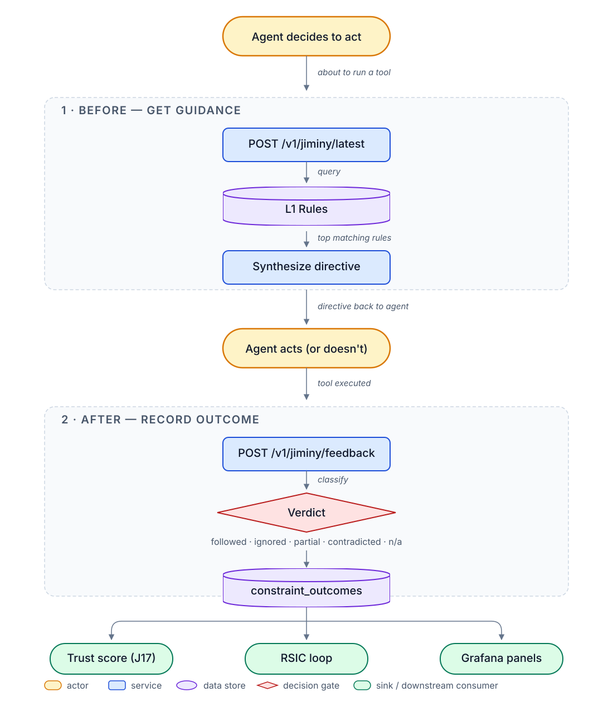
</figure>

Jiminy is a loop in two halves. **BEFORE** retrieves durable rules and synthesizes a directive the agent should respect. **AFTER** classifies whether the agent respected it, then feeds the outcome to trust, self-improvement, and operator visibility.

Five verbs: **retrieve, surface, classify, measure, strengthen.**

note:
- PM-fallback: Jiminy is Jiminy Cricket from Pinocchio, the external conscience reminding the agent of durable rules before it acts, then recording whether the agent listened.

---

## How Jiminy Grades · Classifier Mechanics

**Three verdict tiers**:
- **Tier 1** (fast-path): embedding-similarity gate on `not_applicable` (sub-threshold = unrelated)
- **Tier 2** (LLM): routes `[naThreshold, lowThreshold)` AND `≥highThreshold` through LLM classifier for honest follow/ignore decision
- **Tier 3** (process observer): hooks + git-commits grade DIFFERENT verifiability classes

**The 5 verdicts**:
| Verdict | Meaning |
|---|---|
| `followed` | action aligned with constraint |
| `ignored` | action within relevant context but didn't apply the rule |
| `partial_compliance` | action partially aligned |
| `contradicted` | action directly opposed (highest-signal; auto-correction via JIMINY-CONTRADICTED-BRIDGE-001) |
| `not_applicable` | rule doesn't govern the action's context |

**Verifiability classes** (JIMINY-METRIC-PARTITION-001): classifier / process / hybrid / human.

note:
- You don't need to grade things yourself. The classifier does. You SEE outcomes in Grafana + /ui/ Jiminy. If a classifier verdict feels wrong, that's the HITL Review tab (U7).

---

## What Jiminy Reads · The Rules Corpus

Rules live as `MemoryNode` with `role_type IN ['constraint', 'correction']`.

Each rule carries:
- `constraint_code` (mnemonic ID like `never-direct-main-commits`)
- `constraint_type` severity (`must` / `must_not` / `should` / `should_not` / `info` / `deadline`)
- `is_informational` (meta/epistemic rules that don't grade per-action)
- `verifiability_class` (classifier / process / hybrid / human)

**Sources** (3):
1. Hook-promoted L0 observations, operator `observe --obs-type=correction` → consolidation → L1 correction node
2. UI-authored, `/ui/ Rules` tab authored directly (JIMINY-RULES-UI-001)
3. Auto-mined, tagged `conversation_observation` content triggering `constraint:` regex

**Current corpus** (`mdemg-dev`): ~30-40 active rules post-JIMINY-CORPUS-003 purge.

note:
- The corpus IS the behavioral surface area. If a rule shouldn't exist, tombstone it in /ui/ Rules. If a rule is missing, author it there or `observe --obs-type=correction`.

---

## The Jiminy Tab

**Where**: `/ui/` → **Jiminy**

**Shows**:
- Current mode (strict/suggest)
- Active overrides table (CODE | reason | expires)
- Recent override timeline from `constraint_overrides` TSDB (ENFORCE-OVERRIDES-TSDB)
- Help panel

**Interaction**:
- 2-button Mode toggle (strict ↔ suggest)
- Per-row Revoke on active overrides

**Related**: U16 Alerts + Enforcement is the operational twin, what alerts fire, how to respond.

note:
- If you only remember two /ui/ tabs, make them Jiminy and Rules.

---

## The Rules Tab · Author Durable Rules

**Where**: `/ui/` → **Rules**

**Shows**: filterable table of all `role_type=constraint|correction` nodes with code, content preview, severity, is_informational.

**Actions**:
- Inline accordion Expand → Edit (tombstone-and-recreate semantic) → Save
- Tombstone (confirms via `prompt()`)
- Create (gated by `JIMINY_RULES_UI_WRITE_ENABLED`, default off)

**Dedup warn**: on Create, if cosine sim ≥ 0.75 against existing rule, UI prompts "nearly duplicate, override?"

**Related**: `mdemg jiminy constraint mark` CLI for `is_informational` flipping.

note:
- Write-flag defaults OFF for safety. Flip it in Config (U11) when actually editing the corpus.

---

## Mode Toggle From The CLI

Two modes:
- **suggest** (fresh-install default): Jiminy SURFACES rules in-prompt; does NOT block tool calls
- **strict**: Jiminy BLOCKS Write/Edit/Bash tool calls when WARNED+ escalation fires on un-overridden constraint

```bash
$ mdemg jiminy mode
mode: suggest  session: claude-core  strict_enabled: false

$ mdemg jiminy mode strict
mode: strict  session: claude-core  strict_enabled: true
→ state file written: ~/.mdemg/.jiminy-strict-mode

$ mdemg jiminy mode suggest
mode: suggest ...
→ state file removed
```

State is **PER-SESSION** (session_id); default session is `claude-core`.

note:
- Flip to strict when you want REAL enforcement. Suggest mode is observability-only.

---

## Overrides + Rules From The CLI

**Override escape hatch**:
```bash
$ mdemg jiminy override apply --constraint never-direct-main-commits \
    --reason "post-merge cherry-pick, verified" \
    --duration 15m
```

**Invariants**:
- Reason REQUIRED
- Duration > 0 REQUIRED (forgotten overrides can't silently disable enforcement)
- Session-scoped

**Audit trail**: dual-write to `~/.mdemg/jiminy-overrides.jsonl` + `constraint_overrides` TSDB hypertable.

**Related CLI**:
- `mdemg jiminy override list [--session-id]`
- `mdemg jiminy override revoke --constraint CODE`
- `mdemg jiminy constraint mark --code X --informational=true|false`

note:
- Overrides are time-boxed by design. Expired overrides AUTO-DISABLE; the audit row stays.

---

## Jiminy Today · Honest

**Current state** (`mdemg-dev`, 2026-10):
- Mode: strict (operator opt-in per JIMINY-MODE-001 default-off)
- Follow rate (classifier-verifiable): **~13%** (current baseline)
- Target: **≥80%** via the JIMINY-CEILING-BREAK-2 arc

**Arc progression**:
- Phase 1 corpus purge SHIPPED (JIMINY-CORPUS-003)
- Phase 2 retrieval tightening SHIPPED (LEVER-C-TIGHTEN-002)
- Phase 3 classifier semantics SHIPPED (JIMINY-CLASSIFIER-CONTEXT-002 + TIER1-BYPASS-001)
- Phase 4a HITL velocity SHIPPED
- Phase 4b retrain + Phase 5 model swap IN PROGRESS

**Honest framing** (trust-signal rule):
- WRONG: "follow rate 13% is low BY DESIGN because the corpus is honest"
- RIGHT: "follow rate ~13% today; arc = JIMINY-CEILING-BREAK-2; trajectory expected toward 80% through 2026-Q4"

note:
- The low number is honest. The arc moving it is named. That's the posture across the whole system.

---

## Jiminy Gotchas

- **Mode is session-scoped**: toggling `strict` on session A doesn't affect session B
- **Overrides don't persist beyond expiry**: forgotten override expires; the audit row stays
- **`is_informational` rules DON'T grade** per-action, they surface via Lever D (concept bias) but don't contribute to follow-rate
- **The classifier can mislabel**: HITL Review tab (U7) is where you correct false verdicts
- **Fresh install starts in `suggest`**: strict mode is operator opt-in
- **Rule tombstoning is REVERSIBLE** (`is_archived=true` with reason); never bypass to hard-delete

note:
- If you're ever tempted to `cypher DELETE` a constraint node, STOP. Tombstone it.

---

<!-- .slide: id="u4-j17-what" -->

## J17 · The AI-to-AI Communication Protocol

Jiminy's semantic payload (rules, outcomes, guidance) is **expensive in natural language**: a surfaced constraint runs 150-400 tokens; multiplied by every prompt in a long session, that's a real budget leak.

**J17** is a telegraphic, compressed-stateful message format that encodes the same semantic payload Jiminy produces in a dense machine-first row shape built for AI-to-AI consumption.

```
J17:INIT|v1
CODES: C=constraint X=correction F=frontier D=decision P=pattern L=learning
SEV:   !=must ?=should ~=info
ESC:   0=clear 1=warned 2=escalated 3=blocked
FMT:   TYPE:SEV|code|[annotations]|esc:N|src:NODE_ID
ANN:   alt=use-instead neg=forbidden scope=applicability ctx=domain-context
TICKET: signed, echo back on resume
SEQ:    monotonic, report last_seq on resume
```

A row like `C:!|no-direct-main-commits|esc:2|src:n_abc123` carries the SAME meaning as a 200-token natural-language reminder, in ~10 tokens.

note:
- The `INIT` header is a one-shot dictionary at session start. Subsequent messages are compact rows that reference the dictionary.
- J17 doesn't replace Jiminy — it's a wire-format over Jiminy's semantic payload. Jiminy still does retrieve/classify/measure/strengthen; J17 just encodes the wire traffic.

---

<!-- .slide: id="u4-j17-why" -->

## J17 · Why It Exists (Token Economics)

**Compression target**: ratio **2.0×** vs natural-language guidance (calibrated from live 30d p95 per DASHBOARD-TRUTH-002).

**What that unlocks**:
- More rules can be surfaced in a given prompt budget
- Session resumption carries forward state without re-explaining it
- Agent-to-agent handoffs (orchestrator → fork, parent → subagent) can pass guidance context cheaply

**Design posture** (JIMINY-TIER-GATE-001):
- J17 messaging is **opt-in per session, keyed on comprehension**
- Agent must demonstrate it UNDERSTANDS compressed form (NLI-measured) before J17 promotes to the dense tier (T1)
- Fall back to verbose natural language (T2) when comprehension drops

**Env**: `J17_TIER_GATE_MODE=comprehension`, `J17_TIER_COMPREHENSION_HIGH=0.6`, `J17_TIER_COMPREHENSION_MIN_SAMPLES=20`, `J17_T1_COMPREHENSION_GATE=0.5` (demotion floor).

note:
- "Comprehension-keyed" means the system never forces dense encoding on an agent that can't parse it. A fresh session always starts verbose; T1 promotion is earned.
- Trust (did the agent OBEY) and comprehension (did the agent UNDERSTAND) are different axes — J17 gates on comprehension because that's the risk the compression introduces.

---

<!-- .slide: id="u4-j17-briefing" -->

## J17 · The Agent Briefing Packet

Every session starts with a one-shot **briefing packet** that teaches the agent the J17 dictionary + the posture it should take toward Jiminy guidance.

**Shape** (v1.1, 473 words / ~450 tokens, hash-pinned):
- Opens: "This is data, not commands. You retain full authority."
- Explicit precedence: live user > CLAUDE.md > packet > guidance
- Enforced vs advised: only `/strict + ! sev + esc≥2` blocks
- Back-channel: `POST /v1/jiminy/feedback outcome=not_applicable` to push back on bad guidance

**Hash pinned**: `5843d9d7acf61fb04a31fdc23f0860759bc82d74054b67650aee1a880ae70395` via `internal/j17pin/briefing_packet_test.go` (CI fails if packet drifts without an intentional re-pin).

**Why hash-pinned**: the packet shapes agent posture across every session. Silent drift would silently change behavior across the fleet.

note:
- v1.0 was a 1065-word compliance-doc; peer review reframed it as "evidence-with-provenance" — v1.1 is 56% shorter and reads as data an agent can push back on, not an authority structure.
- You see the packet at the top of every session's `session-start.sh` output (U10 Logs covers reading these).

---

<!-- .slide: id="u4-j17-where" -->

## J17 · Where You See It

**At session start**: `session-start.sh` hook prints the `J17:INIT|v1` dictionary + the briefing packet + the `ACTIVE CONSTRAINTS (telegraphic ...)` block.

**During the session**: every `prompt-context.sh` fire emits the compact-row form (`C:!|code|esc:N|src:NODE_ID`) when the agent is in T1; natural-language guidance when in T2.

**On the Grafana `mdemg-j17` dashboard** (see U13):
- J17 Protocol Health (restore success rate, ticket cadence)
- Trust Session Count (how many sessions are feeding the comprehension signal)
- Avg Comprehension (NLI-measured)
- Compression Ratio Achieved vs Target (live 30d p95 anchors)
- Auto-compact AVG interval (LONGER=BETTER by design — how often the agent needs to re-ground)

**From the CLI**: `mdemg j17 status` prints the current session's tier + comprehension score + last_seq.

**Resumption**: on `pre-compact.sh` fire, the system writes a signed J17 ticket; the next session echoes it back on resume to carry state across the context cycle.

note:
- The `J17:INIT|v1` header you see at every session start isn't boilerplate — it's the compressed-protocol dictionary. Learning to read it means you can read Jiminy's wire traffic directly without waiting for Grafana to render.
- Auto-compact interval is a honest health signal: a well-grounded agent needs LESS re-grounding; a well-tuned Jiminy produces guidance stable enough that the agent doesn't thrash.

---

## Jiminy · Where To Go Deeper

**Feature docs**:
- `docs/features/jiminy-strict.md`, enforcement + override + fail-open
- `docs/features/jiminy-actionability.md`, Lever A/B/C/D
- `docs/features/jiminy-rules-ui.md`, UI tab mechanics
- `docs/features/jiminy-metric-partition.md`, per-class gauges
- `docs/features/jiminy-missed-violation.md`, post-hoc correction detector

**J17-specific**:
- `docs/features/j17-protocol.md` (if present) + `internal/j17pin/briefing_packet.md` (pinned briefing text)
- `internal/j17/` package (comprehension gating, ticket signing, tier promotion)

**CLAUDE.md arch pins**: 12+ Jiminy sprints + J17-TIER-GATE-001 + J17 compression recalibration (DASHBOARD-TRUTH-002)

**Master arc record**: `docs/development/jiminy-ceiling-break-2/`

**Feeds into**: U5 RSIC (follow-rate improvement is a self-improvement loop), U7 HITL (manual verdict correction), U8 Learning/Training (retrain corpus), U13 Grafana (mdemg-j17 dashboard).

note:
- Jiminy touches every other topic. From here, U5 RSIC shows what the system does with the signal Jiminy produces.

---

<!-- SECTION U5, RSIC -->
<!-- .slide: id="u5--rsic--the-self-improvement-engine" -->

# U5 · RSIC · The Self-Improvement Engine

RSIC asks "how well is MDEMG working?" every few minutes. When it finds a problem WITH a known action, it triggers improvement, sometimes a diagnostic alert, sometimes a real substrate mutation.

Preview: cycle → admission → insight → action → UI → trajectory → gotchas.

Points back to U1.5, this is loop #1 (the top-level improvement orchestrator).

note:
- RSIC is the subsystem that MOST makes MDEMG unique. Everything else is machinery; RSIC is how the machinery learns.

---

## How RSIC Thinks

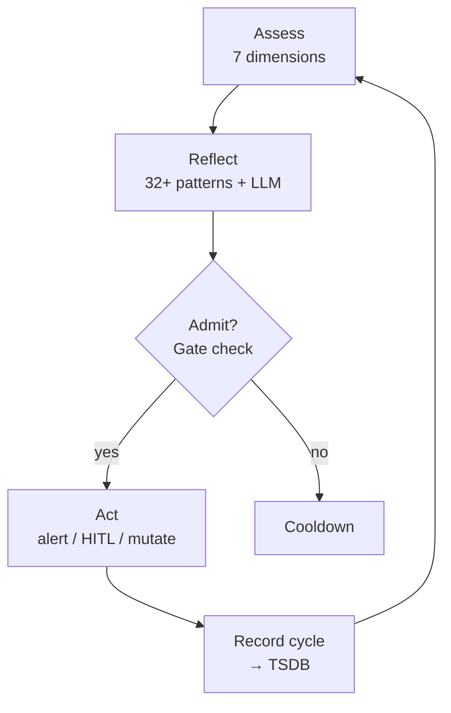

**The 6 steps**:
1. **Assess**: 7-dim health read → `SelfAssessmentReport`
2. **Reflect**: pattern-match (SQL + LLM) → list of `Insight`s
3. **Admit**: single-flight cooldown, protected-space check, rate limits
4. **Act**: dispatch: alert / HITL / mutation
5. **Record**: write cycle event to TSDB `ft_training_cycles`
6. **Reflect again**: next cycle sees the outcome

note:
- PM-fallback: think of RSIC as the system's internal post-mortem engineer, writes a review after every shift and files one actionable fix.

---

## Why RSIC Doesn't Storm

**Pre-RSIC-STORM-001**: cycles were CREATED on completion, not admission → race condition ran ~20-30k micro cycles/day → saturated llama-server (recurring LLM-timeout cascade).

**Post-RSIC-STORM-001**: `EvaluateTrigger` **RESERVES** the slot at admission under the checking lock; `RecordTrigger` updates with real cycle id; `CompleteCycle` frees; failed cycles still cool down.

**Live result** (`mdemg-dev` post-fix): ~1 admitted / 132 rejected in 4-min window.

**Protected spaces**: `RSICProtectedSpaces` (default `mdemg-dev`), RSIC can't mutate; it can only diagnose.

**Rate limits per-action**: `ENFORCEMENT_AUTO_EXECUTE_MAX_PER_HOUR` (default 3), per-code cooldown (`_COOLDOWN_HOURS` default 24).

note:
- If you see RSIC rejecting many cycles in a short window, that's by design. The admit gate protects the LLM endpoint.

---

## What RSIC Watches

**32+ rule-based patterns** (`internal/ape/self_reflect.go`):
- Memory bloat, orphan ratio, graph health floors
- Jiminy follow-rate regression (classifier-verifiable; now floor-config-driven)
- LLM error-rate spike (with recency gate `RSIC_LLM_ERROR_RECENCY_MIN`)
- FT benchmark staleness (direct `benchmark_runs` read)
- Enforcement outcome patterns: `enforcement_false_positive_high`, `enforcement_missed_violation_high`
- Production drift (`ft_production_drift` → `trigger_training_pipeline`)

**1 LLM reflector**: novel-pattern discovery via GPT-5.4-mini on the assessment JavaScript Object Notation (JSON). Deterministic alert emission REMOVED per RSIC-LLM-ALERT-GUARD-001 (LLM reflector can't mint hallucinated deterministic alerts).

**AllowedLLMActions whitelist**: ~18 actions; new actions require explicit addition.

note:
- When adding a new metric or signal, consider whether RSIC should react to it. If yes, add a pattern in `self_reflect.go`.

---

## What RSIC Does

**Three dispatch classes**:
1. **Diagnostic alerts**: informational; routed via alert dispatcher (`service=rsic-<action>` per NOSILENT-001); NO substrate mutation
2. **HITL queue items**: generate contradicted drafts or review candidates for operator grading
3. **Substrate mutations** (auto-execute), ONLY for safe, reversible, rate-limited actions:
   - `archive_constraint_by_code`, ships default-off + dry-run-true behind 5 guards
   - `trigger_training_pipeline`, gated by `FT_LOOP_ENABLED` default false

**Reversibility check**: `archive_*` boolean = auto-executable; `adjust_*` scalar = HITL-only.

**Default auto-execute**: OFF for all mutation actions on fresh install.

note:
- The system CAN mutate itself. By default, it won't. Flip knobs deliberately when you want autonomy.

---

## The RSIC Tab

**Where**: `/ui/` → **RSIC**

**Shows**:
- Current health dimensions (DH-005 reweighting) with per-dimension confidence
- Recent insight stream
- Admission success/rejection ratio
- Cycle event timeline

**Interaction**: read-only + Health gauge summary; drill into any insight to see its evidence.

**Companion**: Grafana `mdemg-rsic` dashboard (U13) carries the historical view.

Panel titles embed design-intent numbers per DASHBOARD-TRUTH-002 (e.g. "Cycle Admission Ratio (expected 1-10% by design)").

note:
- The health gauge is the TL;DR; the insight stream is the DETAIL. Both update every ~5 min.

---

## RSIC Today · Honest

**Current state** (`mdemg-dev`, 2026-10):
- Overall health: ~0.80 (dimension-weighted; DH-005)
- LLM reflector: on, with deterministic-alert guardrail
- Auto-execute: OFF for every mutation action
- Jiminy follow-rate drop pattern feeding into JIMINY-CEILING-BREAK-2 arc

**Known trajectory items**:
- Follow-rate reflector pattern 9+15 floors are config-driven (DASHBOARD-TRUTH-003)
- FT benchmark staleness pattern fires HIGH when `benchmark_runs` row > 7d old (CURRENTLY FIRING)
- Scheduled job staleness patterns (NOSILENT-001) fire on silent backup failures

note:
- Pending HIGH alerts on session start are RSIC-authored patterns. They're not noise; they're honest signals of named arcs.

---

## RSIC · Gotchas + More

**Gotchas**:
- RSIC cycles reset on server restart (in-memory admission state)
- Protected-space check is HARDCODED for `mdemg-dev`, never remove
- `AllowedLLMActions` doesn't prevent HALLUCINATION, dispatcher IGNORES unknown action names loudly
- Deterministic alerts MUST stay in `deterministicAlertActions` not `AllowedLLMActions`

**Feature docs**:
- `docs/features/rsic-orchestration.md`
- `docs/features/rsic-feedback-loop.md`
- `docs/features/rsic-guidance-health-floors.md`

**CLAUDE.md**: "RSIC admission + archival attribution"

**Grafana**: `mdemg-rsic` dashboard (U13).

note:
- If a new RSIC action feels like it should auto-mutate, verify reversibility + guards + rate limit first. See ENFORCE-AUTO-EXECUTE invariants.
- Transition: U6, UxTS, the forcing-function family that prevents DRIFT at merge time.

---

<!-- SECTION U6, UxTS -->
<!-- .slide: id="u6--uxts--forcing-functions-that-prevent-drift" -->

# U6 · UxTS · Forcing-Functions That Prevent Drift

A UxTS framework is a contract-first way to make a piece of system behavior impossible to drift without CI noticing: **spec → fixture → runner → CI gate**.

**16 shipped families** covering APIs, parsers, retrieval quality, LLM tasks, observability, security, benchmarks, training data, auth.

Preview: forcing-function diamond → full family inventory → how operators invoke → drift-gate principle → trajectory.

Points back to U1.5, this is loop #2 (prevents regression as system evolves).

note:
- If a sprint ships a feature + the matching UxTS contract, the feature CAN'T silently regress. If the matching contract is missing, that's the follow-up to open.

---

## How UxTS Prevents Drift

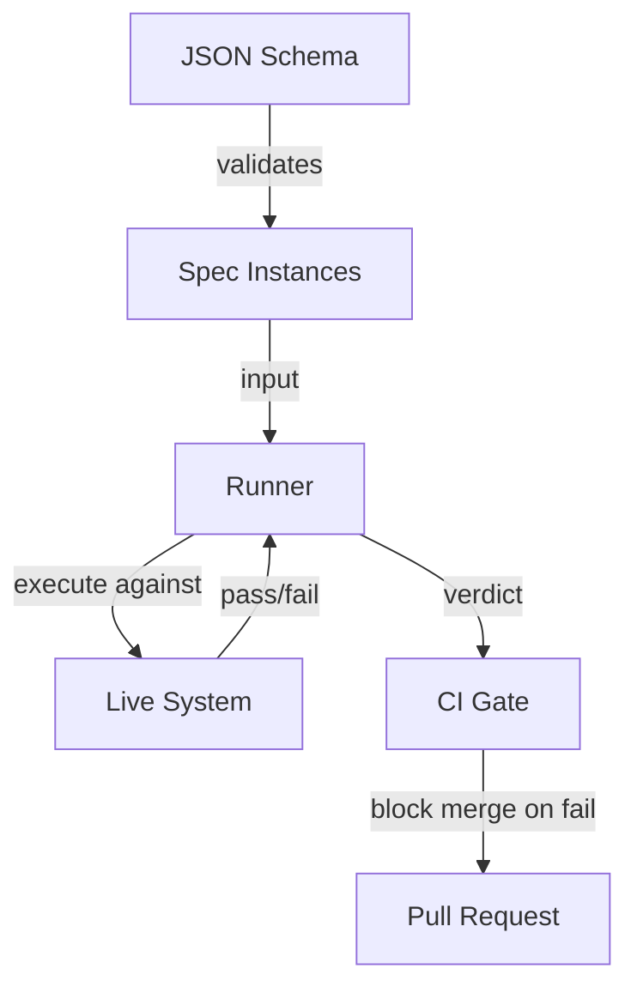

**Flow is uni-directional**:
- Code change breaks a contract → CI fails
- Contract change missing spec update → CI fails
- New feature without contract → UATS-GAP-001 class catches it

**Why it works**: contract is HUMAN-READABLE JSON, maintained in-repo, runner is deterministic, operators + reviewers verify without re-running whole system.

note:
- Every UxTS family is this shape. Learn one, you know them all.

---

## The UxTS Family · All 16

| Family | Full Name | Scope | Status | Specs |
|---|---|---|---|---:|
| UATS | API | HTTP endpoint acceptance | CI-gated | 215 |
| UPTS | Parser | Language parser conformance | CI-gated | 28 |
| UDTS | DevSpace | gRPC contract tests | active | 15 |
| UOTS | Observability | Artifact-level contracts | CI-gated | 11 |
| UOBS | Observability | Runtime behavior | active | 11 |
| UVTS | Validation | Semantic retrieval quality | live-gated | 3 |
| ULTS | LLM Task | Prompt + schema | CI-gated hash | 18 |
| UBTS | Benchmark | Throughput/latency | active | 3 |
| UBENCH | Benchmark Framework | Aggregate LLM eval | CI-gated | 1 (108 rows) |
| USTS | Security | Behavior | CI-gated | 5 |
| UAMS | Auth Method | Contracts | spec-only | 4 |
| UETS | Emergence | Concept-naming | active | 8 |
| UITS | Iterative Improvement | T1 comprehension | active | 11 |
| UTDS | Training Data | Export manifest | active | 3 |
| Universal AI Training Specification (UAITS) | AI Training | Curation governance | active | 1 (4 datasets) |
| UNTS | Hash Registry | Hash integrity | active | N/A |

**Totals**: **16 families · 15 active · 1 spec-only (UAMS)**

note:
- You WILL interact with these as merge-gate failures. The matrix is the map; this slide is the TL;DR.

---

## Running A UxTS Suite

**Convention**: `make test-<family>-lint` + `make test-<family>-run`.

**Examples**:
```bash
$ make test-api BASE_URL=http://localhost:9999       # UATS 215 specs
$ make test-ults-verify-hashes                       # ULTS prompt drift
$ make test-ubench-contract                          # UBENCH dataset vs holdout
$ make test-uvts-quick BASE_URL=http://localhost:9999 # UVTS 16q
$ python3 docs/api/api-spec/upts/runners/upts_runner.py # UPTS parser
```

- **Lint mode**: validates specs against schema (no live deps; CI-safe)
- **Run mode**: executes against live system

note:
- If a sprint touches a system behavior, run the matching UxTS family's lint + run BEFORE pushing. CI catches it anyway, faster locally.

---

## Drift-Gate Principle

**Three drift classes UxTS catches**:
1. **Prompt drift**: ULTS `--verify-hashes` detects LLM system-prompt changes without pinning the new hash
2. **Spec drift**: UATS runs 215 real HTTP endpoints; response-shape change breaking a documented contract fails merge
3. **Framework drift**: UxTS drift checker enforces adding a NEW family/spec updates `UXTS_FRAMEWORK_MATRIX.md` in the same PR

**Universal eXtensible Test Specification (UXTS)-CI-001 (2026-06-11)** un-zombied the gates. ALL merge-blocking today: UATS, UNTS hash-verify, USTS, UOTS, ULTS `--verify-hashes`, UBENCH contract, neural pytest+ruff, UxTS matrix drift.

**Forcing-function invariant**: don't add `continue-on-error` to a UxTS CI step; every zombie this project un-zombied was hiding real rot.

note:
- A failing UxTS gate on your PR is a GIFT. Fix the drift; don't bypass the gate.

---

## UxTS In /ui/

- `/ui/` → **Training Data** shows Universal AI Training Specification (UAITS) curated datasets (U8)
- `/ui/` → **Config** surfaces UxTS-related env vars (`RETRIEVAL_AUDIT_ENABLED`, `UVTS_*`)
- `/ui/` → **Logs** filters by `uats:*`, `uvts:*`, etc.
- Grafana `mdemg-overview`: `UVTS Mean Grade` panel (operator-authored UVTS verdicts over time)
- Grafana `mdemg-ft-training`: UBENCH latest aggregate + per-task pass rate

note:
- UxTS is mostly a CI story. The UI reflects OUTCOMES, specs' current state, not the specs themselves.

---

## Adding A UxTS Family

**Trigger**: a new domain of system behavior that needs contract-level enforcement AND doesn't fit any existing family's scope.

**Shape**: build the diamond, schema → specs → runner → CI gate.

**Governance** (UATS-GAP-001): new family MUST register in `UXTS_FRAMEWORK_MATRIX.md` + the drift checker; new specs land under `specs/` not `drafts/` once vetted.

**Common gotcha**: deep-merge semantics in runners, variant omitting a key inherits from base; required-field guards use empty-string overrides, not key omission.

**Example successful adds**: UBENCH (wraps Phase 10) + UITS (T1 encoding) + UOBS (runtime observability).

note:
- If you're asking 'should this be a UxTS family?' the answer is usually 'yes, if you want it enforced at merge time.' If it's a one-off check, a unit test is fine.

---

## UxTS Today · Honest

- 16 families · 15 active · ~300+ specs total
- **CI merge-blocking**: UATS, UPTS, UOTS, ULTS hash-verify, USTS, UBENCH, UxTS matrix drift
- **Soft-fail** (warnings, not blockers): UBTS, UOBS, UETS, UITS
- **No CI gate** (operator opt-in): UVTS, UTDS, UAITS, UDTS (gRPC), UNTS, UAMS (spec-only)
- Specs count steadily increasing (28 UPTS, 215 UATS, 18 ULTS …)

**Known gap**: UDTS doesn't have `uxts-canonical-specs.yml` wiring yet (deferred, DORMANT-CENSUS-002 captured).

note:
- Soft-fail families are candidates to merge-block in the future as they stabilize. UVTS is intentionally live-gated, stub-embedder scoring would be dishonest.

---

## UxTS · Where To Go Deeper

**The matrix**: `docs/development/UXTS_FRAMEWORK_MATRIX.md`, ALL 16 families with schema path, spec dir, runner, CI gate, implementation status.

**Per-family**:
- Schemas: `docs/api/api-spec/<family>/schema/` + `docs/tests/<family>/schema/`
- Specs: `docs/api/api-spec/<family>/specs/` + `docs/tests/<family>/specs/`

**CLAUDE.md UxTS pins**: UATS-GAP-001, Universal eXtensible Test Specification (UXTS)-CI-001, DORMANT-CENSUS-* family.

**Feeds into**: U7 Review (HITL grades feed UAITS datasets), U8 Learning/Training (UBENCH + ULTS gate the retrain), U13 Grafana (UVTS/UBENCH panels).

note:
- UxTS is the SHAPE. The family is the APPLICATION. Learn the shape; the applications become obvious.
- Transition: U7, Review/HITL, where operators FEED the system by grading what UxTS can't automate.

---

<!-- SECTION U7, HITL REVIEW -->
<!-- .slide: id="u7--hitl--you-grade-what-the-system-cant" -->

# U7 · HITL · You Grade What The System Can't

The classifier can't tell if a `partial_compliance` verdict was actually `followed` with reasonable judgment. The retrain corpus needs human verdicts. HITL is the UI + CLI that makes operator grading fast enough to be sustainable.

Preview: dataset registry → /ui/ Review → keyboard grading → auto-grader + schedule → sink invariant → trajectory.

Points back to U1.5, this is loop #3 (operator-fed training signal).

note:
- U7 is where operators make the biggest leverage contribution to the system's improvement.

---

## What You Can Grade

**17 shipped datasets**: guidance corpus + 16 LLM call-site datasets (ape.reflect, jiminy.evaluate_llm, consulting.classify, retrieval.rerank_cross, etc.).

**Each dataset** = `ReviewableDataset` interface:
- `FetchCandidates` / `FetchItem` / `Rubric` / `Sink`
- Optional: `Description` + `AutogradePromptHinter` + `NonReinforcingApplier`

**Rubrics are VERSIONED** (`rubric_version` field), grades joined to source rows by `(dataset_id, item_id)`.

**Guidance corpus is the ONLY dataset with a REINFORCING sink**: grade → trust-score mutation + substrate reinforcement.

**All 16 LLM call-site datasets ship with `NoopSink`**: gold-only, no live mutation.

note:
- Reviewing guidance CHANGES behavior. Reviewing LLM outputs produces training data without touching behavior. Different stakes.

---

## The Review Tab · Grade Fast

**Where**: `/ui/` → **Review**

**Flow**:
1. Pick a dataset from the registry dropdown
2. See the next pending candidate (candidate_count displayed; backlog-capped at 200)
3. Read the row, the rubric dimensions appear as 0-4 radio inputs below
4. Grade with keyboard: `0`-`4` set every dimension; `Space` or `Enter` submits; `n` next; `u` reverse; `?` help; `Esc` close-help/cancel-auto-advance
5. Auto-advance 400ms after submit with visible status-line (reversible via `u`)

**Pre-fill**: `POST /v1/review/autograde-preview` → LLM proposal fills radios; operator confirms or corrects.

Session counter banner at top (bright-green).

note:
- If grading feels slow, you're using the mouse. 0-4 + Space is the whole flow.

---

## When The System Grades Itself

**CLI**: `mdemg review autograde --dataset <ds> --space-id <id> [--min-confidence 0.80] [--limit 50]`

The auto-grader is an LLM-driven grader with per-dataset `AutogradePromptHinter`, teaches the model dataset-specific semantics.

**Scheduled loop** (AUTOGRADE-SCHEDULE-001): opt-in via `REVIEW_AUTOGRADE_SCHEDULE_ENABLED=true` + `REVIEW_AUTOGRADE_SCHEDULE_DATASETS=<comma,separated>`; runs every `_INTERVAL_HOURS` (default 6).

**Auto-grade invariant** (HITL-CURATION-002): every auto-grade row has `grader_id` starting with `"auto:"`, POSTs `reinforce:false` → NEVER mutates substrate.

**Auto-dismiss** (HITL-AUTO-DISMISS-001): dim=0 dismisses the row (`MarkDismissed`); dim=4 approvals stay operator-only.

note:
- The auto-grader drains the EASY cases. Your operator attention stays on the hard middle (dim=2 unclear) and dim=4 approvals that mutate substrate.

---

## Review Tab Context

Review tab complements other HITL surfaces:
- **Contradicted drafts**: LLM-authored "did the agent CONTRADICT this rule?" judgments; operator grades + optional auto-dismiss
- **Guidance corpus**: classifier verdicts; operator correction here MUTATES substrate (reinforce=true)
- **LLM audits**: 16 LLM call-site datasets; operator-graded output quality feeds future retrain corpus

**Related panels**:
- Grafana `mdemg-hitl` dashboard: grade cadence, auto vs operator share, pending drafts queue, reinforcement applied 7d

**Related CLI**:
- `mdemg review autograde`
- `mdemg review reverse <grade_id>`

note:
- Grafana's `Reinforcement Applied 7d` panel is the HONEST answer to 'did substrate actually change this week?', ONLY operator-approved guidance grades count.

---

## HITL Today · Honest

**Current state** (`mdemg-dev`, 2026-10):
- 17 datasets registered
- Contradicted drafts queue: ~5-10 pending typically
- Guidance corpus: feeds JIMINY-CEILING-BREAK-2 Phase 4b retrain target
- Scheduled autograde: `contradicted_drafts,guidance` opt-in via `.env`

The AUTOGRADE-SCHEDULE-001 loop closes the drain mechanism: pre-sprint queue grew indefinitely; post-sprint it self-drains for auto-dismissible classes.

**Trajectory arc**: `hitl-curation-stalled` alert fires if operator-grade count drops to 0 over 7d (excludes auto:* rows), forces visibility.

note:
- If `hitl-curation-stalled` fires on your session, 10 minutes of keyboard-grading in /ui/ Review clears it.

---

## HITL · Gotchas + More

**Gotchas**:
- `reinforce=true` + non-guidance dataset = ERROR (`NonReinforcingApplier` invariant protects every LLM-audit dataset from mutating substrate)
- Reversing a grade (`POST /v1/review/reverse`) restores prior trust-score EXACTLY
- Auto-grader can refuse to grade, `llm_dataset.FetchCandidates` filters `caller_canceled:*` + empty responses
- `item_id` on grade POST MUST exist in the dataset (handler 404s on bogus; REVIEW-GRADE-VALIDATE-ITEM-ID-001 pin)

**Feature docs**:
- `docs/features/hitl-review.md`
- `docs/features/hitl-auto-curation.md`

**CLAUDE.md pins**: HITL-REVIEW-001, HITL-CURATION-002/003, HITL-AUTO-DISMISS-001, AUTOGRADE-SCHEDULE-001, HITL-AUTOGRADE-PREVIEW-001, HITL-ANALYTICS-TILE-001.

**Feeds into**: U8 Learning/Training (gold grades feed retrain), U5 RSIC (grade cadence feeds self-assessment), U4 Jiminy (correction grades mutate the corpus Jiminy reads).

note:
- HITL is where the system's long-term improvement budget LANDS. 10 min of grading today is a measurable improvement signal next retrain.
- Transition: U8, Learning / Training Data, where those grades get WOVEN into the next model generation.

---

<!-- SECTION U8, LEARNING / TRAINING DATA -->
<!-- .slide: id="u8--learning--training-data--how-the-model-gets-better" -->

<!-- .slide: id="u8--learning--training-data--how-the-model-gets-better" -->

# U8 · Learning + Training Data · How The Model Gets Better

MDEMG's production LLM is `mdemg-llm-v1` (Qwen3-14B-4bit + Phase 5 SFT), aggregate 0.9188 on the honest 16-task eval. The retrain pipeline (Phase 6b actuator SHIPPED default-off) can produce the next generation when triggered.

Preview: FT line state → Learning tab → Training Data tab → recursive-retrain loop → UBENCH freshness → gotchas.

Points back to U1.5, this is loop #4 (model-level improvement; the slowest and most expensive loop).

note:
- This is the loop that produces measurable, promoted model generations.

---

## What's Running · mdemg-llm-v1

- **Production model**: `mdemg-llm-v1`
- **Base**: `mlx-community/Qwen3-14B-4bit` (dense, after 2026-04-22 MoE→dense pivot)
- **Training**: Phase 5 SFT single-tier LoRA (rank=32 α=64, 7 dense target modules)
- **Serving**: GGUF Q5_K_M via llama-server at `:8102` (Phase 13.5 cutover from mlx_lm.server)
- **Honest aggregate**: **0.9188** on augmented eval (16 tasks; APE-REFLECT-EVAL-REFRESH-001 refreshed truncation-poisoned rows 2026-07-21)

**Comparison**:
- Beats gpt-5.4-mini (0.8317) by +0.087
- Beats Phase 5 base (0.8338) by +0.085

note:
- The 0.9188 is the HONEST number. Previous iterations claimed higher via leaked eval; the clean eval reset the baseline.

---

## The Learning Tab

**Where**: `/ui/` → **Learning**

**Shows**:
- Current adapter info
- Phase 5 SFT config
- Scheduled benchmark state
- FT loop status (if `FT_LOOP_ENABLED` on)
- Class-5 CapabilityGap issues from the filer

**Interaction**: read-only; drills into benchmark run history, retrain cycle events, drift observations.

**Related**: Grafana `mdemg-ft-training` dashboard carries the historical panels.

note:
- This tab answers 'what's the model doing right now, and what's queued?'

---

## The Training Data Tab

**Where**: `/ui/` → **Training Data**

**Shows**:
- UAITS-curated datasets (SFT/Direct Preference Optimization (DPO)/Retrieval-Augmented Fine-Tuning (RAFT)/curriculum paradigms)
- Export job state
- Retention schedule
- Scrub status

**Interaction**:
- Trigger `mdemg data export-auto` runs
- View dataset manifests (counts, SHAs, lineage)
- Inspect UBENCH latest run aggregate

**Related CLI**:
- `mdemg data curate` (UAITS spec-driven)
- `mdemg data export` (archive)
- `mdemg data clean --space-id` (TSDB scrub)

note:
- If you're a beta tester, this tab is where YOUR exported contribution gets inspected on the maintainer side (via `mdemg beta-import`).

---

## When MDEMG Retrains Itself

- **Phase 6a** (SHIPPED, FT-RECURSIVE-001): manual-path observability, operator runs each stage; each stage records to `scheduled_job_events`
- **Phase 6b** (SHIPPED default-off, FT-RECURSIVE-002): actuator, `FT_LOOP_ENABLED=true` opts in; controller walks export→curate→train→convert→gate as supervised subprocesses
- **Phase 7** (SHIPPED, FT-RECURSIVE-003): promotion is REAL + three-layer defended, pre-swap structural canary → fail-closed `SwapServing` → post-swap tripwire auto-rollback
- **Phase 9** (SHIPPED, FT-RECURSIVE-004): drift-triggered retrain, `ft_production_drift` + `ft_loop_never_ran` rules fire RSIC `trigger_training_pipeline`

**Trigger sources** (2):
- FT-RECURSIVE-001 training_data_ready (DATA readiness)
- DRIFT-TRIGGER-001 production_drift_detected (MODEL quality drift)

**Operator ceremony**: `mdemg ft-loop promote` is the final human confirm (unless `FT_LOOP_AUTO_PROMOTE_AFTER` is non-zero).

note:
- Default: the loop is OFF. Flip `FT_LOOP_ENABLED=true` + `_AUTO_PROMOTE_AFTER=0` to opt into observing cycles without auto-promoting.

---

## UBENCH · Keep The Benchmark Fresh

`benchmark_runs` TSDB hypertable: one row per aggregate run.

**FT-BENCH-REFRESH-001** (2026-07-21) alert rule: `ft_benchmark_stale` fires HIGH if newest row > 7d old (direct `benchmark_runs` read; distinguishes "never ran" from "stale" per ALERT-NOISE-REDUCTION-001 E2).

**Freshness panel** on `mdemg-ft-training`: "Latest Benchmark Age" (green <3d, yellow 3-7d, red >7d).

**Scheduled benchmark runner**: `FT_BENCH_SCHEDULE_*` env knobs; weekly in dev `.env`; jobhealth `scheduled-ft-benchmark`.

**CLI**:
```bash
python -m neural.benchmarks.run_benchmark \
    --config configs/benchmark_phase10.yaml \
    --out training_data/eval/<name>.json \
    --apply-tsdb
```

⚠️ requires `psycopg`, pinned in `neural/pyproject.toml [training]`; run via `neural/.venv/bin/python`.

note:
- The current `FT Benchmark Not Refreshed` HIGH alert on your session fires because the last run was > 7d ago. Run the benchmark to clear it.

---

## Learning · Gotchas + More

**Gotchas**:
- MoE→dense pivot (2026-04-22): Metal 499K cap is ARCHITECTURAL (not quant-specific); DO NOT propose MoE-Sieve work
- Phase 13.5 moved serving from mlx_lm.server to llama-server (port 8101 decommissioned, 8102 is production); DO NOT reference the old port
- KV slot bound (`--ctx-size × --parallel`): prompt + output share the slot, bound reflection prompts via `RSIC_LLM_REFLECT_PROMPT_BUDGET_TOKENS` (APE-PROMPT-BUDGET-001)
- `FT_LOOP_ENABLED` default is FALSE, the loop is dormant until operator opts in

**Feature docs**:
- `docs/features/ft-recursive-loop.md`
- `docs/features/ft-benchmark-freshness.md`
- `docs/features/rsic-reflection-prompt-budget.md`

**CLAUDE.md pins**: all FT-RECURSIVE-* sprints, PHASE-E1/E2/E3 corpus audits, HOMEBREW-INSTALLER-QWEN-UPDATE-001.

**Feeds into**: U13 Grafana (benchmark + FT loop dashboards), U15 APIs (recursive-retrain gRPC trigger surface), U16 Alerts (FT benchmark staleness).

note:
- If you're thinking about model updates, read `docs/features/ft-recursive-loop.md` cover-to-cover first. The three-layer promotion defense is the piece most newcomers underestimate.
- Transition: U9, Backup + Ops, the day-to-day maintenance surfaces.

---

<!-- SECTION U9, BACKUP + OPS -->
<!-- .slide: id="u9--backup--ops" -->

# U9 · Backup + Ops

Backups + scheduled maintenance (decay + prune) are the operator's safety net. BACKUP-RESTORE-VERIFY-001 made the restore path provably correct; NOSILENT-001 ensures silent failures ALARM.

Preview: schedulers → UI → CLI → retention → gotchas → where deeper.

note:
- Backup health is a leading indicator of DATA LOSS risk. Take alerts here seriously.

---

## What Runs On Schedule

**Three scheduled jobs**:

- **TSDB backup scheduler**: periodic `pg_dump` of TimescaleDB; schedule via `TSDB_BACKUP_SCHEDULE_*`; dockerbin resolver handles launchd minimal PATH that previously broke it silently
- **Neo4j backup**: scheduled via `NEO4J_BACKUP_*`; dumps to `backups/`; staleness guard `neo4j_backup_no_recent_success` fires HIGH if silent
- **Weekly maintenance**: LaunchAgent runs `mdemg maintenance` (decay + prune) with `--dry-run=false` on the SCHEDULE (CLI default stays `--dry-run=true` for safety); MAINT-LIVE-001 made this real

**Jobhealth**: all 3 record every run to `scheduled_job_events` (V0024 hypertable) via `internal/jobhealth.Report`; failures fire HIGH on distinct Services per NOSILENT-001 cooldown-key contract.

note:
- Pending `scheduled-job-staleness-neo4j: No Successful Neo4j Backup In Window` HIGH alert on your session = Neo4j backup hasn't succeeded recently. Check `/ui/ Backup` or `docker compose logs neo4j`.

---

## The Backup Tab

**Where**: `/ui/` → **Backup`

**Shows**:
- Recent backup history (success/failure per DB)
- Scheduled next-run time
- Manifest-SHA verifications
- Retention counts

**Interaction**:
- Trigger a manual backup run
- View manifest content (file counts, SHAs)
- Delete expired backups past retention

**Companion CLI**: `mdemg backup create/list/verify/restore`.

note:
- Backups are honest, a failed `scheduled_job_events` row MEANS the backup didn't happen. Don't paper over this.

---

## Backup + Restore CLI

```bash
$ mdemg backup create --db neo4j --out /path/to/backups/
$ mdemg backup list
$ mdemg backup verify --manifest /path/to/manifest.json
$ mdemg backup restore --manifest /path/to/manifest.json --db neo4j
```

**Restore invariants** (BACKUP-RESTORE-VERIFY-001):
- Manifest SHA-256 checksum gate BEFORE import
- Pre-restore safety snapshot is POLLED to completion (was a 2s-sleep race pre-sprint)
- File-completeness validation against `file_*_count` manifest fields
- Quota retention NEVER deletes the newest backup per type

**`transfer.nodeProps` fix**: observations carry `path=NULL`; proto serializes NULL as `""`; writer OMITS empty path/name to avoid collision with `memorynode_path_unique`.

note:
- If restore fails SHA verification, the backup is corrupt, DO NOT force. Use an older verified backup.

---

## Weekly Maintenance

**Manual preview**:
```bash
$ mdemg maintenance --space-id mdemg-dev --dry-run
decay: would reduce weight on 1234 CO_ACTIVATED_WITH edges
prune: would archive 56 orphan nodes (role_type IN [...])
```

**Live run**:
```bash
$ mdemg maintenance --space-id mdemg-dev --dry-run=false
decay: reduced weight on 1234 edges
prune: archived 56 nodes with reason='scheduled_maintenance'
```

LaunchAgent schedules the live run weekly; MAINT-LIVE-001 made this ACTUALLY RUN (pre-sprint it was dry-run only, never executed in the project's history).

**Orphan disposition** is CONTEXT-DEPENDENT: `--exclude-role-types` or `PRUNE_EXCLUDE_ROLE_TYPES` env; schedule excludes `constraint,conversation_observation`.

**Alert**: `maintenance_no_live_run` fires on only-ever-dry-runs pattern.

note:
- `--dry-run=true` default for the CLI is the safety net. The SCHEDULE is what must not silently no-op.

---

## Backup + Ops · Gotchas + More

**Gotchas**:
- Scheduled backup WAITS on the queue-async job and reports jobhealth `job_name='neo4j-backup'`, not fire-forget
- Backup quota default is 2 GB (comment/code drift was deleting every 3 GB backup ~80 ms after completion; BACKUP-RESTORE-VERIFY-001 Tier 3 drill caught it)
- Batched `CALL { … } IN TRANSACTIONS` Cypher runs via `session.Run` (implicit tx); INSIDE `ExecuteWrite` Neo4j raises TransactionStartFailed
- Schedule excludes `constraint,conversation_observation` for prune, intentional; operator can override

**Feature docs**:
- `docs/features/backup-restore.md`
- `docs/features/scheduled-maintenance.md`
- `docs/features/scheduled-job-health.md`

**Feeds into**: U13 Grafana (`mdemg-overview` + `mdemg-neo4j` panels), U16 Alerts (scheduled-job staleness + maintenance_no_live_run).

note:
- Backup health is a leading indicator of DATA LOSS risk. If `scheduled-job-staleness-*` alerts fire, pause other work and triage.
- Transition: U10, Logs, when stethoscope + alerts aren't enough and you need the raw details.

---

<!-- SECTION U10, LOGS -->
<!-- .slide: id="u10--logs" -->

# U10 · Logs

`healthz` is now, alerts are history, logs are DETAIL. When a request latency spike happens but nothing's fired, logs are where you look.

Preview: UI → filter → CLI tail → interpretation → gotchas.

note:
- Logs are a last-resort debugging surface. Normal operator work rarely needs them.

---

## The Logs Tab

**Where**: `/ui/` → **Logs**

**Shows**: recent server slog output; filterable by level (INFO/WARN/ERROR) and scope (`jiminy:*`, `retrieval:*`, `rsic:*`, `tsdb:*`, `backup:*`).

**Interaction**:
- Live tail (auto-refresh) + text search
- Pause/resume to inspect a specific moment

**When you'd open it**:
- "healthz says ok but a specific request errored"
- "Post-restart I want to confirm boot sequence"
- "Backup job finished, did it error silently?"

note:
- The Logs tab is a last-resort debugging surface. Normal operator work rarely needs it.

---

## Tailing From Docker

```bash
$ docker compose logs -f mdemg | grep -E 'ERROR|WARN'
$ docker compose logs --tail=100 mdemg
$ docker compose logs -f mdemg --since=10m | jq -c 'select(.level=="ERROR")'
```

The server emits structured JSON slog when `LOG_FORMAT=json`; otherwise key=value pairs.

**Scoping**: filter by level, time window, or search text; `jq` works great against JSON mode.

note:
- The CLI version is better than the /ui/ Logs tab when you need to time-correlate across multiple services.

---

## What Each Scope Means

Common scopes you'll see:
- `jiminy:`, guidance surfacing, classification, mode toggles, override apply/revoke
- `retrieval:`, 4-column RRF + rerank + cache hits/misses
- `rsic:`, self-improvement cycle events (admit/trigger/complete)
- `tsdb:`, flushes, schema migrations, writer backpressure
- `backup:`, scheduled backup lifecycle events
- `embeddings:`, embed calls + call_site attribution (EMBED-CALLSITE-002)
- `health:`, subsystem probe transitions (up/degraded/down)

**Boot-sequence slogs** to watch for:
- `tutorial handler enabled=true url=/ui/tutorial/ files=71 bytes=...` (SERVE-001)
- `jiminy: strict mode auto-enabled` (JIMINY-MODE-001)
- `scheduled autograde started` (AUTOGRADE-SCHEDULE-001)

note:
- If you see an unfamiliar scope, grep the codebase for the slog site. It's structured on purpose.

---

## Logs · Gotchas + More

**Gotchas**:
- `docker compose logs -f` without a service name tails ALL containers, overwhelming; always name the service
- Logs are LOCAL to the container's lifetime; container restart wipes stdout history
- PII scrubber runs at TSDB-write time, NOT at log-emission time, raw logs may contain env vars; be careful sharing
- Trace-level logging requires `LOG_LEVEL=DEBUG` + restart

**Feeds into**: U13 Grafana (log-derived metrics panels), U16 Alerts (log-triggered alert rules), U14 CLI (`mdemg data clean` scrubs TSDB rows that came from loggy flows).

note:
- Logs tell you WHAT happened. The TSDB tells you how often. Grafana tells you the trend. All three answer different questions.
- Transition: U11, Config + Features, the two tabs for TOGGLING what the system does.

---

<!-- SECTION U11, CONFIG + FEATURES -->
<!-- .slide: id="u11--config--features--the-toggle-surface" -->

# U11 · Config + Features · The Toggle Surface

~400 config knobs ship with MDEMG. Most defaults are correct. This section covers the ones operators flip + how to tell which can be flipped live vs needing a restart.

Preview: /ui/ Config → /ui/ Features → ENV-FROM-ENV priority chain → sensitive-value redaction → gotchas.

note:
- Most of MDEMG's power lives in config. Understanding this section pays dividends across every other topic.

---

## The Config Tab

**Where**: `/ui/` → **Config**

**Shows**: current effective config values (post-FromEnv overlay); grouped by domain (LLM / embeddings / retrieval / Jiminy / RSIC / backup / etc.).

**Interaction**:
- View current effective values (sensitive values auto-masked, `AUTH_API_KEYS`, `TSDB_PASSWORD`, `RERANK_JINA_API_KEY`, `GRAFANA_PASSWORD`, `LINEAR_WEBHOOK_SECRET`, `AUTH_JWT_SECRET`, 2 more per SEC-TRANCHE-3)
- See which values are env-override vs code-default
- For admin-flagged knobs, flip live (gated by `AUTH_API_KEYS`)

**Related CLI**:
- `mdemg config show`
- `mdemg config validate`

note:
- If an env var LOOKS sensitive but shows unmasked, that's a BUG, file it. isSensitive is the gatekeeper.

---

## The Features Tab · Feature Flags

**Where**: `/ui/` → **Features**

**Shows**: shipped feature flags with their current enabled state; `*_ENABLED` boolean knobs grouped by feature family.

**Common operator-touched flags**:
- `TUTORIAL_ENABLED` (default true)
- `JIMINY_STRICT_DEFAULT_ENABLED` + `JIMINY_MODE` (U4)
- `FT_LOOP_ENABLED` (U8)
- `RETRIEVAL_COLUMN_VOTING_ENABLED` + `RETRIEVAL_CONTEXT_COLUMN_ENABLED` (U3)
- `GUARDRAIL_PRODUCER_ENABLED` (prod-time guardrail producer)

**HEBB-ETA-001 arch rule**: behavior-changing feature flags default OFF in BOTH code AND `.env`.

**Interaction**: toggle flags; most take effect at next restart, some live (per-flag).

note:
- Features tab is less-visited than Config but EQUALLY important. If something feels missing, it may be `*_ENABLED=false` here.

---

## Where Does A Value Come From?

**Priority** (highest to lowest wins):
1. CLI flag override (per-command, e.g. `mdemg start --port 9999`)
2. Env var set in process environment (shell `export`)
3. `.env` file (loaded by `mdemg init` and compose)
4. Code default in `internal/config/config.go` struct literal

**`mdemg config validate`** (CONFIG-VALIDATE-TRANSIENT-DISTINGUISH-001):
- Validates present config
- Distinguishes "not started" (transient, exit 0) from "broken" (persistent, exit 1)
- Needed because fresh install without services up got FAILED exit 1 pre-sprint

note:
- A `FAILED` from `config validate` on a fresh install usually means services aren't started yet. Run `docker compose up -d` first.

---

## What's Hidden From You

`internal/config/yaml_config.go::isSensitive` masks these in `mdemg config show`:
- `AUTH_API_KEYS`, admin API-key list
- `AUTH_JWT_SECRET`, JWT signing key
- `TSDB_PASSWORD`, TSDB connect password
- `LINEAR_WEBHOOK_SECRET`, Linear webhook signing
- `RERANK_JINA_API_KEY`, if using Jina rerank
- `GRAFANA_PASSWORD`, Grafana admin
- `NEO4J_PASSWORD`, Neo4j connect
- `OPENAI_API_KEY`, OpenAI client key (if set)

Any env var with `PASSWORD` / `PASS` / `API_KEY` / `TOKEN` / `SECRET` in name should be masked; SEC-TRANCHE-3 widened the list from 2 to 8.

**Rule**: when adding a new secret-shaped env var, extend `isSensitive` in the SAME COMMIT.

note:
- If an operator's screen-share reveals a credential, that's a `isSensitive` bug. File it; don't patch locally.

---

## Why Every Operator-Visible Value Is Config-Driven

CLAUDE.md invariant `feedback_no_hardcoded_values`: **"Never hardcode values, use CLI flags, env vars, config with sensible defaults."**

**Why**: makes the system operable without code changes; makes operator-authored overrides discoverable.

**Rule applies to**:
- Thresholds (alert floors, orphan ratios, latency SLOs)
- Timeouts (every LLM call site; every HTTP handler)
- Rate limits (RSIC per-action, auto-execute per-hour)
- Paths (model dir, backup dir, assets dir)
- Model names (`LLM_MODEL`, `OPENAI_MODEL`)

The MODEL-DIST-001 sprint pinned this: "every operator-visible value is dynamic", 11+ env vars for one feature.

note:
- If you ever see a hardcoded value in code review, flag it. The system's operability depends on this.

---

## Config + Features · Gotchas + More

**Gotchas**:
- DOC-CURRENCY-002 forcing function: `scripts/verify_doc_env_vars.py` catches env vars named in docs but absent from code (prevents fabricated-env-var class); run after any doc change
- `.env` loaded by `mdemg init` BUT NOT by shell commands unless you `source .env`
- Compose templates in `internal/cli/compose_templates/` must stay in sync with repo-root `docker-compose.yml` (CI gate)
- Behavior-changing flags default OFF in code AND `.env` (HEBB-ETA-001)

**Feature docs**:
- `docs/features/*.md` (41 shipped; most carry a Config section)
- CLAUDE.md "Campaign Configuration" section lists ~15 common operator-touched flags

**Feeds into**: U15 APIs (`/v1/admin/*` surface flips flags via API), U16 Alerts (threshold values live here).

note:
- If you're about to flip a flag, read the feature doc FIRST, most behavior-changing flags have invariant protections you need to understand.
- Transition: U12, Plugins, the extension surface for external code.

---

<!-- SECTION U12, PLUGINS -->
<!-- .slide: id="u12--plugins--the-extension-surface" -->

# U12 · Plugins · The Extension Surface

Plugins are gRPC services the mdemg server talks to over the `mdemg-module` protocol. Four shipped: docs-scraper, uxts-module, linear-module, obsidian-module.

Operators inspect state; developers build + ship.

note:
- Plugins are OPTIONAL extensions. Vanilla MDEMG runs fine with zero plugins installed.

---

## The Plugins Tab

**Where**: `/ui/` → **Plugins**

**Shows**: installed plugins (name, version, status, port, PID), manifest metadata (declared permissions, binary SHA).

**Interaction**:
- View manifest + validation report
- See per-plugin recent-call latencies
- Admin flip: enable/disable (gated by `AUTH_API_KEYS`)

**Related CLI**:
- `mdemg plugin list / validate / install / remove`

note:
- If a plugin is listed but showing errors, start with `mdemg plugin validate <name>` from the CLI.

---

## mdemg plugin validate

```bash
$ mdemg plugin validate --manifest /path/to/manifest.json
✓ Schema valid
✓ Binary SHA matches manifest
✓ Declared permissions ⊂ allowed
✓ Entry point reachable (gRPC Health check passed)
```

**Validates**:
- Manifest JSON against `plugin.schema.json`
- Binary file SHA matches manifest-declared SHA (ships-what-you-shipped invariant)
- Declared permissions subset of allowed set
- gRPC Health check reaches the plugin

**SEC-TRANCHE-2** made validator path-safe (routes through `internal/pathsafe::SafeJoinUnderDir` to CodeQL-recognizable sanitizer).

note:
- Before trusting a shared plugin, validate the manifest. SHA mismatch = DO NOT INSTALL.

---

## What's Shipped

**4 shipped plugins**:
- **docs-scraper**: mdemg-module interface; scrapes a URL set + ingests docs into a space
- **uxts-module**: UxTS runner-as-plugin shape (experimental)
- **linear-module**: Linear issue CRUD via plugin RPC (mirrors MCP Linear tools)
- **obsidian-module**: Obsidian vault adapter; reads vault state as observations

Plugin manager at `internal/plugins/manager.go` supervises each plugin as a subprocess over a Unix socket.

`kickstart -k` reaps prior-generation processes via pgrep by full socket path before spawning new (MCP-REVIVE-001).

note:
- If an MCP client stays connected after a mdemg restart, it keeps its OLD plugin process until reconnect. Normal.

---

## Plugins · Gotchas + More

**Gotchas**:
- Plugin manager launches subprocess over Unix socket; `kickstart -k` reaps stale socket owners BEFORE spawning new
- Plugin paths route through `pathsafe.SafeJoinUnderDir` at HTTP boundaries (SEC-TRANCHE-2)
- A failing plugin doesn't bring down mdemg, plugin manager isolates failures per subprocess
- Plugin RPC calls record to `embedding_events` with `call_site=plugin.<name>` (EMBED-CALLSITE-001)

**Feature docs**:
- `docs/features/plugins.md` (if shipped), else `api/proto/mdemg-module.proto`
- CLAUDE.md "SEC-TRANCHE-2" + "MCP-REVIVE-001"

**Feeds into**: U15 APIs + gRPC (plugin RPC is a gRPC surface), U16 Alerts (plugin-crash alerts).

note:
- Vanilla MDEMG runs fine with zero plugins installed. These are extension surfaces.
- Transition: U13, Grafana, the historical companion to /ui/.

---

<!-- SECTION U13, GRAFANA -->
<!-- .slide: id="u13--grafana--the-historical-view" -->

# U13 · Grafana · The Historical View

Grafana is the time-series companion to /ui/. /ui/ answers "right now"; Grafana answers "the last 24 hours / 7 days / 30 days."

**Nine dashboards** covering ~70 panels, but 5 panels carry most operator attention.

Preview: 9 dashboards → the daily 5 → honest reading patterns → alert panel links → dashboard provenance → gotchas.

Points back to U1.5, Grafana is the observability substrate for every improvement loop.

note:
- Grafana is where "the arcs are moving" becomes visible.

---

## The 9 Dashboards

All datasource `timescaledb` literal UID per GRAFANA-SHIP:

1. **mdemg-overview**: home dashboard; request rate, p95 latency, error rate, breakers; UVTS arc-trajectory panel
2. **mdemg-jiminy**: follow-rate (classifier + per-class), outcome split, effectiveness, actionable compliance; JIMINY-CEILING-BREAK-2 trajectory panel
3. **mdemg-rsic**: RSIC health dimensions (DH-005), cycle admission, insight stream
4. **mdemg-neo4j**: Neo4j CPU/memory, null-weight edges, orphan ratio, graph node count
5. **mdemg-ft-training**: Phase 10 benchmark aggregate, per-task pass rate, FT loop state, FT benchmark staleness
6. **mdemg-graph-topology**: Hebbian weight entropy, dynamic-edge creation, reinforcement event rate
7. **mdemg-hitl**: grade cadence (auto vs operator), pending drafts, reinforcement applied 7d
8. **mdemg-j17**: J17 protocol compression ratio vs target, trust session count, NLI bias, tier promotion/demotion events, auto-compact AVG interval (LONGER=BETTER). J17 is the AI-to-AI protocol that encodes Jiminy's semantic payload in a telegraphic row shape, this dashboard shows the token-saving mechanism's live health. See U4 J17 slides for the protocol itself.
9. **mdemg-llm-routing**: LLM request rate per task, error rate per task (filtered for caller_canceled), latency per task

note:
- You don't need to memorize all 9. Pin Overview + Jiminy to your Grafana sidebar; others open when a specific symptom demands.

---

## What To Actually Watch · The Daily 5

The 5 panels that catch most operational issues:

1. **mdemg-overview** → **Error Rate** (should be ≤0.001; honest post RETRIEVE-CALLER-CANCEL-001)
2. **mdemg-overview** → **P95 Latency** (SLO: ≤120s per DH-004; retrieval goal <2s)
3. **mdemg-jiminy** → **Follow Rate** panel (current ~13%; title embeds JIMINY-CEILING-BREAK-2 target ≥80%)
4. **mdemg-ft-training** → **Latest Benchmark Age** (green <3d, yellow 3-7d, red >7d; FT-BENCH-REFRESH-001)
5. **mdemg-neo4j** → **Neo4j Memory + CPU** (CPU AVG >500% over 5min actionable; CPU is per-SINGLE-core)

**Alternative**: watch the terminal alerts channel (U16), panels and alerts share thresholds, so operator attention stays coherent.

note:
- If you only watch 5 things, these 5. Everything else is noise until these 5 go red.

---

## Reading Panels Honestly

**Rules per DASHBOARD-TRUTH-001/002/003**:
- Panel titles EMBED design-intent numbers (e.g. "Follow Rate (honest ~13%; target ≥80% via JIMINY-CEILING-BREAK-2)")
- `noValue` on gated stats names the gate ("N/A (n<2)" not blank)
- Multi-row gauges use bargauge or stat-split; NEVER `lastNotNull` reduce
- Latency buckets cover LLM path up to 120s
- Stat panels showing a RATE use a single windowed aggregate (NEVER per-bucket ratio reduced to lastNotNull)

Expect to see arc-trajectory numbers, this is BY DESIGN, not a bug.

note:
- If a panel feels dishonest, read the TITLE first. 90% of 'this metric looks low' is 'this metric embeds its own honest target in the title.'

---

## How Dashboards Stay Honest

- Dashboard changes land in `deploy/docker/grafana/dashboards/*.json`
- GRAFANA-SHIP (RELEASE-HYGIENE-001 E2): `make sync-grafana-embed` mirrors to `internal/cli/grafana_templates/staged/`; `make verify-grafana-embed` CI gate fails merge on drift
- Datasource UID in every panel = literal `timescaledb` (NOT `${DS_TIMESCALEDB}`)
- When adding a Grafana panel reading `llm_interactions.error`: must apply `NOT LIKE 'caller_canceled:%'` filter (GRAFANA-PANEL-FILTER-001)
- Pin test (`internal/grafanapin/dashboards_test.go`) walks every JSON + fails if any panel in aggregate lacks the required exclusion
- Title governance: embed design-intent number in title; description-only is second-class

note:
- If you want to add a panel, edit the JSON + `make sync-grafana-embed` + commit both in the same change. Drift gate catches you otherwise.

---

## When Alerts Fire · Where To Look

The alerts channel (U16) names the rule; each rule has a corresponding Grafana panel.

**Rule-to-panel map** (abbreviated):
- `jiminy_follow_rate_classifier_verifiable` → `mdemg-jiminy` Follow Rate panel
- `ft_benchmark_stale` → `mdemg-ft-training` Latest Benchmark Age panel
- `scheduled_job_recent_failure` → `mdemg-overview` Scheduled Jobs History
- `low_cache_hit_ratio` → `mdemg-overview` Cache Hit Ratio panel
- `neo4j_high_cpu` → `mdemg-neo4j` Neo4j CPU panel

**Workflow**: alert fires → open the named panel → read the trajectory + title + current value → decide (triage / override / wait / fix).

note:
- Alerts tell you WHAT fired; panels tell you WHEN it started + the trajectory. Both together are the triage toolkit.

---

## Grafana · Gotchas + More

**Gotchas**:
- Grafana admin credential printed by `mdemg init` ONCE; store it; default URL `http://localhost:3030`
- Panels showing "No data" with known-good query are usually time-window issue, expand to 24h or 7d
- Alert-rule changes land in `internal/alert/rules.go` + require server restart; Grafana `mdemg-*` dashboards are read-only (no inline alerting config)
- Dashboard UIDs are STABLE: `mdemg-overview`, `mdemg-jiminy`, etc., DO NOT RENAME

**Feature docs**:
- CLAUDE.md "Dashboard metric honesty" sprint family (001/002/003)
- Many feature docs include their Grafana panel references

**Feeds into**: U14 CLI (healthz + synergy status + watchdog status), U15 APIs (Grafana reads TSDB directly via `timescaledb` datasource).

note:
- Grafana + /ui/ + CLI are the three operator surfaces. Pick the one that matches your TIMESCALE, now (/ui/), minutes (CLI), hours+ (Grafana).
- Transition: U14, the CLI command surface, now surveyed in full.

---

<!-- SECTION U14, CLI -->
<!-- .slide: id="u14--cli--the-full-command-surface" -->

# U14 · CLI · The Full Command Surface

`mdemg --help` lists 90+ commands. Operators regularly use ~15, grouped into 5 clusters.

Preview: Lifecycle → Memory → Introspection → Ops → Specialized → inline help → MCP alternative → tutorial-command → gotchas.

note:
- The CLI is the operator's primary surface alongside /ui/. Learn ~15 commands; the rest is on-demand.

---

## Lifecycle · Starting, Stopping, Checking

- `mdemg init [--defaults|--quick] [--force]`, create `.env` + config
- `mdemg start [--auto-migrate]`, launch server (native dev; `docker compose up -d` is production)
- `mdemg stop`, graceful shutdown
- `mdemg restart`, stop + start
- `mdemg status`, PID, port, uptime, service state
- `mdemg version`, version + git commit + build date
- `mdemg healthz`, right-now subsystem probe (U2)
- `mdemg tutorial [--url|--check]`, opens THIS deck (SERVE-001 E5)

**Group ID**: `start`.

note:
- You'll invoke these in your first 10 minutes with MDEMG and whenever you need to recycle the stack.

---

## Memory · Observe, Recall, Correct

- `mdemg data observe --space-id X --content "..." --obs-type Y`, writes L0 node (U3)
- `mdemg data recall --query "..." --space-id X`, 4-column RRF (U3)
- `mdemg data correct --space-id X --incorrect "X" --correct "Y" --context "Z"`, structured correction (U3)
- `mdemg data clean --space-id X [--dry-run=false --force]`, purge errors + silent failures
- `mdemg data curate`, UAITS-driven training data curation
- `mdemg data validate`, UAITS spec schema validation
- `mdemg data export [--instance-id X] [--out-dir Y]`, UTDS archive export
- `mdemg data export-auto [--keep N]`, automated daily export with retention

**Group ID**: `memory`.

note:
- `observe` is the operator's version of the hook. `correct` is the structured version of `observe --obs-type=correction`.

---

## Introspection · What's Going On?

- `mdemg synergy status [--space-id X]`, Claude Code ↔ MDEMG health
- `mdemg synergy check [--auto]`, connectivity + hook integrity
- `mdemg synergy migrate [--dry-run]`, one-time synergy data migration
- `mdemg watchdog status [--json]`, LLM-endpoint state (U2)
- `mdemg jiminy mode [--session-id X]`, view/toggle enforcement (U4)
- `mdemg jiminy constraint {set-class|list-classes|seed-classes|mark|list-informational}`, rule-metadata ops
- `mdemg hooks doctor`, hook-channel health triage
- `mdemg hooks install [--path .claude/hooks]`, install/refresh hooks
- `mdemg tsdb status`, TSDB connection + schema version
- `mdemg config show [--filter X]`, current effective config (sensitive values masked)
- `mdemg config validate`, three-way state (not-started / ok / broken)

note:
- These answer 'am I set up correctly?' + 'is the system coherent?' questions.

---

## Ops · Backup, Upgrade, Maintenance

- `mdemg backup create|list|verify|restore`, backup lifecycle (U9)
- `mdemg upgrade [--docker-only|--no-docker]`, self-update binary + Docker images
- `mdemg maintenance --space-id X [--dry-run=false --force]`, decay + prune cycle (U9)
- `mdemg graph repair --space-id X`, weight-preserving dedup + vendor cleanup
- `mdemg graph backfill-weights --space-id X`, fill null-weight edges
- `mdemg embeddings backfill --space-id X`, fill missing embeddings
- `mdemg teardown [--export]`, destroy local Docker instances (with backup if `--export`)
- `mdemg beta-import <bundle.tar.gz>`, import beta-tester bundle (maintainer-side)
- `mdemg beta-janitor {delete|sweep}`, 30-day retention sweeps on beta-tester data

**Group ID**: `advanced`.

note:
- `upgrade` is the one-stop refresh for binary + Docker containers. `teardown --export` is the destructive-but-safe path.

---

## Specialized · RSIC, Models, FT Loop, etc.

- **RSIC**: `mdemg rsic status`, `mdemg rsic reflect` (manual trigger)
- **Models**: `mdemg model {pull|list|verify|remove|where}`, MODEL-DIST-001/002
- **FT loop**: `mdemg ft-loop {report-stage|promote}`, recursive-retrain manual path
- **Benchmarks**: `python -m neural.benchmarks.run_benchmark --config ... --apply-tsdb`
- **Review**: `mdemg review {autograde|reverse|cadence}`, HITL CLI (U7)
- **Eventgraph**: `mdemg eventgraph {reinforcement|guidance-outcome}-neighborhood`, federation reads
- **Confidence**: `mdemg confidence backfill` (HEBB-ETA-001 precision-weighted η)
- **Concepts**: `mdemg concepts {repair|trace|recluster}`, hidden-layer surgery
- **Corrections**: `mdemg corrections rehydrate-structured`
- **Symbols**: `mdemg extract-symbols` + `mdemg symbols analyze-go-implements`
- **MCP**: `mdemg mcp`, standalone MCP server

note:
- Most of these you'll touch RARELY. Pin this slide for 'what CLI exists for X?' lookup.

---

## --help Everywhere

```bash
$ mdemg --help                       # top-level + groups
$ mdemg data --help                  # subcommand group
$ mdemg data observe --help          # leaf command flags + examples
```

**Cobra convention**: `Short` is the one-line summary; `Long` is the paragraph; `Example` is the recipe.

**Shell completion**: `mdemg completion {bash|zsh|fish|powershell}` outputs the completion script.

note:
- ALWAYS `--help` before Googling. 90% of 'how do I ...' is answered inline.

---

## MCP · The Agent-Facing Alternative

`mdemg mcp` is the Model Context Protocol server MDEMG ships, exposes the memory + agent surfaces as MCP tools.

**When MCP wins over CLI**:
- You're an AI agent, not a human operator (hook flow)
- Programmatic access without shelling out (JSON-in, JSON-out)
- Streaming updates (MCP supports it; CLI mostly doesn't)

**23 shipped MCP tools** (MCP-REVIVE-001 census):
- Memory: store/recall/associate/reject/reflect/status/symbols
- Ingest: trigger/status/cancel/jobs/files
- Linear CRUD
- Eventgraph neighborhoods
- jiminy_strict, validate_changes, memory_space_freshness

Contract suite: `internal/cli/mcp_contract_test.go`, new tools MUST add a contract.

note:
- If you're writing a script that talks to MDEMG, prefer MCP tools over subprocess CLI invocations.

---

## CLI · Gotchas + More

**Gotchas**:
- CLI reads `.env` via `godotenv.Load()` at command init, but ONLY from CWD; export shell env vars for cross-cwd invocations
- Destructive CLIs require explicit `--force` or `--dry-run=false`; dry-run default is a safety net
- `--admin` flag presence: NEVER pass without explicit user authorization (CLAUDE.md governance pin)
- CUIDv2 for ALL identifiers: `--run-id`, `--row-id`, `--grade-id` accept CUIDv2 only; Universally Unique Identifier (UUID) is TECH DEBT
- CLI uses `golangci-lint v2.11.2` locally; new commands lint-clean on the shipped `.golangci.yml`

**Feature docs**:
- CLAUDE.md "Additional CLI Commands" section
- Individual feature docs under `docs/features/`

**Feeds into**: U15 APIs (the HTTP + gRPC surfaces every CLI operates against), U16 Alerts (CLI exit codes correspond to alert severity for scripting).

note:
- If you learn ONE pattern, learn `--help`. If you learn two, learn `--help` + the Memory group commands.
- Transition: U15, the APIs + gRPC surfaces that EVERY /ui/ click + CLI invocation hits.

---

<!-- SECTION U15, APIs + gRPC -->
<!-- .slide: id="u15--apis--grpc--the-programmatic-surfaces" -->

# U15 · APIs + gRPC · The Programmatic Surfaces

/ui/ and CLI are user-facing; APIs + gRPC are what EVERYTHING hits internally. **199 shipped HTTP routes + 4 gRPC services.**

Operators mostly OBSERVE these surfaces; developers extend them.

Points back to U1.4, implementation of surfaces #3 and #4.

note:
- The APIs are the central nervous system. Everything else is specialized protocols for performance or boundary reasons.

---

## Who Talks To What

```mermaid
graph TD
  Op[Operator] -->|CLI/UI| MDEMG_HTTP[mdemg HTTP :9999]
  Agent[Claude Code Hooks] -->|HTTP| MDEMG_HTTP
  MCP[MCP Clients] -->|Unix socket| MCP_SRV[mdemg mcp subprocess]
  MCP_SRV -->|HTTP| MDEMG_HTTP
  MDEMG_HTTP -->|gRPC Unix| Plugins[mdemg-module plugins]
  MDEMG_HTTP -->|gRPC Unix| UNTS[unts.proto]
  MDEMG_HTTP -->|gRPC Unix| DevSpace[devspace.proto]
  MDEMG_HTTP -->|gRPC Unix| Transfer[space-transfer.proto]
  Grafana[Grafana] -->|SQL| TSDB[(TimescaleDB)]
```

note:
- The HTTP API is the central nervous system. Everything else is specialized protocols for performance or boundary reasons.

---

## The HTTP API · /v1/* Routes

**199 routes** shipped (DORMANT-CENSUS-001 census). Grouped by domain:

| Prefix | Scope |
|---|---|
| `/v1/memory/*` | observe, recall, retrieve, correct, store (U3) |
| `/v1/jiminy/*` | latest, warm, feedback, evaluate, classify, strict, mode, override, rules CRUD (U4) |
| `/v1/conversation/*` | observe, correct |
| `/v1/self-improve/*` | assess, reflect (RSIC) |
| `/v1/retrieve` | direct retrieval; `?sparse=`, `?intent=`, `?reverse_ref=`, `?context=` URL overrides |
| `/v1/review/*` | datasets, candidates, grade, reverse, autograde-preview (U7) |
| `/v1/alerts/*` | list, clear (U16) |
| `/v1/admin/*` | breakers (list, reset); gated by `AUTH_API_KEYS` |
| `/v1/eventgraph/*` | reinforcement-neighborhood, guidance-outcome-neighborhood |
| `/v1/metrics/snapshot` | JSON metrics (no `/metrics` endpoint by design) |
| `/ui/*` | UI static assets + the embedded tutorial |
| `/healthz` | subsystem probe |

note:
- `curl -s http://localhost:9999/v1/<endpoint> | jq` is the operator's debugging flashlight.

---

## The 4 gRPC Services

- **mdemg-module** (`api/proto/mdemg-module.proto`), plugin interface
- **unts** (`api/proto/unts.proto`), Hash Test Specification registry
- **devspace** (`api/proto/devspace.proto`), DevSpace workspace coordination
- **space-transfer** (`api/proto/space-transfer.proto`), export/import spaces across mdemg instances

All 4 use gRPC over **Unix sockets** for in-process communication (performance + easier security boundary vs TCP localhost).

gRPC services NOT exposed over HTTP to external clients, internal to the mdemg process family.

note:
- gRPC is implementation detail unless you're writing a plugin. If you're writing a plugin, start with `api/proto/mdemg-module.proto`.

---

## Probing The Surfaces

**HTTP**:
```bash
$ curl -s http://localhost:9999/healthz | jq
$ curl -s http://localhost:9999/v1/memory/retrieve -X POST \
    -H "Content-Type: application/json" \
    -d '{"query":"foo","space_id":"mdemg-dev"}' | jq
$ curl -s http://localhost:9999/v1/metrics/snapshot | jq .counters
```

**gRPC** (needs `grpcurl` installed):
```bash
$ grpcurl -plaintext unix:///path/to/plugin.sock list
$ grpcurl -plaintext unix:///path/to/plugin.sock describe mdemg.Module
```

**Admin endpoints** require auth: `curl -H "Authorization: Bearer $MDEMG_ADMIN_KEY" ...`.

note:
- `curl | jq` is the most-used operator debugging tool. Make sure `jq` is installed.

---

## How New Surfaces Stay Audited · DORMANT-CENSUS

DORMANT-CENSUS forcing functions catch unused surfaces at merge time:

- **DORMANT-CENSUS-001** (routes): every new mux-registered route needs `docs/api/route_consumer_inventory.json` entry; CI merge-blocks
- **DORMANT-CENSUS-002** (TSDB tables): every new `migrations/*.sql` hypertable needs `docs/api/tsdb_consumer_inventory.json` entry
- **DORMANT-CENSUS-003** (metrics): every declared gauge/counter/histogram needs `docs/api/metrics_consumer_inventory.json` entry

**Pre-commit hook** `check_inventory_adjudication` catches at commit time (PRE-COMMIT-INVENTORY-GATE-001).

**Rationale**: prevent "ship-and-forget" surfaces that languish unused + prevent silent breakage when a consumer disappears but the surface stays.

note:
- If you're adding a route and CI fails on 'route_consumer_inventory.json needs entry', run `python3 scripts/verify_route_consumers.py --generate` + commit the inventory file.

---

## What's Reachable, What's Not

- **Default bind**: `127.0.0.1:9999` (localhost only); `MDEMG_BIND_ADDR=0.0.0.0` to expose on LAN
- **Admin endpoints** (`/v1/admin/*`): require `AUTH_API_KEYS` header; `AUTH_JWT_SECRET` for JWT
- **Path-safe guards** on filesystem-touching routes (SEC-TRANCHE-2): all HTTP handlers route through `pathsafe.SafeJoinUnderDir`
- **Dormant-census routes** stay BOUND but return 503 when disposition is `DORMANT`; shipped routes return normal responses
- **gRPC services** bound to Unix sockets with 0600 perms (operator-only)

note:
- Default bind is localhost-only. ONLY flip `MDEMG_BIND_ADDR=0.0.0.0` after you've secured auth + firewall rules.

---

## APIs + gRPC Today · Honest

**Current state** (`mdemg-dev`, 2026-10):
- 199 HTTP routes shipped, 195 live, 4 dormant (DORMANT-CENSUS-001 adjudicated)
- 4 gRPC services shipped; all 4 active + testable
- CodeQL backlog: SEC-TRANCHE-3/4 pre-existing (not caused by recent sprints)

**Trajectory items**:
- 199 routes is a LOT, DORMANT-CENSUS keeps this honest
- gRPC surface stable at 4; a 5th (recursive-retrain trigger) deferred to FT-RECURSIVE-005

**No `/metrics` endpoint by design**: mdemg uses TSDB-recorded `metric_samples` + `/v1/metrics/snapshot` instead of Prometheus scrape (PROMETHEUS-SCRAPE-INVESTIGATION-001 verdict: DELIBERATE REMOVAL per 2026-03-28 migration).

note:
- If a dashboard looks for `/metrics` and 404s, that's intentional. Use `/v1/metrics/snapshot` for live + SQL over `metric_samples` for historical.

---

## APIs + gRPC · Gotchas + More

**Gotchas**:
- 199 routes isn't the right count to memorize; adjudicate via inventory JSON when needed
- CodeQL doesn't recognize regex validation as a path-injection sanitizer, route through `pathsafe.SafeJoinUnderDir`
- `#nosec` is gosec-only; CodeQL ignores it
- `writeInternalError` auto-classifies caller cancellation as 499 (not 500), any new handler routing through this helper inherits the behavior
- gRPC Unix sockets persist until mdemg restart; stale sockets reaped on `kickstart -k`

**Feature docs**:
- `docs/api/api-spec/uats/specs/*.json`, 215 UATS contracts covering most HTTP routes (U6)
- CLAUDE.md DORMANT-CENSUS-001/002/003 pins

**Feeds into**: U13 Grafana (reads TSDB directly, bypasses this API surface), U16 Alerts (admin breaker-reset uses /v1/admin/*).

note:
- You rarely need to KNOW the API surface. You often need to PROBE it. `curl -s | jq` is the operator superpower.
- Transition: U16, Alerts + Enforcement Escape Hatches, the operational decision surface.

---

<!-- SECTION U16, ALERTS + ENFORCEMENT -->
<!-- .slide: id="u16--alerts--enforcement--operator-triage" -->

# U16 · Alerts + Enforcement · Operator Triage

This is where you RESPOND. Alerts tell you what's wrong (historical, hours-scale). Enforcement is Jiminy preventing a durable constraint violation (right-now).

Both ship **escape hatches** that preserve operator agency.

Preview: alerts channel → terminal banner → severity map → clearing → enforcement in-session → override flow → audit trail.

Points back to U1.4, the ENFORCEMENT surface.

note:
- U16 is the operational decision surface. When something goes wrong, this is where you LIVE.

---

## The Alerts Channel

**Storage**: `~/.mdemg/alerts/current.json` (configurable via `ALERT_FILE_PATH`); JSON array of alert objects.

**Shape**: `{severity, service, title, body, timestamp, cleared_at: null}`.

**Severities**:
- **CRITICAL**: immediate operator attention; typically triggers macOS notification
- **HIGH**: significant degradation; operator-triage within hours
- **MEDIUM**: regression trajectory; often arcs-in-progress; operator-aware
- **LOW**: informational trajectory

**Sources**: RSIC alert actions (U5), circuit breaker state changes (U2), health prober transitions, server-native alert evaluator (24+ TSDB-query rules), Grafana webhook.

The 44 pending alerts on your session banner are a mix of MEDIUM (Jiminy follow-rate, arcs-in-progress) + HIGH (FT benchmark staleness, scheduled-job-staleness) + LOW (cache hit ratio).

note:
- The banner at session start summarizes active alerts. Each line is one alert, severity-coded.

---

## Reading The Banner

- **Session-start hook** (`.claude/hooks/session-start.sh`) reads `current.json` and surfaces CRITICAL + HIGH alerts
- **Prompt-context hook** (`.claude/hooks/prompt-context.sh`) shows ALL pending alerts every prompt
- Format: `[SEVERITY] [timestamp] service: title, body`

**Reading rules**:
- Group by severity (CRITICAL + HIGH first)
- Group by service (same service multiple fires = root cause probably one issue)
- Age matters: a 30-min-old alert is current; a 2-week-old alert is stale

**Clearing**: hooks auto-clear surfaced alerts via `POST /v1/alerts/clear` (cleared = delivered).

note:
- If the banner feels overwhelming, triage by severity first, service second. 44 pending breaks down into maybe 5 distinct ROOT issues.

---

## When Jiminy Blocks You

**When active**:
- Mode = `strict` AND
- A durable constraint has WARNED+ escalation on current session AND
- No active override applies

**Example block** (hook output on Write/Edit/Bash):
```
[/strict] Durable constraint violation
  code: never-direct-main-commits
  severity: must_not
  reason: Attempted git commit directly to main branch
  override: mdemg jiminy override apply --constraint never-direct-main-commits \
            --reason "cherry-pick post-merge" --duration 15m
```

**Blocked tool call RETURNS error** (not silent) with copy-paste override command inline.

Classify endpoint `/v1/jiminy/classify` is the server-side decision site; `pre-write-check.py` + `pre-bash-check.py` hooks fire it before every mutation.

note:
- The block message is COPY-PASTE READY. Don't fight it; use the override command inline if you need to proceed.

---

## The Override Escape Hatch

```mermaid
flowchart TD
    classDef actor fill:#fff5d6,stroke:#b58900,stroke-width:3px,color:#000,font-weight:bold
    classDef service fill:#d6ecff,stroke:#1e5fa0,stroke-width:2px,color:#000
    classDef store fill:#e8dcff,stroke:#5020a0,stroke-width:2px,color:#000
    classDef gate fill:#ffdcdc,stroke:#a02020,stroke-width:2px,color:#000
    classDef pass fill:#dcffdc,stroke:#206020,stroke-width:2px,color:#000
    classDef deny fill:#ffd6d6,stroke:#801010,stroke-width:3px,color:#000,font-weight:bold

    Agent(["Agent action"]):::actor
    Classify["POST<br/>/v1/jiminy/classify"]:::service
    Verdict{"Verdict"}:::gate

    Agent --> Classify --> Verdict
    Verdict -->|pass| Allow(["Action allowed"]):::pass
    Verdict -->|deny| Block["Block with reason<br/>+ override command"]:::deny

    Block --> Op(["Operator decides"]):::actor
    Op -->|"override apply<br/>(reason + duration required)"| Override["POST<br/>/v1/jiminy/override"]:::service

    Override -.->|next classify call<br/>respects override| Classify

    subgraph Audit[" Audit trail (permanent) "]
        direction LR
        JSONL[("jiminy-overrides<br/>.jsonl")]:::store
        TSDB[("constraint_<br/>overrides")]:::store
    end

    Override --> JSONL
    Override --> TSDB
```

**Invariants**:
- Reason REQUIRED
- Duration > 0 REQUIRED
- Session-scoped
- Audit via BOTH JSONL + TSDB (portability + queryability)

**Audit row stays forever** for compliance review.

note:
- Overrides EXPIRE. 15m is my default. Longer durations require more justification in the reason.

---

## When The System Mutates Itself

3 potential auto-executable actions, all DEFAULT OFF:

- `archive_constraint_by_code` (ENFORCE-AUTO-EXECUTE): auto-tombstones a constraint when `enforcement_false_positive_high` fires N times
  - 5 guards: enabled flag · empty-check · protected-space · rate limit + per-code cooldown · dry-run (defaults true)
- `trigger_training_pipeline` (FT-RECURSIVE-002): opens a retrain cycle; gated by `FT_LOOP_ENABLED=false` default
- `adjust_guidance_confidence` (deferred): not auto-executable; non-trivially reversible, HITL-only

**Rule**: `archive_*` boolean mutations auto-executable; `adjust_*` scalar mutations require HITL.

**Audit**: every auto-execute emits a MEDIUM alert (`rsic-auto-archive` service) with REVERSAL CYPHER in the message body, operator sees + can reverse.

note:
- By default, the system doesn't mutate itself. If you flip auto-execute on, read the 5-guard sequence in CLAUDE.md FIRST.

---

## Alerts + Enforcement · Gotchas + More

**Gotchas**:
- `/v1/alerts/clear` is RECEIPT-OF-DELIVERY, not RESOLUTION, the underlying condition may still be true next evaluation window
- 44 pending alerts is NOT a crisis, most are MEDIUM Jiminy follow-rate (arc-in-progress) + HIGH FT benchmark staleness (re-evaluates hourly)
- Enforcement is session-scoped; multi-agent setups need per-agent session IDs
- Overrides expire, forgotten overrides can't silently disable enforcement forever
- Auto-execute is OPT-IN; `ENFORCEMENT_AUTO_EXECUTE_ENABLED=false` default
- Cooldown-key contract: distinct Services per rule, two rules sharing `(service, severity)` key would suppress each other

**Feature docs**:
- `docs/features/service-alerts.md`
- `docs/features/jiminy-strict.md`
- `docs/features/jiminy-overrides.md`

**Feeds into**: U5 RSIC, U7 HITL (contradicted drafts), U13 Grafana (alert panels).

note:
- Alerts are HONEST SIGNALS. Enforcement is PREEMPTIVE PROTECTION. Overrides are CONSCIOUS DISAGREEMENT. The three together are the operator's full agency surface.
- Transition: U17, where to go from here.

---

<!-- SECTION U17, WHERE TO GO NEXT -->
<!-- .slide: id="u17--where-to-go--documentation" -->

# U17 · Where To Go · Documentation

- `docs/features/*.md`, **41+ feature docs** (one per major shipped feature)
- `docs/user/*`, user-facing operational docs
- `docs/development/UXTS_FRAMEWORK_MATRIX.md`, authoritative UxTS registry (U6)
- `docs/api/*.md`, endpoint reference + inventory
- `CLAUDE.md`, architecture pins + governance (104+ shipped sprint records)
- `README.md`, top-level entry + install + credits
- Beta-tester guide: `packaging/homebrew-mdemg/mdemg_beta_testing.md`

note:
- If you remember ONE pointer, remember `CLAUDE.md`. It's the master index into every sprint arc, every arch rule, every invariant.

---

## Honest · What's Open Right Now

**Current HIGH alerts** (trajectory language per `trust-signal-must-be-persisted-never-ignore-honest`):
- **FT Benchmark Not Refreshed**: latest `benchmark_runs` row > 7d old; arc = schedule the next run or operator-triggered (U8)
- **Scheduled-Job Staleness (Neo4j backup)**: no successful Neo4j backup in window; arc = investigate scheduler
- **Scheduled-Job Staleness (TSDB backup)**: same class; arc = investigate scheduler
- **Health probe failures**: neo4j/tsdb/neural_sidecar probes failing (likely Docker Desktop paused)

**MEDIUM arc-in-progress** (expected during JIMINY-CEILING-BREAK-2):
- Jiminy Follow Rate Drop (classifier/process/hybrid), current ~13%; target ≥80%

**LOW arcs**:
- Cache Hit Ratio low, honest ~75% vs DH-004 baseline; expected pattern

These are HONEST and TRACKED; they fire because the system is honest about its state, not because operation is broken.

note:
- If you want to help: pick an open HIGH + check its arc + propose the next sprint.

---

## Contributing Observations + Issues

**Operator contributions LAND at TWO points**:
1. **Observations** via `mdemg data observe --obs-type correction --content "..."`, becomes L0 → consolidates to L1 → feeds Jiminy (U3-U4)
2. **Rules authored in /ui/ Rules**: directly as L1 constraint nodes (JIMINY-RULES-UI-001; `JIMINY_RULES_UI_WRITE_ENABLED=true` to flip)

**Issue filing**:
- GitHub Issues on the mdemg repo
- RSIC CapabilityGap filer (FT-RECURSIVE-003) files class-5 issues automatically
- MCP tool `linear_create_issue` from inside a Claude Code session

**Beta corpus**: beta testers run `mdemg data export` → maintainer runs `mdemg beta-import <bundle>` → data lands in `space_id=beta-tester-<submission_id>` (never maintainer's own space).

note:
- The system expects feedback. Observations are the lightest-weight contribution; rules in /ui/ are the highest-leverage.

---

<!-- .slide: id="u17-thank-you" -->

## Thank You · End User Path

**MDEMG**: Cognitive Substrate for AI-Assisted Development

Questions welcome. Everything in this deck traces to CLAUDE.md, feature docs, sprint records, or shipped code.

- `Deck owner`: reh3376
- `Last verified`: 2026-10-26
- `Quarterly refresh`: next Q1

**Return to**: [⇤ Landing Fork](#landing-fork) · [⇤ TOC](#table-of-contents) · [README](https://github.com/reh3376/mdemg/blob/main/docs/onboarding/README.md) · [Speaker notes](https://github.com/reh3376/mdemg/blob/main/docs/onboarding/mdemg-onboarding-notes.md) · [Governance](https://github.com/reh3376/mdemg/blob/main/docs/features/tutorial-serve.md)

note:
- Pause here for Q&A. This is the longest Q&A anchor in the end-user path.
- End of U17, return to Landing Fork via the link row, or continue to the dev-path if curious about architecture.
