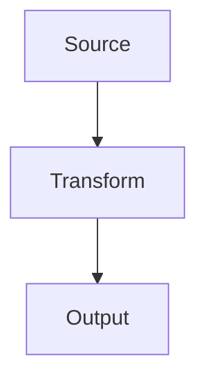

# tutorial-forge

**Status**: v1.0 — stable, repo-agnostic, ready to reuse.
**Canonical source**: [`github.com/reh3376/mdemg` → `scripts/tutorial-forge/`](https://github.com/reh3376/mdemg/tree/main/scripts/tutorial-forge)
**Reference consumer**: the MDEMG onboarding tutorial at [`https://reh3376.github.io/mdemg/`](https://reh3376.github.io/mdemg/) (live demo of every feature below).

Config-driven, repo-agnostic framework that renders a markdown deck into a
static HTML tutorial package.

> **For an AI coding agent**: start with [`FSD.md`](./FSD.md). It is the
> structured, agent-oriented reference (purpose, non-goals, file-by-file
> contracts, decision tables, failure signatures). This README is the
> human-oriented quick-start.

Any repo can point it at its own deck + config and get the same professional
presentation layer:

- **Persistent left-margin TOC + Graphs sidebar** (REQUIRED feature; see
  FSD §15). Fixed-position sidebar listing section headings AND every
  diagram, with scroll-sync highlighting the current section. Readers can
  jump anywhere in a long tutorial without scrolling.
- **Pre-rendered Mermaid diagrams** — every ```mermaid``` fence is rendered to
  SVG at build time via headless Puppeteer, wrapped in an interactive viewer
  (toolbar + wheel-zoom + drag-pan + fullscreen). No client-side Mermaid
  runtime in the shipped bundle.
- **Hand-authored SVG passthrough** — any SVG files under your `assetsDir`
  land in the output beside the generated ones and get the same viewer
  treatment.
- **Acronym expansion on first use** — the first N occurrences of each known
  acronym become "Expansion (ACRONYM)" automatically. Industry-standard
  dictionary ships with the framework; extend or override per repo.
- **Heading anchors + TOC-safe IDs** — every heading gets a stable
  slug-based ID. Explicit `<!-- .slide: id="..." -->` directives can pin
  specific IDs for anchor-link stability across edits.
- **Speaker notes become collapsible `<details>`** — any `note:`-prefixed
  trailing block in a slide becomes a `<details class="speaker-notes">`.
- **Drift breadcrumb for CI gating** — the build writes `SOURCE_SHA256.txt`
  with the SHA of each configured source file; a consumer-side verifier
  (see `scripts/verify_tutorial_embed.py` in mdemg for the reference impl)
  fails CI when the deck was edited without re-running the sync.

## Install

```bash
# From inside your repo, after copying scripts/tutorial-forge/ into place:
cd scripts/tutorial-forge
npm install
```

The dependencies (marked, mermaid, puppeteer, highlight.js, reveal-md for the
default favicon) install into `scripts/tutorial-forge/node_modules/`. Puppeteer
downloads a bundled Chromium on first install (one-time, ~150 MB).

## Minimal usage

Create `tutorial.config.json` at your repo root:

```json
{
  "deck": "docs/my-tutorial.md",
  "output": "build/tutorial-static",
  "title": "My Project Tutorial"
}
```

Build:

```bash
node scripts/tutorial-forge/cli.mjs build --config tutorial.config.json
```

The output directory is a self-contained static site — serve it from any
static host (GitHub Pages, Netlify, nginx, `python -m http.server`, embedded
in a binary via `//go:embed`, etc.).

### See it work in 60 seconds

A ready-to-run demo lives at [`example/`](./example/) — a tiny 5-section
deck with 2 Mermaid diagrams and the minimum config (just `deck`, `output`,
`title`; no overrides). It exercises every default: TOC + Graphs sidebar,
scroll-sync, pre-rendered Mermaid, acronym expansion, the interactive SVG
viewer. From the forge directory:

```bash
cd example
node ../cli.mjs build --config tutorial.config.json
cd dist && python3 -m http.server 8000
# open http://localhost:8000/
```

If the demo produces a left-margin TOC with 5 Sections + 2 Graphs and
every acronym expands on first use, your `scripts/tutorial-forge/`
install is healthy.

## Full config schema

Every path in the config is resolved relative to the config file's directory
(absolute paths work too).

```jsonc
{
  // REQUIRED
  "deck": "docs/my-tutorial.md",
  "output": "build/tutorial-static",

  // Shell / branding (optional)
  "title": "My Tutorial",             // <title> text; default "Tutorial"
  "iconPath": "docs/assets/favicon.ico", // default: framework favicon

  // Overrides (optional — framework ships sensible defaults)
  "cssPath": "docs/overrides.css",    // override the dark-theme CSS
  "svgViewerPath": "docs/viewer.js",  // override the zoom/pan viewer JS

  // Hand-authored assets (optional)
  // Everything under this dir is recursively merged into <output>/assets/,
  // layering over generated mermaid-NN.svg files (same filename collides
  // deterministically — the user's hand-authored file wins).
  "assetsDir": "docs/assets",

  // Acronyms (optional)
  "acronyms": {
    "expandCount": 1,                 // first-N occurrences → "Expansion (ACRONYM)"
                                      // every subsequent occurrence becomes a
                                      // link to the auto-generated glossary
    "extra": {                        // per-repo additions (merged into defaults)
      "FOO": "Full Of Options",
      "BAR": "Baz And Related"
    },
    "disabled": ["API", "CLI"],       // drop these from the dict entirely
                                      // (useful for project-internal names
                                      // you don't want auto-expanded)
    "glossary": {
      "enabled": true,                // auto-emit a Glossary section at the
                                      // end of the deck listing every used
                                      // acronym. A floating "← Return to
                                      // Previous" button lets readers jump
                                      // back from a glossary entry.
      "label": "Glossary"
    }
  },

  // Mermaid (optional)
  "mermaid": {
    "theme": "default",               // "default" (light) or "dark"
    "skipRender": false               // if true, keep ```mermaid blocks as
                                      // code fences (no SVG pre-rendering)
  },

  // Persistent TOC + Graphs sidebar (REQUIRED; opt-out at your own risk)
  "toc": {
    "enabled": true,                  // default: true; sidebar always on
    "minLevel": 1,                    // headings H{min}..H{max} go in TOC
    "maxLevel": 2,
    "label": "Contents",              // sidebar heading
    "graphs": {
      "enabled": true,                // list every .svg-figure as a jump link
      "label": "Graphs"
    }
  },

  // Frontmatter (optional)
  "stripFrontmatter": true            // strip leading --- YAML --- block (default true)
}
```

## Deck-authoring conventions

tutorial-forge treats your markdown as one long document. These conventions
let you add structure without leaving plain markdown:

### Slide-break separators
A line containing just `---` splits the source into logical sections,
rendered with a subtle `<hr class="slide-break" />` separator.

### Explicit heading IDs
Add a slide directive *before* a heading to pin its anchor ID:

```markdown
<!-- .slide: id="my-stable-anchor" -->
## Heading text

Content...
```

Any TOC link using `#my-stable-anchor` stays valid even if the heading text
changes later.

### Speaker notes
Trailing `note:` block after the main content of a section becomes a
collapsible `<details>`:

```markdown
## Section

Main content for the reader.

note:
Internal notes for the presenter. These start hidden; readers click to expand.
```

### Mermaid diagrams
Standard fenced ```` ```mermaid ```` blocks get pre-rendered to SVG and
wrapped in the interactive viewer:

````markdown

````

**Author-side tips** that improve rendered quality:
- **Prefer `flowchart TD` over `LR` for diagrams with long labels** —
  wide-aspect SVGs (viewBox width > 3× height) crush text. TD lays out
  vertically and lets labels breathe.
- **Quote labels containing `(`, `)`, `/`, `&` or newlines**:
  `A["RRF fusion (1/(k+rank))"]`. The renderer auto-wraps most unquoted
  cases but explicit quoting is more robust.
- **Use `<br/>` for in-label line breaks** (auto-converted to Mermaid's
  native `\n`).

## Subcommands

### `build` (default)
Render the deck to a static HTML package at `config.output`. Overwrites the
output directory in place.

```bash
node scripts/tutorial-forge/cli.mjs build --config tutorial.config.json
```

### `expand-acronyms`
Dry-run the acronym transform; prints what would change in the deck source
file. Add `--write` to persist the expansion back to `config.deck`:

```bash
# Preview what the transform would change
node scripts/tutorial-forge/cli.mjs expand-acronyms --config tutorial.config.json

# Persist the expansion to the deck source
node scripts/tutorial-forge/cli.mjs expand-acronyms --config tutorial.config.json --write
```

Note: `build` also runs acronym expansion in-memory on every build; `--write`
is only needed if you want the expanded form in the source file itself.
The transform is **idempotent** — running it against an already-expanded deck
is a no-op.

## Package layout emitted

```
<config.output>/
├── index.html                       the deck as one long readable document
├── favicon.ico                      from config.iconPath or framework default
├── SOURCE_SHA256.txt                drift breadcrumb (SHA of each configured input)
└── assets/
    ├── css/
    │   ├── slides-overrides.css     from config.cssPath or framework default
    │   └── zenburn.min.css          highlight.js code theme (framework-shipped)
    ├── js/
    │   └── svg-viewer.js            from config.svgViewerPath or framework default
    └── svg/
        ├── mermaid-01.svg …         one per ```mermaid fence, in source order
        └── <hand-authored>.svg …    merged from config.assetsDir if present
```

## CI drift gate (recommended)

Add a verifier that fails CI when the deck was edited without re-running the
sync. See `scripts/verify_tutorial_embed.py` in the mdemg repo for a working
reference — it reads `tutorial.config.json`, re-computes the SHA of each
source file, and compares against `SOURCE_SHA256.txt`.

Wire into your Makefile:

```makefile
.PHONY: sync-tutorial-embed verify-tutorial-embed
sync-tutorial-embed:
	@node scripts/tutorial-forge/cli.mjs build --config tutorial.config.json

verify-tutorial-embed:
	@python3 scripts/verify_tutorial_embed.py \
		|| (echo "DRIFT: run 'make sync-tutorial-embed' and commit the result."; exit 1)
```

And run `verify-tutorial-embed` on every PR.

## Example: embedding in a Go binary via `//go:embed`

Point `config.output` at a directory under `internal/`, then embed it:

```go
import "embed"

//go:embed all:tutorial_templates/staged
var tutorialFS embed.FS
```

Serve it from an HTTP handler (see mdemg's `internal/api/handlers_tutorial.go`
for the reference impl: 503 when disabled, `..` path-traversal rejection,
longest-prefix routing).

## Framework defaults

If you don't provide an override, the framework uses:

- **CSS**: `scripts/tutorial-forge/templates/default.css` (dark theme, 1400px
  max-width centered, 18/16px type, interactive `.svg-figure` styling,
  collapsible speaker-notes, zenburn code highlighting)
- **SVG viewer**: `scripts/tutorial-forge/templates/svg-viewer.js` (vanilla
  JS, zero deps, toolbar `[+][−][⟳][⤢]`, wheel-zoom at cursor, drag-pan,
  touch pinch, double-click reset, idempotent + MutationObserver-safe)
- **Favicon**: tiny generic from reveal-md's bundle
- **Acronym dictionary**: `scripts/tutorial-forge/defaults/acronyms.json`
  (~55 industry-standard terms)

## Reusing across repos

### Quick install (recommended)

From inside the TARGET repo (the one that wants a tutorial):

```bash
bash <(curl -fsSL https://raw.githubusercontent.com/reh3376/mdemg/main/scripts/tutorial-forge/install-into.sh)
```

The installer:
- Clones a shallow copy of mdemg (framework code only, not the mdemg deck).
- Copies `scripts/tutorial-forge/` into your repo verbatim.
- Scaffolds `tutorial.config.json` at your repo root if missing.
- Scaffolds `docs/tutorial.md` as a starter deck if missing.
- Appends sensible `.gitignore` entries.
- Prints the exact next-steps.

Then from your repo root:

```bash
cd scripts/tutorial-forge && npm install   # one-time (~150 MB Chromium)
# edit docs/tutorial.md with your content
node scripts/tutorial-forge/cli.mjs build --config tutorial.config.json
# serve build/tutorial-static/ with any static host
```

### Share-with-a-teammate one-liner

Just paste this at the end of a message:

```
Install tutorial-forge into any repo:
  bash <(curl -fsSL https://raw.githubusercontent.com/reh3376/mdemg/main/scripts/tutorial-forge/install-into.sh)
Live demo: https://reh3376.github.io/mdemg/
```

### Manual install (if the installer isn't a fit)

1. Copy `scripts/tutorial-forge/` from mdemg into your target repo.
2. Run `cd scripts/tutorial-forge && npm install` once.
3. Create `tutorial.config.json` at your repo root pointing at your deck
   and output locations.
4. Add Makefile targets (`sync-tutorial-embed`, `verify-tutorial-embed`)
   or equivalent in your build system.
5. Author your deck in markdown with standard conventions (headings, lists,
   tables, ```mermaid``` blocks, `note:` speaker-notes).

Future: the forge may land as its own repo via `git subtree split
--prefix=scripts/tutorial-forge` + published to npm; for v1.0 it ships as a
drop-in directory under mdemg.

## License

Same as the containing repository.
