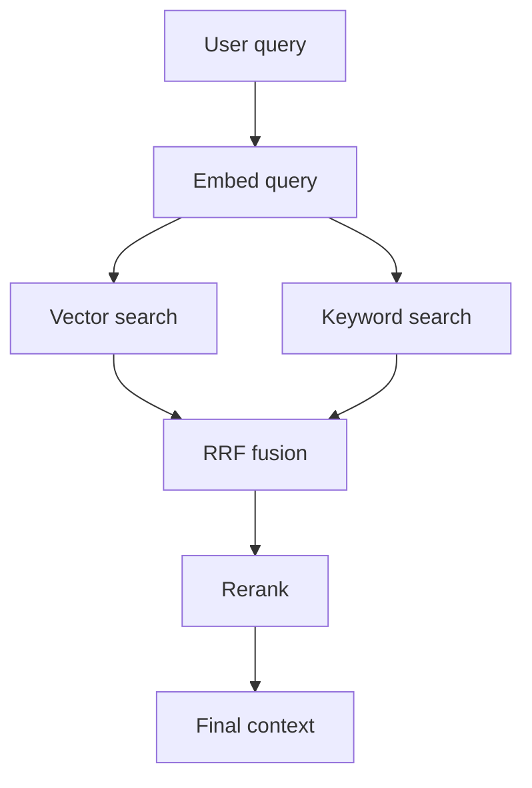
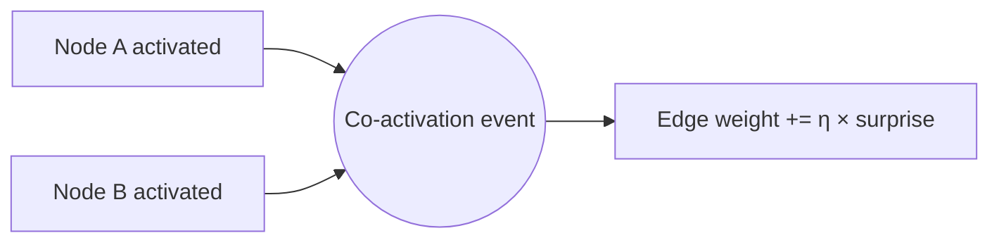

# Introduction

This is a minimal tutorial-forge demo. It uses nothing but framework
defaults — no custom CSS, no custom SVG viewer, no `assetsDir`. A real
repo adopting the framework can start here and layer overrides as its
tutorial grows.

Everything you need to see is on this page:

- A persistent **left-margin TOC** that lists every section header
  (the headings you see in the sidebar were auto-collected from this
  very deck).
- A **Graphs** sub-section with jump-links for each rendered diagram.
- Pre-rendered **Mermaid diagrams** wrapped in an interactive viewer.
- **First-use acronym expansion** — HyperText Markup Language (HTML) and
  Large Language Model (LLM) get their long form the first two times
  they appear, then revert to the acronym (so this third HTML stays bare).

# Memory Model

Here's a simple diagram showing how a cognitive substrate reads and
writes. Scroll through the whole page — the TOC entry for this section
should highlight as it crosses into the top-30%-of-viewport zone.



Modern retrieval combines vector + keyword signals through Reciprocal
Rank Fusion. The pipeline above is a simplified sketch of what a real
Retrieval-Augmented Generation system looks like.

# Hebbian Learning

Nodes that fire together wire together. Over time a graph that observes
its own traffic can learn an implicit topology that reflects how its
users actually combine concepts.



The weight update is a straight-up Hebbian rule: η is the learning rate
and surprise reduces the update's magnitude for predictable co-activations
so routine traffic doesn't dominate.

# Try It Yourself

Edit this deck's markdown, re-run the build, and watch the TOC
auto-regenerate from your new section headers:

```bash
# From the repo root containing tutorial.config.json:
node scripts/tutorial-forge/cli.mjs build --config tutorial.config.json
```

The emitted static site is self-contained — serve it from any static
host or embed it in a Go binary via `//go:embed`.

note:
Speaker notes become collapsible <details> blocks. Readers click to
expand them; authors use them for pointer rails during a live walkthrough.

# Where To Go From Here

For a complete reference see:

- `scripts/tutorial-forge/README.md` — operator quick-start
- `scripts/tutorial-forge/FSD.md` — AI-agent functional specification
- The mdemg deployment (served at `/ui/tutorial/`) as a working
  real-world example with 28 sections and 23 diagrams.
